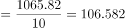
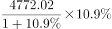
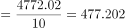
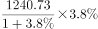
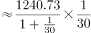
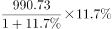
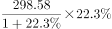
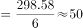

# 增长量计算与比较（同比增量最接近）

考点：[[20-考点/资料分析/增长/增长量计算与比较（同比增量最接近）|增长 / 增长量计算与比较（同比增量最接近）]]
材料：[[15-材料/资料分析/270131 某市2018年国民经济和社会发展运行|270131 某市2018年国民经济和社会发展运行]]

**问法模型**：题干'从产业增加值的同比增量看，高端装备制造产业和谁最接近'→ 对各分项分别求增长量 Δ=现期×r÷(1+r)，比较与高端装备制造增量之差谁最小

## 推理链
1. 第1步：提取七大战略性新兴产业2018年增加值：高端装备制造1065.82、新一代信息技术4772.02、数字经济1240.73、绿色低碳990.73、海洋经济421.69、新材料365.61、生物医药298.58亿元，各分项增速以试卷标注为准（本材料文本百分数空缺，不得凭记忆补数）
2. 第2步：所用公式为增长量公式 Δ=现期×r÷(1+r)，'最接近'即各分项增量与高端装备制造增量之差最小
3. 第3步：先做方向与量级筛查：海洋经济为'下降'（负增长），其增量为负值，与正增量比较方向不符先排除；新一代信息技术(4772.02)约为高端装备制造的4.5倍、生物医药(298.58)不足其1/3，即使增速不同，增量也差数倍，可排除
4. 第4步：剩余数字经济1240.73与绿色低碳990.73两项，试卷上两者增速均与高端装备制造相近，增量大小主要由现期量决定：1065.82−990.73≈75亿元（差约7%），而1065.82与1240.73相差约175亿元（差约16%），绿色低碳现期量明显更贴近
5. 第5步：代入试卷标注增速用Δ=现期×r÷(1+r)复核，绿色低碳产业增量与高端装备制造产业增量之差最小，与选项对照锁定C

**最快解法**：⚡ 观察法+量级比较：题干要求'增量最接近'，而试卷上高端装备制造与绿色低碳的现期量（1065.82 vs 990.73亿元）和同比增速都是各分项中最接近的一对，两者增量必然最接近，可直接猜C；严格验证时用Δ=现期×r÷(1+r)（百化分/截位直除）逐项求增量即可确认

## 易错点
- ⚠ 增量≠现期量：题问的是'同比增量'最接近而非'增加值'最接近，严格应按Δ=现期×r÷(1+r)比较；只有当两者增速也相近时，才可用现期量近似替代增量，本题恰好满足（现期量与增速双接近）
- ⚠ 海洋经济为'下降'即负增长，其增量为负值，比较'最接近'时正负方向不能丢，应先排除或带符号比较，否则可能误把现期量421.69纳入比距
- ⚠ 本材料文本中所有增速百分数空缺，任何环节不得凭该市真实统计公报的记忆补数，必须以试卷标注的具体百分数代入计算，否则增量算不准；另注意七大战略性新兴产业合计9155.18亿元与其他层级口径重叠，不能跨层级相加比较

## 母题抽象
> 🧩 当题干出现'从同比增量看，A与哪个分项最接近'的特征时，用Δ=现期×r÷(1+r)逐项求增量再比差；若各分项增速接近，可先按现期量量级快速锁定目标，再剔除负增长项并用公式验证

**同类特征**：同比增量、最接近、增长量比较、七大战略性新兴产业分项、高端装备制造产业、含负增长干扰项

## 相关题
- [[10-真题/资料分析/增长/13504660 增长量计算与比较（同比增量超阈值年份计数）|13504660]]（辽宁 2025，相关度2）
- [[10-真题/资料分析/增长/5509786 增长量比较（折线图趋势匹配）|5509786]]（四川 2023，相关度2）
- [[10-真题/资料分析/增长/5102404 同比增量（增长量）逐年计算与折线图趋势匹配|5102404]]（河南 2022，相关度2）
- [[10-真题/资料分析/增长/2144598 增长量比较|2144598]]（选调 2018，相关度1）
- [[10-真题/资料分析/增长/23447 增长量比较（现期量×r-(1+r)）|23447]]（云南 2011，相关度1）

---

### 题干
2018年，从产业增加值的同比增量看，该市七大战略性新兴产业中，高端装备制造产业和（    ）最接近。

### 选项
- A. 新一代信息技术产业
- B. 数字经济产业
- C. 绿色低碳产业　✅
- D. 生物医药产业

### 官方解析

根据题干“从产业增加值的同比增量看，······高端装备制造产业和（    ）最接近”，可判定本题为增长量计算问题。定位文字材料第一段可知，高端装备制造产业增加值1065.82亿元，增长；新一代信息技术产业增加值4772.02亿元，增长；数字经济产业增加值1240.73亿元，增长；绿色低碳产业增加值990.73亿元，增长；生物医药产业增加值298.58亿元，增长。根据公式：增长量，各产业增加值的同比增量如下： 

高端装备制造产业增加值：亿元；

新一代信息技术产业增加值：亿元；

数字经济产业增加值：亿元；

绿色低碳产业增加值：亿元；

生物医药产业增加值：亿元。

则高端装备制造产业增加值的同比增量与绿色低碳产业增加值的同比增量最接近。

故正确答案为C。

注：考试时，通过观察比较数据，可知“高端装备制造产业增加值”与“绿色低碳产业增加值”的现期量与同比增速均是最接近的，可直接猜C项。

### 给定材料

        2018年，某市实现地区生产总值24221.98亿元，比上年增长。其中，第一产业增加值22.09亿元，增长；第二产业增加值9961.95亿元，增长；第三产业增加值14237.94亿元，增长。现代产业中，现代服务业增加值10090.59亿元，增长；先进制造业增加值6564.83亿元，增长；高技术制造业增加值6131.20亿元，增长。四大支柱产业中，金融业增加值3067.21亿元，增长；物流业增加值2541.58亿元，增长；文化及相关产业（规模以上）增加值1560.52亿元，增长；高新技术产业增加值8296.63亿元，增长。七大战略性新兴产业增加值合计9155.18亿元，比上年增长，占地区生产总值比重。其中，新一代信息技术产业增加值4772.02亿元，增长；数字经济产业增加值1240.73亿元，增长；高端装备制造产业增加值1065.82亿元，增长；绿色低碳产业增加值990.73亿元，增长；海洋经济产业增加值421.69亿元，下降；新材料产业增加值365.61亿元，增长；生物医药产业增加值298.58亿元，增长。

        全市年末常住人口1302.66万人，其中常住户籍人口454.70万人，增长，占常住人口比重；常住非户籍人口847.97万人，增长，占比重。年末城镇登记失业率为。全年居民消费价格比上年上涨。全年完成一般公共预算收入3538.41亿元，比上年增长。其中税收收入2899.60亿元，增长。一般公共预算支出4282.54亿元，下降。

