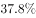
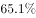
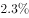

# 混合增长率（居中且偏向基期大者）

考点：[[20-考点/资料分析/增长/混合增长率（居中且偏向基期大者）|增长 / 混合增长率（居中且偏向基期大者）]]
材料：[[15-材料/资料分析/270131 某市2018年国民经济和社会发展运行|270131 某市2018年国民经济和社会发展运行]]

**问法模型**：总人口=常住户籍+常住非户籍两部分之和，材料给出各部分现期量与增速，求整体增速 → 混合增长率模型：总增速居中且偏向基期量大的一方（用现期量代替基期量）

## 推理链
1. 第1步：定位第二段——2018年末常住人口1302.66万人＝常住户籍454.70万人（增长r₁）＋常住非户籍847.97万人（增长r₂），两分项具体百分数以试卷标注为准（材料文本中空缺）；户籍+非户籍=1302.67与1302.66差0.01为四舍五入尾差，非数据矛盾
2. 第2步：识别为混合增长率问题：整体增速r介于r₁与r₂之间（混合居中），且偏向基期量较大的一方，按通用近似规则用现期量代替基期量
3. 第3步：比较权重：常住非户籍847.97万人＞常住户籍454.70万人（约1.9倍），故总增速r更靠近非户籍人口增速r₂
4. 第4步：以r₁、r₂为上下限确定r的取值区间，结合选项排除A、C两项
5. 第5步：r落在偏向r₂（非户籍增速）一侧的子区间内，对照四个选项仅B满足，故选B

**最快解法**：⚡ 混合增长率线段法（居中+偏向基期大）：总增速必夹在户籍增速与非户籍增速之间，且因非户籍847.97万约为户籍454.70万的1.9倍，总增速明显贴近非户籍增速；先用两分项增速锁定区间排A、C，再按'偏向量大者'定位B。

## 易错点
- ⚠ 方向坑：混合增速偏向基期量大的非户籍人口（847.97万人），若误偏向户籍人口增速或把两分项增速简单平均，区间定位就错
- ⚠ 量级/尾差坑：人口单位为万人（1302.66万人≈0.13亿人），选项若换算成'亿人'口径须注意；户籍+非户籍=1302.67与总人口1302.66差0.01万人系四舍五入尾差，不能据此设矛盾项
- ⚠ 补数坑：本材料文本中全部增速为空缺形式，户籍与非户籍的具体百分数必须以试卷标注为准，不得凭记忆中该市公报真实数据代填

## 母题抽象
> 🧩 当题干出现'总量由甲、乙两部分构成，已知各部分现期量与增速，求总量增速'时，用混合增长率'居中且偏向基期量大者（现期代替基期）'法，验证总增速介于两分项增速之间且更贴近量大的一方，再对照选项锁定。

**同类特征**：常住人口同比增长、户籍与非户籍人口分项、混合增长率、选项为百分数、1302.66万人（总体）、现期量代替基期量

## 相关题
- [[10-真题/资料分析/增长/2031160 混合增长率（基期差值模型，求部分增速）|2031160]]（北京 2017，相关度2）
- [[10-真题/资料分析/增长/9629 一般增长率计算（现期需由增量倒推）|9629]]（安徽 2009，相关度1）
- [[10-真题/资料分析/比重/2604234 现期比重计算|2604234]]（广东 2020，相关度1）
- [[10-真题/资料分析/增长/27835 一般增长率计算（已知现期量与增长量求增长率）|27835]]（河北 2012，相关度1）
- [[10-真题/资料分析/平均数/10204497 平均数增长率（均价=值-量的比值增长率）|10204497]]（海南 2024，相关度1）

---

### 题干
2018年，该市年末常住人口同比增长约：

### 选项
- A. 

- B. 

　✅
- C. 

- D. 

### 官方解析
根据题干“2018年，该市年末常住人口同比增长约”，结合选项为百分数，且材料给出该市2018年末该市常住户籍人口与常住非户籍人口的增长率，可判定本题为混合增长率问题。定位文字材料第二段，2018年，全市年末常住人口1302.66万人，其中常住户籍人口454.70万人，增长，占常住人口比重；常住非户籍人口847.97万人，增长，占比重。根据“混合后居中，偏向基期大的（一般用现期量代替基期量计算）”，可得：，结合选项，排除A、C两项；由于常住户籍人口数（454.70万人）常住非户籍人口数（847.97万人），可得：更接近常住非户籍人口的增长率（），即，只有B项在范围内。
故正确答案为B。

### 给定材料

        2018年，某市实现地区生产总值24221.98亿元，比上年增长。其中，第一产业增加值22.09亿元，增长；第二产业增加值9961.95亿元，增长；第三产业增加值14237.94亿元，增长。现代产业中，现代服务业增加值10090.59亿元，增长；先进制造业增加值6564.83亿元，增长；高技术制造业增加值6131.20亿元，增长。四大支柱产业中，金融业增加值3067.21亿元，增长；物流业增加值2541.58亿元，增长；文化及相关产业（规模以上）增加值1560.52亿元，增长；高新技术产业增加值8296.63亿元，增长。七大战略性新兴产业增加值合计9155.18亿元，比上年增长，占地区生产总值比重。其中，新一代信息技术产业增加值4772.02亿元，增长；数字经济产业增加值1240.73亿元，增长；高端装备制造产业增加值1065.82亿元，增长；绿色低碳产业增加值990.73亿元，增长；海洋经济产业增加值421.69亿元，下降；新材料产业增加值365.61亿元，增长；生物医药产业增加值298.58亿元，增长。

        全市年末常住人口1302.66万人，其中常住户籍人口454.70万人，增长，占常住人口比重；常住非户籍人口847.97万人，增长，占比重。年末城镇登记失业率为。全年居民消费价格比上年上涨。全年完成一般公共预算收入3538.41亿元，比上年增长。其中税收收入2899.60亿元，增长。一般公共预算支出4282.54亿元，下降。

