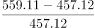
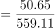
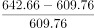
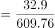
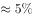
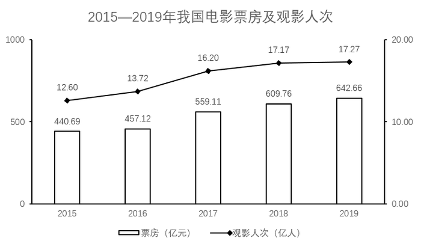

# 增长率计算与比较（两步设问：先比较票房各年同比增幅找最低年份，再求该年观影人次同比增幅）

考点：[[20-考点/资料分析/增长/增长率计算与比较（两步设问：先比较票房各年同比增幅找最低年份，再求该年观影人次同比增幅）|增长 / 增长率计算与比较（两步设问：先比较票房各年同比增幅找最低年份，再求该年观影人次同比增幅）]]
材料：[[15-材料/资料分析/270133 该材料讲2015—2019年我国电影|270133 该材料讲2015—2019年我国电影]]

**问法模型**：‘A指标同比增幅最低的年份，当年B指标的同比增幅’→先对指标A逐年用（现期−基期）/基期求增长率并比较找最小值年份，再锁定该年指标B的现期与上一年基期求增长率

## 推理链
1. 第1步：定位图1，提取2015—2019年票房：440.69、457.12、559.11、609.76、642.66亿元（左轴柱形）
2. 第2步：用增长率=（现期−基期）/基期逐年计算2016—2019年票房同比增幅
3. 第3步：2016年16.43/440.69≈3.7%；2017年101.99/457.12≈22.3%；2018年50.65/559.11≈9.1%；2019年32.90/609.76≈5.4%，比较得2016年票房增幅最低（约3.7%）
4. 第4步：锁定2016年，从图1折线（右轴）提取当年观影人次13.72亿人，其同比基期为2015年的12.60亿人
5. 第5步：代入公式：(13.72−12.60)/12.60=1.12/12.60≈8.9%
6. 第6步：与选项对照，C项最接近，故选C

**最快解法**：⚡ 截位直除+增量粗判：比较票房增幅时，2017、2018年柱形跳升明显直接排除；只需精比2016与2019：16.43/440.69（≈16/441≈3.6%）＜32.90/609.76（≈33/610≈5.4%），锁定2016年；再截位直除1.12/12.6，首位商8，得≈8.9%选C

## 易错点
- ⚠ 双轴图取数认错轴：票房读左轴柱形（亿元），观影人次读右轴折线（亿人），两轴刻度0—1000与0.00—20.00完全不同，不可直接比高低
- ⚠ 基期定位错误：增幅最低年份为2016年，其观影人次同比的基期是2015年（12.60亿人），2015年虽是首年仍须作基期使用，勿误用其他年份
- ⚠ 目测陷阱：观影人次折线在2019年最平缓（17.17→17.27），易误以为2019年才是‘增幅最低’的年份，但题干比较的是票房增幅（2019年≈5.4%＞2016年≈3.7%），且2016年票房柱高增量（16.43）小于2019年（32.90）但基期也更小，必须动笔计算不能目测

## 母题抽象
> 🧩 当题干出现‘A指标增幅最低（最高）的年份，当年B指标增幅’的两步设问时，先对A逐年截位直除求增长率并比较锁定目标年份，再取该年B的现期与上一年基期求增长率，注意首年数据可作基期

**同类特征**：同比增幅最低的年份、两步设问：先比较后计算、双轴图票房与观影人次、增幅基期为上一年、增长率计算与比较

## 相关题
（暂无）

---

### 题干
2016-2019年，电影票房同比增幅最低的年份，当年观影人次的同比增幅为：

### 选项
- A. 

- B. 

- C. 

　✅
- D. 

### 官方解析

根据题干“当年观影人次的同比增幅”，结合选项为，可判定本题为一般增长率计算问题。定位统计图一，已知2016~2019年电影票房收入，根据公式：增长率，可知各年份电影票房增长率如下：

2016年：；

2017年：；

2018年：；

2019年：。

则2016年电影票房同比增幅最低，结合统计图一，2015、2016年的观影人次分别为12.60亿人、13.72亿人，故2016年的观影人次的同比增幅，与C项最接近。

故正确答案为C。

### 给定材料

