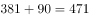
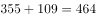
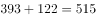
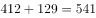
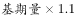
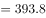
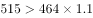
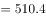
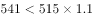
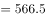

# 增长率计算与比较（同比增幅超过10%的年份计数）

考点：[[20-考点/资料分析/增长/增长率计算与比较（同比增幅超过10%的年份计数）|增长 / 增长率计算与比较（同比增幅超过10%的年份计数）]]
材料：[[15-材料/资料分析/270133 该材料讲2015—2019年我国电影|270133 该材料讲2015—2019年我国电影]]

**问法模型**：问'上映电影数同比增幅超过10%的年份有几个'→先把国产+进口加总得各年上映总数，再用'现期量＞1.1×基期量'替代增长率计算逐年代入判定

## 推理链
1. 第1步：从图2提取各年国产、进口电影部数并加总得上映总数：2015年278+80=358部、2016年381+90=471部、2017年355+109=464部、2018年393+122=515部、2019年412+129=541部
2. 第2步：增长率=(现期-基期)/基期；'同比增幅超过10%'等价于判定 现期量＞1.1×基期量
3. 第3步：逐年代入：2016年471＞358×1.1=393.8，满足；2017年464＜471（同比为负增长），排除；2018年515＞464×1.1=510.4，满足（增幅约10.99%）；2019年541＜515×1.1=566.5，排除（增幅约5.05%）
4. 第4步：满足条件的为2016、2018共2个年份，对照选项选B

**最快解法**：⚡ 替代法避除法：先加总得5年总数序列358/471/464/515/541，再心算基期×1.1（358→393.8、464→510.4、515→566.5）与现期直接比大小；2016年一眼超线、2017年下降直接排除、2019年差20多部一眼不够，仅2018年515 vs 510.4需细看

## 易错点
- ⚠ 图2为堆叠柱，'上映电影总数'图中未直接标注，必须自己加总（如2017年355+109=464），只读单一分段数据会全错
- ⚠ 2017年总数471→464实为同比下降，易凭柱子高度相近误判为增长而多计1年
- ⚠ 临界点陷阱：2018年增幅10.99%刚过10%线（515对510.4仅多4.6部），心算不细易误排除；2019年5.05%远不足10%，勿误计

## 母题抽象
> 🧩 当题干出现'某指标同比增幅超过10%（或x%）的年份有几个'时，先把堆叠/分项数据加总成逐年总量序列，再用'现期＞(1+x%)×基期'逐项比较，负增长年份先排除，只精算临界年份

**同类特征**：2016-2019年逐年判定、上映电影数=国产+进口需加总、同比增幅超过10%、…的年份有几个、堆叠柱状图取数、基期为上一年数据

## 相关题
- [[10-真题/资料分析/增长/4924299 同比增长率计算与±10%阈值比较计数|4924299]]（选调 2022，相关度1）
- [[10-真题/资料分析/比重/1758918 两期比重比较（比重升降⟺部分增速与整体增速大小）|1758918]]（上海 2016，相关度1）
- [[10-真题/资料分析/增长/5893729 同比增长率超100%的年份计数（增长率比较）|5893729]]（国考 2024，相关度1）
- [[10-真题/资料分析/增长/2443073 同比增长率比较|2443073]]（辽宁 2019，相关度1）

---

### 题干

2016-2019年，上映电影数同比增幅超过的年份有（    ）个。

### 选项
- A. 1
- B. 2　✅
- C. 3
- D. 4

### 官方解析

根据题干“······同比增幅超过······”，可判定本题为一般增长率问题。定位统计图二可知上映电影数进口电影国产电影，可知各年份上映电影数：2015年为；2016年为；2017年为；2018年为；2019年为；根据公式：增长率，同比增幅超过，即现期量。2016年：，满足；2017年上映电影数较上年下降，排除；2018年：，满足；2019年：，排除。因此2016-2019年，上映电影数同比增幅超过的年份有2个。

故正确答案为B。

### 给定材料

> [!warning] 疑点（官方解析可能有误，待人工复核）
> 所给题干文本中'超过'后的阈值数字缺失，按官方解析'即现期量＞基期量×1.1'反推阈值为10%；经验证2016年31.6%、2018年11.0%超线，2017年负增长、2019年5.05%未超，与官方答案B一致，不影响作答

<!-- CODEX-ANSWER-REVIEW:BEGIN -->
### 本次独立复核

**复核状态：** `resolved`（答案与解析已核定）

**计分答案：** B（可计分）

**复核解析：**

2015—2019上映电影数由图读出278、381、356、393、412。2016年增幅约37.1%，2017年下降，2018年约10.4%，2019年约4.8%；超过10%的有2016、2018两年，选B。

**相关信息：**

2018精算约10.4%，超过而非等于10%。

**题源依据：** [固定版本原题](https://github.com/Mentat-Uran/kaogongzhentizhengliu/blob/84ab93d4b64b61d897bece8a1c0a5bab06b4feb2/10-%E7%9C%9F%E9%A2%98/%E8%B5%84%E6%96%99%E5%88%86%E6%9E%90/%E5%A2%9E%E9%95%BF/2730991%20%E5%A2%9E%E9%95%BF%E7%8E%87%E8%AE%A1%E7%AE%97%E4%B8%8E%E6%AF%94%E8%BE%83%EF%BC%88%E5%90%8C%E6%AF%94%E5%A2%9E%E5%B9%85%E8%B6%85%E8%BF%8710%25%E7%9A%84%E5%B9%B4%E4%BB%BD%E8%AE%A1%E6%95%B0%EF%BC%89.md)；固定内容 commit `84ab93d4b64b61d897bece8a1c0a5bab06b4feb2`，Markdown blob `f6477f68d1feefac189036ce7f1bd3ade40830bb`。
<!-- CODEX-ANSWER-REVIEW:END -->
