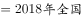
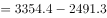

# 基期差值计算（现期值±变化量反推基期后作差）

考点：[[20-考点/资料分析/增长/基期差值计算（现期值±变化量反推基期后作差）|增长 / 基期差值计算（现期值±变化量反推基期后作差）]]
材料：[[15-材料/资料分析/270449 2019年全国棉花产量与种植面积的总|270449 2019年全国棉花产量与种植面积的总]]

**问法模型**：题干问'2018年除新疆外其他地区总面积'→基期差值模型：先由'现期值±变化量'反推全国与新疆的2018年基期面积，再相减求差

## 推理链
1. 第1步：从文字段提取：2019年全国种植面积3339.2千公顷、比上年减少15.2千公顷；新疆面积比上年增加49.2千公顷；从表格提取：2019年新疆种植面积2540.5千公顷
2. 第2步：基期推算规则——'减少'用加法、'增加'用减法：2018年全国面积=3339.2+15.2=3354.4千公顷，2018年新疆面积=2540.5-49.2=2491.3千公顷
3. 第3步：'除新疆外其他地区'=全国口径减新疆（不能用表内6省相加替代）：3354.4-2491.3=863.1千公顷
4. 第4步：863.1千公顷落在800-900区间，对照选项只有C符合

**最快解法**：⚡ 速算技巧：现期作差+变化量修正。2019年其他地区=3339.2-2540.5=798.7千公顷（警惕：此值落在700-800是陷阱），再修正到2018年：其他地区同比净变化=全国-15.2千公顷扣去新疆+49.2千公顷即-64.4千公顷，故2018年=798.7+64.4=863.1千公顷，直接锁定C区间

## 易错点
- ⚠ 符号方向错误：全国'减少15.2'反推2018须加15.2，新疆'增加49.2'反推2018须减49.2，若方向弄反会错算出734.3或863.1以外的值而误选其他区间
- ⚠ 现期陷阱：直接用2019年数据相减得798.7千公顷，恰落在700-800之间，误选B；题干问的是2018年基期，必须先反推再作差
- ⚠ 口径陷阱：'除新疆外其他地区'必须用全国3339.2减新疆2540.5（2019年）推算，绝不能把表格其余6省（河北203.9+安徽60.3+江西42.6+山东169.3+湖北162.8+湖南63.0=701.9千公顷）相加当作其他地区总面积——表只列前7省区，非全国分省全集

## 母题抽象
> 🧩 当题干出现'基期年份+某区域除外/其他+总量范围'特征时，用基期差值模型：先以现期值±变化量反推两处基期值（减少加、增加减），再作差，最后对照区间选项验证

**同类特征**：'2018年'基期年份设问、'除新疆外/其他地区'差值口径、种植总面积、区间型范围选项、跨文表取数（文字段给变化量+表格给现期值）、现期±变化量反推基期

## 相关题
- [[10-真题/资料分析/平均数/2448499 现期平均数计算（户均注册资本，跨单位量级换算）|2448499]]（国考 2020，相关度1）

---

### 题干
2018年除新疆外，全国其他地区棉花种植总面积在以下哪个范围内？

### 选项
- A. 不到700千公顷
- B. 700-800千公顷之间
- C. 800-900千公顷之间　✅
- D. 900千公顷以上

### 官方解析

根据题干“2018年······其他地区棉花种植总面积······”，结合材料时间是2019年，可判定本题为基期计算问题。定位文字材料可知：（2019年）全国棉花种植面积3339.2千公顷，比上年减少15.2千公顷；新疆的棉花种植面积比上年增加49.2千公顷。定位表格材料可知：2019年新疆的棉花种植面积是2540.5千公顷。2018年全国棉花种植面积千公顷；2018年新疆棉花种植面积千公顷；则2018年除新疆外，全国其他地区棉花种植总面积千公顷。只有C项符合。

故正确答案为C。

### 给定材料

        2019年，全国棉花产量588.9万吨，比上年减少21.3万吨。其中，新疆棉花产量500.2万吨，比上年减少10.8万吨；全国棉花种植面积为3339.2千公顷，比上年减少15.2千公顷。新疆的棉花种植面积比上年增加49.2千公顷。长江流域棉花种植面积比上年减少32.4千公顷，同比下降。黄河流域棉花种植面积比上年减少28.1千公顷，同比下降。

