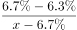
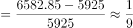
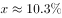
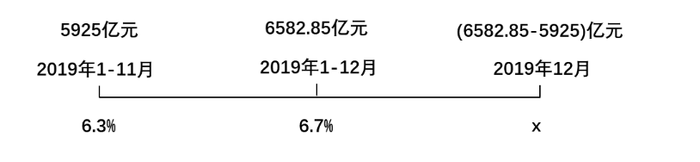

# 混合增长率（线段法求部分量增速）

考点：[[20-考点/资料分析/增长/混合增长率（线段法求部分量增速）|增长 / 混合增长率（线段法求部分量增速）]]
材料：[[15-材料/资料分析/270448 2019年A地区社会消费品零售总额（|270448 2019年A地区社会消费品零售总额（]]

**问法模型**：题干求'某单月（12月）的同比增速'，而材料只给全年累计增速与1-11月累计增速 → 把全年拆为'1-11月+12月'的混合增长率模型，用线段法反推12月增速

## 推理链
1. 第1步：表1取全年（1-12月累计）社会消费品零售总额6582.85亿元、累计同比增速6.7%；图2取1-11月累计5925亿元、累计同比增速6.3%
2. 第2步：图2柱子为累计值，12月单月零售额=全年累计-1-11月累计=6582.85-5925=657.85亿元
3. 第3步：全年是'1-11月（5925亿元、6.3%）'与'12月（657.85亿元、设增速为x）'的混合，整体增速6.7%必介于6.3%与x之间，且x>6.7%
4. 第4步：线段法'距离与量成反比'：(x-6.7%)÷(6.7%-6.3%)=5925÷657.85≈9
5. 第5步：解得x=6.7%+0.4%×9≈6.7%+3.6%=10.3%
6. 第6步：与选项对照，C项（约10.3%）最接近，故选C

**最快解法**：⚡ 线段法+份数估算：12月量657.85≈5925的1/9，由'距离与量成反比'，12月增速到整体6.7%的距离≈0.4%的9倍=3.6%，x≈6.7%+3.6%=10.3%，直接锁定C

## 易错点
- ⚠ 图2柱子是1-N月累计值而非当月值，须用6582.85-5925差分出12月单月657.85亿元，直接拿5925或柱高当月度量必错
- ⚠ 图2折线6.3%是1-11月累计同比增速，不是12月单月增速，不能直接比较6.7%与6.3%了事
- ⚠ 线段法方向写反：量小的12月其增速离整体6.7%的距离应更大（约为0.4%的9倍），误用657.85/5925会得到约6.74%的错误结果

## 母题抽象
> 🧩 当题干出现'全年（或大区间累计）与截至前一月的累计增速均已知、求最后一个单月增速'时，先累计差分求出该单月量，再套混合增长率线段法：小量一侧的增速偏离=（大量÷小量）×整体与大量增速之差，验证结果偏向大量一侧且介于两增速之外

**同类特征**：2019年12月、同比增速约为、全年累计与1-11月累计增速、混合增长率、累计值差分求单月、线段法

## 相关题
- [[10-真题/资料分析/增长/12536411 混合增长率（整体=限上+限下，线段法-口诀定区间）|12536411]]（四川 2024，相关度1）
- [[10-真题/资料分析/增长/17467526 同比增速计算（分季当期值加总拼累计基期-现期）|17467526]]（河北 2026，相关度1）
- [[10-真题/资料分析/增长/2049536 混合增长率（多主体合计-平均增速，居中偏向基期量大）|2049536]]（新疆 2017，相关度1）
- [[10-真题/资料分析/增长/2049720 混合增长率（居中偏向）|2049720]]（山东 2017，相关度1）
- [[10-真题/资料分析/增长/2050992 混合增长率（居中原则-线段法）|2050992]]（江西 2017，相关度1）

---

### 题干
2019年12月，A地区社会消费品零售总额同比增速约为？

### 选项
- A. 

- B. 

- C. 

　✅
- D. 

### 官方解析

根据题干“2019年12月······同比增速约为”，结合材料中给出了2019年1-12月和1-11月的同比增速，可判定本题为混合增长率问题。定位统计表材料可得：2019年1-12月A地区社会消费品零售总额累计全额为6582.85亿元，同比增速为；定位统计图材料可得：2019年1-11月A地区社会消费品零售总额累计全额为5925亿元，同比增速为。

根据线段法（如下图所示），设2019年12月A地区社会消费品零售总额同比增速为，根据“距离与量成反比”可列式：，解得，与C项最接近。

故正确答案为C。

### 给定材料

