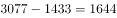
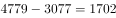
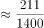
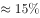
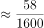
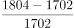
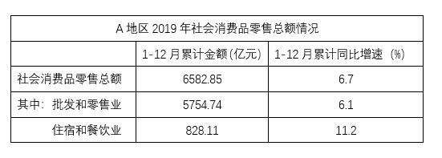

# 累计值差分还原季度值+环比增速计算与排序

考点：[[20-考点/资料分析/增长/累计值差分还原季度值+环比增速计算与排序|增长 / 累计值差分还原季度值+环比增速计算与排序]]
材料：[[15-材料/资料分析/270448 2019年A地区社会消费品零售总额（|270448 2019年A地区社会消费品零售总额（]]

**问法模型**：题干问'2-4季度环比增速从低到高排列'→先用相邻累计值差分还原各季度总额，再套环比增速公式r=(本期-上期)/上期逐一计算并排序

## 推理链
1. 第1步：从图2柱子读累计值：1-3月1433亿元、1-6月3077亿元、1-9月4779亿元；从表1读1-12月累计6582.85亿元
2. 第2步：柱子为1-N月累计值，季度总额须相邻累计相减：Q1=1433，Q2=3077-1433=1644，Q3=4779-3077=1702，Q4=6582.85-4779=1803.85（亿元）
3. 第3步：环比增速是与上一季度比较，套公式r=(本期-上期)/上期，2季度r=(1644-1433)/1433=211/1433≈14.7%
4. 第4步：3季度r=(1702-1644)/1644=58/1644≈3.5%，4季度r=(1803.85-1702)/1702=101.85/1702≈6.0%
5. 第5步：比较三者，3季度3.5%<4季度6.0%<2季度14.7%，从低到高为3季度、4季度、2季度，与D项吻合

**最快解法**：⚡ 差分还原+分子分母倍数关系秒比：三季环比分子分别为211、58、101.85，分母1433、1644、1702接近；Q3分子58最小且分母居中→最低；Q2分子211约为Q4的2倍而分母更小→最高，直接锁定'3、4、2'选D，无需精确算出百分比

## 易错点
- ⚠ 把柱高当单季值：直接用3077当Q2、4779当Q3，未做相邻累计差分，必错
- ⚠ 环比与同比混淆：材料折线6.x%是累计同比增速，题干要的是季度间环比，折线数据在此完全用不上，勿被带偏
- ⚠ Q4须跨图表拼数据：6582.85来自表1、4779来自图2，只看一张图会漏掉Q4或算错；且两套数据精度不同（表1两位小数、图2取整），结果为近似值
- ⚠ 环比基期是上一季度而非本期自身，分母错用本期值会全部算反

## 母题抽象
> 🧩 当题干出现'各季度/各月环比增速比较排序'且材料以1-N月累计值呈现时，先用相邻累计差分还原单期值，再用r=(本期-上期)/上期逐一求环比，最后按大小排序对照选项

**同类特征**：2-4季度、环比增速、从低到高排列、社会消费品零售总额、累计值差分还原、跨图表取数

## 相关题
- [[10-真题/资料分析/增长/15833691 环比增速计算与折线趋势匹配（累计值连环相减化当期值）|15833691]]（黑龙江 2026，相关度1）
- [[10-真题/资料分析/比重/5445849 现期比重计算（跨图表取数、分子分母均需加总）|5445849]]（国考 2023，相关度1）
- [[10-真题/资料分析/增长/10204609 环比增长率计算与比较（累计值差分求当期值＋折线图走势判定）|10204609]]（辽宁 2024，相关度1）
- [[10-真题/资料分析/其他/12536434 分段加总排序比较（季度产量求和）|12536434]]（四川 2024，相关度1）
- [[10-真题/资料分析/增长/15833698 环比增速计算与折线趋势图匹配|15833698]]（黑龙江 2026，相关度1）

---

### 题干
将2019年2-4季度按A地区社会消费品零售总额环比增速从低到高排列，以下正确的是：

### 选项
- A. 3季度，2季度，4季度
- B. 2季度，3季度，4季度
- C. 4季度，3季度，2季度
- D. 3季度，4季度，2季度　✅

### 官方解析

根据题干“将2019年2-4季度······环比增速从低到高排列”，可判定本题为一般增长率问题。定位材料可得，2019年A地区社会消费品零售总额分别是：1-3月为1433亿元，1-6月为3077亿元，1-9月为4779亿元，1-12月为6582.85亿元。则2019年A地区各季度的社会消费品零售总额分别是：1季度为1433亿元，2季度为亿元，3季度为亿元，4季度为亿元。根据公式：增长率，则2-4季度的增长率分别为：

2季度：；

3季度：；

4季度：，即2019年2-4季度按A地区社会消费品零售总额环比增速从低到高排列，顺序为3季度4季度2季度。

故正确答案为D。

### 给定材料

> [!warning] 疑点（官方解析可能有误，待人工复核）
> 官方解析中增长率公式与各季度算式文字显示缺失（占位空白），但数据口径与计算结果（Q2≈14.7%、Q3≈3.5%、Q4≈6.0%，排序3季度<4季度<2季度）核验无误，答案D正确

<!-- CODEX-ANSWER-REVIEW:BEGIN -->
### 本次独立复核

**复核状态：** `resolved`（答案与解析已核定）

**计分答案：** D（可计分）

**复核解析：**

根据累计零售额依次作差得到各季度额：一季度1433、二季度3077−1433=1644、三季度4779−3077=1702、四季度6582.85−4779≈1803.85。环比增速约为二季度14.7%、三季度3.5%、四季度6.0%，从低到高为三季度、四季度、二季度，选D。

**相关信息：**

累计值转季度值须用相邻累计值作差；环比增速的基期是上一季度值，而非累计总值。

**题源依据：** [固定版本原题](https://github.com/Mentat-Uran/kaogongzhentizhengliu/blob/84ab93d4b64b61d897bece8a1c0a5bab06b4feb2/10-%E7%9C%9F%E9%A2%98/%E8%B5%84%E6%96%99%E5%88%86%E6%9E%90/%E5%A2%9E%E9%95%BF/2741682%20%E7%B4%AF%E8%AE%A1%E5%80%BC%E5%B7%AE%E5%88%86%E8%BF%98%E5%8E%9F%E5%AD%A3%E5%BA%A6%E5%80%BC%2B%E7%8E%AF%E6%AF%94%E5%A2%9E%E9%80%9F%E8%AE%A1%E7%AE%97%E4%B8%8E%E6%8E%92%E5%BA%8F.md)；固定内容 commit `84ab93d4b64b61d897bece8a1c0a5bab06b4feb2`，Markdown blob `a80e19d4937fc5259c102b17725764185797e3db`。
<!-- CODEX-ANSWER-REVIEW:END -->
