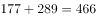
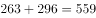
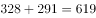
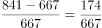

# 增长率（同比增速）比较

考点：[[20-考点/资料分析/增长/增长率（同比增速）比较|增长 / 增长率（同比增速）比较]]
材料：[[15-材料/资料分析/270457 2019年我国电信业务收入构成（固定|270457 2019年我国电信业务收入构成（固定]]

**问法模型**：题干问'某几年中同比增速最快的年份'→先对堆积柱状图逐年加总分项得总量序列，再逐年套用增长率=(现期-基期)/基期比较大小

## 推理链
1. 第1步：从堆积柱状图提取各年分项数据（万个）：2014年非4G 266、4G 85；2015年289、177；2016年296、263；2017年291、328；2018年295、372；2019年297、544
2. 第2步：基站总量=4G+非4G逐年加总，得2014~2019年总量依次为351、466、559、619、667、841万个
3. 第3步：套用增长率=(现期量-基期量)/基期量，选项涉及年份的同比增量为：2015年466-351=115、2016年559-466=93、2017年619-559=60、2019年841-667=174万个
4. 第4步：代入计算：2015年115/351≈32.8%，2016年93/466≈20.0%，2017年60/559≈10.7%，2019年174/667≈26.1%
5. 第5步：比较可知32.8%>26.1%>20.0%>10.7%，2015年增速最快，对照选项A，故正确答案为A

**最快解法**：⚡ 截位直除+分数比较：先逐年加总得总量351→466→559→619→667→841万个，再比'增量/基期'四个分数115/351、93/466、60/559、174/667——2015年分子115相对最大而基期351最小，分子大且分母小者分数必然最大，直接锁定2015年，无需精算

## 易错点
- ⚠ 堆积柱状图误读：柱内标注是4G/非4G分项值，柱顶高度才是总量，求'基站总量'增速必须逐年将两项相加，只看4G或只看非4G都会算错
- ⚠ 基期错位：2015年的同比基期是2014年总量351万个，需从图中最左柱取起，勿用当年自身或错位年份作基期
- ⚠ '增量最大'与'增速最快'混淆：2019年增量174万个为各年最大，但其基期667万个也大，增速26.1%反而低于2015年的32.8%

## 母题抽象
> 🧩 当题干出现'堆积柱状图中XX总量在若干年份中同比增速最快'时，先把各分项逐年加总得总量序列，再用'增量/基期'截位直除比较，分子最大且基期最小者即为增速最快的年份

**同类特征**：同比增速最快、移动电话基站总量、2015~2019多年份比较、堆积柱状图需分项加总、增长率比较模型

## 相关题
- [[10-真题/资料分析/增长/13504524 同比增速（增长率）比较|13504524]]（云南 2025，相关度2）
- [[10-真题/资料分析/增长/2097276 同比增速直接读表比较|2097276]]（四川 2017，相关度1）
- [[10-真题/资料分析/增长/2261975 同比增速（增长率）大小比较|2261975]]（广东 2019，相关度1）
- [[10-真题/资料分析/增长/5802088 增长率比较（基期需由现期−增量还原）|5802088]]（浙江 2023，相关度1）
- [[10-真题/资料分析/增长/10204493 同比增速（一般增长率）比较|10204493]]（甘肃 2024，相关度1）

---

### 题干
2015~2019年，移动电话基站总量同比增速最快的年份是：

### 选项
- A. 2015年　✅
- B. 2016年
- C. 2017年
- D. 2019年

### 官方解析

根据题干“2015~2019年，移动电话基站总量同比增速最快的年份”，可判定本题为一般增长率比较问题。定位图形材料可得2014~2019年移动电话基站总量分别为：

2014年：万个；

2015年：万个；

2016年：万个；

2017年：万个；

2018年：万个；

2019年：万个。

代入公式：增长率，可得：

2015年：；

2016年：；

2017年：；

2019年：。

比较可知，2015~2019年，移动电话基站总量同比增速最快的年份是2015年。

故正确答案为A。

### 给定材料

根据所给材料，回答76~80题。

        2019年，我国电信业务收入累计完成金额1.31万亿元，固定通信业务收入完成4161亿元，同比增长，在电信业务收入中所占比重较上年提高2.6个百分点；移动通信业务实现收入8942亿元，同比减少。2014~2019年，全国移动电话4G及非4G基站数变化情况如下图所示：

