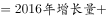
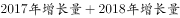
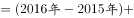
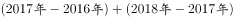
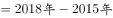
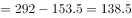
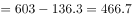
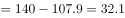
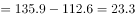

# 增长量比较（定基指数累计增量，末年减首年）

考点：[[20-考点/资料分析/增长/增长量比较（定基指数累计增量，末年减首年）|增长 / 增长量比较（定基指数累计增量，末年减首年）]]
材料：[[15-材料/资料分析/270492 国家统计局以2014年=100的定基|270492 国家统计局以2014年=100的定基]]

**问法模型**：题干问'2016-2018年指数值累计增量最多和最少的分类指数'→ 定基指数下逐年增量之和等于末年指数减首年指数，即用2018年指数−2015年指数作差比较5个分类指数

## 推理链
1. 第1步：题干限定'分类指数'，须剔除表首'经济发展新动能'总指数行，只比较经济活力、创新驱动、网络经济、转型升级、知识能力5行；时间范围为2016-2018年
2. 第2步：定基指数下，2016-2018年累计增量=（2016年指数−2015年指数）+（2017年指数−2016年指数）+（2018年指数−2017年指数）=2018年指数−2015年指数（中间年份项相互抵消，即'末年减首年'）
3. 第3步：从表中取各行2018年与2015年指数值作差：经济活力269.0−153.5=115.5点；创新驱动174.2−113.5=60.7点；网络经济603.0−136.3=466.7点；转型升级140.0−107.9=32.1点；知识能力135.9−112.6=23.3点
4. 第4步：比较5个差值：最大为网络经济466.7点（远超其他，肉眼可判）；最小在转型升级32.1点与知识能力23.3点之间产生，两者仅差8.8点，需精算确认最小为知识能力
5. 第5步：'最多=网络经济、最少=知识能力'对照选项，只有A项吻合，故选A

**最快解法**：⚡ 末年减首年法（定基指数累计增量技巧）：每行只取2018与2015两列作差，无需逐年求和。网络经济603.0−136.3≈466.7点，量级碾压其余，'最多'秒判；焦点集中在'最少'——转型升级140.0−107.9=32.1点 vs 知识能力135.9−112.6=23.3点，截位精算得23.3<32.1，最小为知识能力，锁定A

## 易错点
- ⚠ 误把表首'经济发展新动能'总指数行当成第6个分类指数参与比较（2018年269.0−2015年124.8=144.2点），题干问分类指数必须剔除该行
- ⚠ 用增速代替增量比较：增速大≠增量大，如转型升级2018年增速16.3%高于知识能力5.8%，但累计增量反而是转型升级32.1点>知识能力23.3点；'最多/最少'必须用指数值作差
- ⚠ 时间口径错位：误用'2018年指数−2016年指数'（漏掉2016年当年增量），累计增量应为2018年指数−2015年指数；且转型升级与知识能力差值小（32.1对23.3），两列指数横向取数串行易判错最小者

## 母题抽象
> 🧩 当题干出现'定基指数+连续若干年累计增量最多/最少'特征时，用'末年指数−首年指数'作差替代逐年求和（中间项抵消），验证时剔除总指数行、只比分类指数，且最接近的两项须截位精算，切忌以增速大小代替增量比较

**同类特征**：累计增量最多和最少、分类指数、2016-2018年、定基指数（2014年=100）、指数值作差、表格多行横向取数比较

## 相关题
- [[10-真题/资料分析/比重/2741961 贡献率两年比较（比值比较计数）|2741961]]（江苏 2021，相关度1）

---

### 题干
2016-2018年指数值累计增量最多和最少的分类指数分别是：

### 选项
- A. 网络经济指数、知识能力指数　✅
- B. 经济活力指数、转型升级指数
- C. 网络经济指数、转型升级指数
- D. 经济活力指数、知识能力指数

### 官方解析

根据题干“2016-2018年······累计增量最多和最少······”，可判定本题为增长量比较问题。定位表格材料，可知2015-2018年各种指数的具体值。根据增长量，则累计增长量。代入数据可得：

经济活力的累计增量；

网络经济的累计增量；

转型升级的累计增量；

知识能力的累计增量。

比较发现，网络经济指数累计增长最多；知识能力指数累计增长最少。

故正确答案为A。

### 给定材料

        国家统计局采用定基指数方法，以2014年为100，根据第四次全国经济普查数据修订结果以及部分指标最新数据，将5个分类指标的权重均设定为0.2，对2015-2019年我国经济发展新动能总指数进行测算，结果见下表。

注：分类指数对总指数增长的贡献率计算公式为

