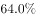
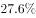
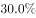
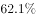
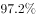

# 增长率（增幅）比较——增幅之差的百分点计算

考点：[[20-考点/资料分析/增长/增长率（增幅）比较——增幅之差的百分点计算|增长 / 增长率（增幅）比较——增幅之差的百分点计算]]
材料：[[15-材料/资料分析/270494 党的十八大以来我国居民收入与消费状况|270494 党的十八大以来我国居民收入与消费状况]]

**问法模型**：以2012年为基期，农村增幅比城镇高多少个百分点 → 直接取材料中两个'比2012年增长'的增幅相减，差值即百分点数，无需算基期值

## 推理链
1. 第1步：锁定材料第二段：2019年城镇居民人均消费支出28063元、比2012年增长63.3%；农村居民人均消费支出13328元、比2012年增长99.2%（原文空缺处须回核原始材料补齐，两数同为以2012年为基期的增幅口径）
2. 第2步：题干问'增幅高多少个百分点'→增幅即增长率，模型为：农村增幅−城镇增幅，不涉及基期量、城乡人口权数或总量计算
3. 第3步：代入作差：99.2%−63.3%=35.9个百分点
4. 第4步：与选项对照：A高25.2、B高35.9、C高41.3、D高54.5，仅B与35.9个百分点吻合，故选B

**最快解法**：⚡ 直接作差法（免计算）：材料已给出两增幅，口算99.2%−63.3%=35.9个百分点；秒杀信号是题干问'高/低多少个百分点'，必为两百分数之差，切勿去求基期值或倍数比值

## 易错点
- ⚠ '个百分点'≠'%'：增幅之差用百分点表示；若误求两增幅的比值（1.992/1.633≈1.22倍）或增长率之比，将得不到任何选项
- ⚠ 基期口径锁定：材料中'比2000年''比2002年''比2012年'多口径交错，本题两数必须同为'比2012年增长'，勿混入城镇住房（基期2002年）或农村住房（基期2000年）的增幅
- ⚠ 本材料文本两处增幅为空缺，须回核原始材料补齐（城镇63.3%、农村99.2%）后再作差，不得用28063、13328凭空倒推基期值或凭感觉代数

## 母题抽象
> 🧩 当题干出现'A的增幅比B高/低多少个百分点'时，直接从材料取A、B两个增长率作差即得答案；仅当材料只给两期数值时，才先各自求(现期−基期)/基期再作差

**同类特征**：以2012年为基期、农村居民人均消费支出、增幅比城镇、高…个百分点、城乡口径对比、两增长率直接作差

## 相关题
- [[10-真题/资料分析/增长/2742033 多年复合增长下的基期回推与正负增长判定（年均增长链式计算）|2742033]]（江苏 2021，相关度1）

---

### 题干
以2012年为基期，2019年我国农村居民人均消费支出的增幅比城镇居民：

### 选项
- A. 高25.2个百分点
- B. 高35.9个百分点　✅
- C. 高41.3个百分点
- D. 高54.5个百分点

### 官方解析

定位文字材料第二段可得，2019年“城镇居民人均消费支出28063元，比2012年增长；农村居民人均消费支出13328元，比2012年增长”，则以2012年为基期，2019年我国农村居民人均消费支出的增幅比城镇居民高，即高35.9个百分点。

故正确答案为B。

### 给定材料

        党的十八大以来，我国居民收入水平持续较快增长，消费水平稳步提高，消费结构优化升级，生活质量明显提升，人民生活正阔步迈向全面小康。

        2019年，全国居民人均可支配收入30733元，比2000年增长4.4倍。全国居民人均消费支出21559元，比2012年增长，年均增长。其中，城镇居民人均消费支出28063元，比2012年增长；农村居民人均消费支出13328元，比2012年增长。

        2019年全国居民恩格尔系数（人均食品支出占人均消费支出的比重）为，比2000年下降14.0个百分点。其中，城镇居民恩格尔系数为，农村居民恩格尔系数为，分别比2000年下降11.0和18.3个百分点。

        2019年，全国居民平均每百户拥有彩色电视机120.6台、洗衣机96.0台、电冰箱100.9台、空调115.6台、汽车35.3辆。城镇居民人均住房建筑面积为39.8平方米，比2002年增长；农村居民人均住房建筑面积为48.9平方米，比2000年增长。全国居民人均交通通信支出2862元，比2000年年均增长，占人均消费支出的比重较2000年提高6.1个百分点。全国居民人均医疗保健支出1902元，比2000年年均增长，占人均消费支出的比重较2000年提高2.9个百分点。

> [!warning] 疑点（官方解析可能有误，待人工复核）
> 官方答案B无误；但本笔记文本中城乡'比2012年增长'数值均为空缺（官方解析亦未展示具体增幅），答案依赖原始材料中的城镇63.3%、农村99.2%（99.2−63.3=35.9），使用时须先回核补齐空缺值

<!-- CODEX-ANSWER-REVIEW:BEGIN -->
### 本次独立复核

**复核状态：** `resolved`（答案与解析已核定）

**计分答案：** B（可计分）

**复核解析：**

原题公式图直接给出城镇2019年较2012年增长64.0%、农村增长99.9%。题目问增幅差，计算99.9%−64.0%=35.9个百分点，选B。疑点里的63.3%/99.2%与这两张公式图不符，是误抄的数值；虽然差值碰巧仍为35.9，但应以原图数值更正。

**相关信息：**

同比增长率 r 以小数代入时，增长量=现期量×r/(1+r)；同比下降量取正数时用现期量×|r|/(1−|r|)。百分点为两个百分率之差。单位沿用原材料。

**题源依据：** [固定版本原题](https://github.com/Mentat-Uran/kaogongzhentizhengliu/blob/84ab93d4b64b61d897bece8a1c0a5bab06b4feb2/10-%E7%9C%9F%E9%A2%98/%E8%B5%84%E6%96%99%E5%88%86%E6%9E%90/%E5%A2%9E%E9%95%BF/2742010%20%E5%A2%9E%E9%95%BF%E7%8E%87%EF%BC%88%E5%A2%9E%E5%B9%85%EF%BC%89%E6%AF%94%E8%BE%83%E2%80%94%E2%80%94%E5%A2%9E%E5%B9%85%E4%B9%8B%E5%B7%AE%E7%9A%84%E7%99%BE%E5%88%86%E7%82%B9%E8%AE%A1%E7%AE%97.md)；固定内容 commit `84ab93d4b64b61d897bece8a1c0a5bab06b4feb2`，Markdown blob `3bc96f248f22ac07a664b5e56361bd22dd6c72f8`。
<!-- CODEX-ANSWER-REVIEW:END -->
