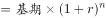
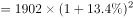
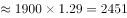

# 年均增速外推（现期计算）

考点：[[20-考点/资料分析/增长/年均增速外推（现期计算）|增长 / 年均增速外推（现期计算）]]
材料：[[15-材料/资料分析/270494 党的十八大以来我国居民收入与消费状况|270494 党的十八大以来我国居民收入与消费状况]]

**问法模型**：'按2001—2019年年均增速估算2021年值'→以2019年1902元为外推基期、n=2021−2019=2年，用现期=基期×(1+r)²计算，对照区间选项

## 推理链
1. 第1步：从材料第四段提取：2019年全国居民人均医疗保健支出1902元，比2000年年均增长13.4%（给定文本该数值为空缺，回核原始材料补齐，该值与官方答案C自洽），此年均增速对应2001—2019年共19年
2. 第2步：确定外推期：以2019年为基期推2021年，n=2021−2019=2年（不是从2000年起推21年）；所用公式：现期=基期×(1+年均增速)^n
3. 第3步：代入：2021年支出=1902×(1+13.4%)²，其中(1+13.4%)²=1.134²≈1.286
4. 第4步：计算：1902×1.286≈2446元（速算：1900×1.286≈2443元）
5. 第5步：与选项对照：2446元落在2420元~2470元之间，对应C项，故正确答案为C

**最快解法**：⚡ 两年累计增幅速算（公式法+凑整）：(1+r)²≈1+2r+r²=1+26.8%+1.8%≈1.286，1902×1.286≈2443元，直接锁定C区间2420~2470；注意必须补上r²≈1.8%这一项，否则1902×1.268≈2412元会误判入B区间

## 易错点
- ⚠ 外推年数错：把材料中2001—2019的19年当成外推期，或误从2000年起推21年；正确是以2019年为基期、n=2
- ⚠ 展开(1+13.4%)²时漏掉r²项：只算1+2×13.4%=1.268得约2412元会误选B，加上r²≈1.8%得1.286才是约2446元（C）
- ⚠ 取数与口径陷阱：给定文本中年均增速处为空缺，须回核原始材料补齐，不得凭空代数；1902元是2019年（外推基期）值，勿误当作2000年基期值；纯文字材料需先锁定主体'全国居民'与指标'人均医疗保健支出'

## 母题抽象
> 🧩 当题干出现'按某时期年均增速估算未来某年'且选项为区间时，以最近已知年份为基期、n=目标年−基期年，用基期值×(1+r)^n，n=2时用1+2r+r²速算，对照区间边界即可定答案

**同类特征**：按……年均增速估算、2021年、人均医疗保健支出、介于……之间（区间选项）、现期外推计算、比2000年年均增长

## 相关题
- [[10-真题/资料分析/增长/19452634 年均增长量与现期量外推|19452634]]（上海 2026，相关度1）
- [[10-真题/资料分析/倍数/5514929 现期倍数（间隔年份基期定位）|5514929]]（广东 2023，相关度1）
- [[10-真题/资料分析/比重/5509536 现期比重求部分量（部分=整体×占比，跨图表拼数据）|5509536]]（甘肃 2023，相关度1）
- [[10-真题/资料分析/比重/5510163 现期比重计算（跨图表：表1部分合计÷图1全国总量）|5510163]]（江西 2023，相关度1）
- [[10-真题/资料分析/比重/14993577 现期比重结构判断（饼图占比关系：最大项占比-50%）|14993577]]（选调 2024，相关度1）

---

### 题干
按2001-2019年的年均增速估算，2021年全国居民人均医疗保健支出介于：

### 选项
- A. 2320元和2370元之间
- B. 2370元和2420元之间
- C. 2420元和2470元之间　✅
- D. 2470元和2520元之间

### 官方解析

根据题干“按2001-2019年的年均增速估算，2021年······”，可判定本题为现期计算问题。定位文字材料第四段可得：2019年，全国居民人均医疗保健支出1902元，比2000年年均增长，根据公式：现期，则2021年全国居民人均医疗保健支出元，在C项范围内。

故正确答案为C。

### 给定材料

        党的十八大以来，我国居民收入水平持续较快增长，消费水平稳步提高，消费结构优化升级，生活质量明显提升，人民生活正阔步迈向全面小康。

        2019年，全国居民人均可支配收入30733元，比2000年增长4.4倍。全国居民人均消费支出21559元，比2012年增长，年均增长。其中，城镇居民人均消费支出28063元，比2012年增长；农村居民人均消费支出13328元，比2012年增长。

        2019年全国居民恩格尔系数（人均食品支出占人均消费支出的比重）为，比2000年下降14.0个百分点。其中，城镇居民恩格尔系数为，农村居民恩格尔系数为，分别比2000年下降11.0和18.3个百分点。

        2019年，全国居民平均每百户拥有彩色电视机120.6台、洗衣机96.0台、电冰箱100.9台、空调115.6台、汽车35.3辆。城镇居民人均住房建筑面积为39.8平方米，比2002年增长；农村居民人均住房建筑面积为48.9平方米，比2000年增长。全国居民人均交通通信支出2862元，比2000年年均增长，占人均消费支出的比重较2000年提高6.1个百分点。全国居民人均医疗保健支出1902元，比2000年年均增长，占人均消费支出的比重较2000年提高2.9个百分点。

> [!warning] 疑点（官方解析可能有误，待人工复核）
> 给定材料原文及官方解析中'比2000年年均增长'的数值均为空缺（解析公式代入处亦被截断，未显示具体数值）；按官方答案C反推，r须约在12.8%~14.0%之间（取13.4%时1902×1.134²≈2446元，恰在C区间）。此为给定文本取数口径提示，不改变官方答案C。
