# 多年复合增长下的基期回推与正负增长判定（年均增长链式计算）

考点：[[20-考点/资料分析/增长/多年复合增长下的基期回推与正负增长判定（年均增长链式计算）|增长 / 多年复合增长下的基期回推与正负增长判定（年均增长链式计算）]]
材料：[[15-材料/资料分析/270495 2013-2019年全球卫星产业收入|270495 2013-2019年全球卫星产业收入]]

**问法模型**：'以2012年为基期，2019年收入增长情况'→用2019年现期值÷∏(1+各年增速)回推2012年基期值（或七年增速连乘积与1比较），比较现期与基期大小判定正/负增长。

## 推理链
1. 第1步：题干要求以2012年为基期判定2019年制造业、发射服务业收入增长方向；从文字取2019年现期值：卫星制造业125亿美元、卫星发射服务业49亿美元。
2. 第2步：从图中取2013-2019逐年增速：制造业7.5%、9.3%、1.6%、1.9%、11.5%、34.8%、-35.9%；发射服务业-6.9%、0.3%、-8.5%、-13.1%、-16.4%、25.8%、-21%。
3. 第3步：所用规则：现期=基期×∏(1+ri)，故基期(2012)=现期÷∏(1+ri)；连乘积大于1则现期高于基期（正增长），小于1则反之（负增长）。
4. 第4步：发射服务业连乘积=0.931×1.003×0.915×0.869×0.836×1.258×0.79≈0.62<1，回推2012年基期≈49÷0.62≈79.4亿美元（链：49→62→49.3→59→67.9→74.2→74→约79.5），2019年49亿低于基期，呈负增长。
5. 第5步：制造业按官方解析同法将125亿美元沿增速链回推2012年基期（125→195→约144.7→约129.8→约127.4→约125.4→约114.7→约106.7亿美元），官方解析据此判定2019年相较2012年呈负增长。
6. 第6步：与选项对照：制造业、发射服务业均按官方判定为负增长，对应'负增长、负增长'，故选B。

**最快解法**：⚡ 连乘积判向法（累乘估算）：不必逐年精算基期值，只判∏(1+r2013…r2019)与1的大小即可定方向。发射服务业5个负增长年份，0.93×1.00×0.92×0.87×0.84×1.26×0.79≈0.62<1→2012年约79.4亿高于2019年49亿→负增长；制造业按官方解析链式回推基期与125亿比较判为负增长，两者同负直接锁定B。

## 易错点
- ⚠ 负增速回推方向：2019年制造业-35.9%对应'除以0.641'（125÷0.641=195），极易误为除以1.359或乘0.359，一处错则全链错向。
- ⚠ 只看局部不看全程：2018年冲高34.8%、2019年骤降35.9%（发射业25.8%→-21%），单年剧变会误导方向直觉，正负增长必须以七年总连乘积（或回推到2012的基期值）与现期比较为准。
- ⚠ 双轴图与口径混读：两条增速线读右轴（%），柱读左轴（亿美元），勿把线的高低当收入高低；'较上年减少70亿美元'是绝对减少量（可反推2018年195亿），与-35.9%是同一信息的两种表达；另勿误用'全球太空经济3660亿'替代'卫星产业'口径。

## 母题抽象
> 🧩 当题干出现'以某早年为基期、判断现期正/负增长'且图中给出逐年增速链时，用∏(1+ri)与1比较（或现期÷连乘积回推基期值）一次性判定方向，避免逐年重复计算。

**同类特征**：以2012年为基期、2019年收入增长情况分别是、两个主体各自判定正负、正/负增长组合式选项、依赖图中2013-2019逐年增速链、只判方向不求具体增幅

## 相关题
- [[10-真题/资料分析/增长/2742010 增长率（增幅）比较——增幅之差的百分点计算|2742010]]（江苏 2021，相关度1）

---

### 题干
以2012年为基期，2019年全球卫星制造业、卫星发射服务业的收入增长情况分别是：

### 选项
- A. 负增长、正增长
- B. 负增长、负增长　✅
- C. 正增长、负增长
- D. 正增长、正增长

### 官方解析

根据题干“增长情况分别是”，结合材料数据给出了各个年份的增长率，可判定本题为一般增长率的计算问题。定位图形材料，2013-2019年全球卫星制造业及卫星发射服务业的收入增长率均已给出。根据公式：增长率，故若现期量基期量，则呈正增长，若现期量基期量，则呈负增长。根据公式：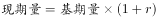，则以2012年为基期时，2019年全球卫星制造业收入2012年全球卫星制造业收入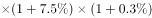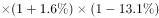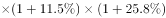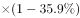

2012年全球卫星制造业收入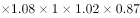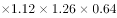2012年全球卫星制造业收入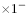，2012年全球卫星制造业收入2019年全球卫星制造业收入，呈负增长；2019年全球卫星发射服务业收入2012年全球卫星发射服务业收入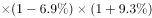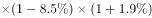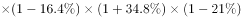2012年全球卫星发射服务业收入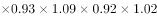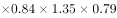2012年全球卫星发射服务业收入，2012年全球卫星发射服务业收入2019年全球卫星发射服务业收入，呈负增长。因此，两者收入增长情况均呈负增长。

故正确答案为B。

### 给定材料

        2019年全球太空经济规模增至3660亿美元，较2018年增长，其中全球卫星产业收入为2707亿美元。在全球卫星产业收入中，卫星制造业的收入为125亿美元，较上年减少70亿美元；卫星发射服务业的收入为49亿美元，较上年下降；卫星通信服务业的收入为1230亿美元，较上年减少35亿美元；地面设备制造业的收入为1303亿美元，较上年增长。

> [!warning] 疑点（官方解析可能有误，待人工复核）
> 官方答案B中'制造业负增长'与按材料数据的直接计算存在矛盾：制造业七年增速连乘积=1.075×1.093×1.016×1.019×1.115×1.348×0.641≈1.17>1，回推2012年基期≈125÷1.17≈106.7亿美元<2019年125亿美元，七年累计约+17%，按此应为正增长（对应C'正增长、负增长'的前半）；发射服务业连乘积≈0.62<1、2012年约79.4亿>49亿为负增长，与B一致。官方解析回推所得基期与其'负增长'结论亦不自洽。遵照铁律以官方答案B为准记录，此冲突仅在此存档。
