# 增长率比较（逐年增速大小比较并计数）

考点：[[20-考点/资料分析/增长/增长率比较（逐年增速大小比较并计数）|增长 / 增长率比较（逐年增速大小比较并计数）]]
材料：[[15-材料/资料分析/270495 2013-2019年全球卫星产业收入|270495 2013-2019年全球卫星产业收入]]

**问法模型**：题干为'2014-2019年A指标增速大于B指标的年份有几个'的计数型设问 → A的增速图中未直接给出，须用柱状图相邻两年收入自算逐年增速，再与B（发射服务业）给定增速逐年比较后数个数

## 推理链
1. 第1步：从柱状图提取全球卫星产业收入2013-2019年依次为2309、2466、2548、2605、2690、2774、2707亿美元；从灰色虚线提取卫星发射服务业增速2014-2019年依次为0.3%、-8.5%、-13.1%、-16.4%、25.8%、-21%
2. 第2步：产业收入增速未直接给出，用公式 增速=（现期-基期）/基期 对相邻两柱逐年计算
3. 第3步：代入得2014年(2466-2309)/2309≈6.8%、2015年(2548-2466)/2466≈3.3%、2016年(2605-2548)/2548≈2.2%、2017年(2690-2605)/2605≈3.3%、2018年(2774-2690)/2690≈3.1%、2019年(2707-2774)/2774≈-2.4%
4. 第4步：与发射服务业增速逐年比较：2015年3.3%＞-8.5%、2016年2.2%＞-13.1%、2017年3.3%＞-16.4%（产业小正增速对发射大负增速，直接成立）；2019年两值皆为负，-2.4%＞-21%（负数比绝对值，绝对值小者为大）成立；2018年3.1%＜25.8%不满足
5. 第5步：依官方解析，满足'产业收入增速＞发射服务业增速'的年份为2015、2016、2017、2019，共4个年份
6. 第6步：对照选项，4个对应C项

**最快解法**：⚡ 截位直除+同号分档比较：先用相邻柱截位直除自算产业增速（157/2309≈6.8%、82/2466≈3.3%、57/2548≈2.2%、85/2605≈3.3%、84/2690≈3.1%、-67/2774≈-2.4%）；异号年份直接判大小（2015-2017产业正对发射负必满足），2019年两个负数只比绝对值（-2.4%＞-21%）满足，2018年3.1%＜25.8%排除；按官方计数（2014年不计入，口径矛盾见疑点）共4个，选C

## 易错点
- ⚠ 图中两条折线是制造业与发射服务业增速，没有产业收入增速线，必须用相邻柱状图自算，勿拿橙色制造业增速线（如2017年11.5%、2018年34.8%）当产业增速
- ⚠ 双轴图正负号陷阱：2019年产业约-2.4%、发射-21%，两个负数比较'-2.4%＞-21%'成立（负号下绝对值大的反而小），勿凭数字表面大小判反
- ⚠ 2018年两条增速线同时冲高（制造业34.8%、发射25.8%），易错觉产业增速也高，实际由柱状图算出仅约3.1%＜25.8%，该年不满足；且勿把柱高（收入规模2774亿最大）当作增速最高

## 母题抽象
> 🧩 当题干出现'某时段内A指标增速大于B指标的年份有几个'且A的增速未在图中直接给出时，先用相邻两期数据自算A的逐年增速（截位直除），再与B的逐年增速逐一同号比较计数，负数之间只比绝对值大小

**同类特征**：2014-2019年连续年份区间、增速大于、年份数有（计数型设问）、被比较的增速需自算（柱状图相邻值）、与图中折线增速逐年对照、选项为'N个'形式

## 相关题
（暂无）

---

### 题干
2014-2019年全球卫星产业收入增速大于卫星发射服务业的年份数有：

### 选项
- A. 2个
- B. 3个
- C. 4个　✅
- D. 5个

### 官方解析

根据题干“2014-2019年······增速大于······的年份数有”，可判定本题为一般增长率的比较问题。定位图形材料可得：2013-2019年全球卫星产业收入以及2014-2019年卫星发射服务业收入增速。根据公式：增长率，2014-2019年的增长率比较如下：

2014年：全球卫星产业收入增速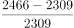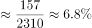卫星发射服务业收入增速；

2015年：全球卫星产业收入增速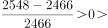卫星发射服务业收入增速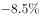；

2016年：全球卫星产业收入增速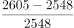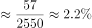卫星发射服务业收入增速；

2017年：全球卫星产业收入增速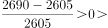卫星发射服务业收入增速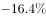；

2018年：全球卫星产业收入增速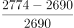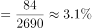卫星发射服务业收入增速；

2019年：全球卫星产业收入增速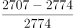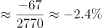卫星发射服务业收入增速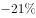。

满足要求的年份分别是2015年、2016年、2017年和2019年，共4个年份。

故正确答案为C。

### 给定材料

        2019年全球太空经济规模增至3660亿美元，较2018年增长，其中全球卫星产业收入为2707亿美元。在全球卫星产业收入中，卫星制造业的收入为125亿美元，较上年减少70亿美元；卫星发射服务业的收入为49亿美元，较上年下降；卫星通信服务业的收入为1230亿美元，较上年减少35亿美元；地面设备制造业的收入为1303亿美元，较上年增长。

> [!warning] 疑点（官方解析可能有误，待人工复核）
> 按图中数据，2014年产业收入增速(2466-2309)/2309≈6.8%＞发射服务业增速0.3%，2014年应同样满足，满足年份应为2014/2015/2016/2017/2019共5个（对应D项）；官方解析剔除2014年、计4个（C），与图数据存在出入。依命题铁律答案以官方C为准，此处仅记录矛盾，不改答案。
