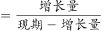
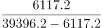
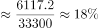
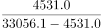
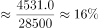
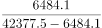
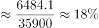
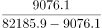
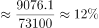

# 增长率比较（已知现期值与同比增加额，先减法求基期再算增速）

考点：[[20-考点/资料分析/增长/增长率比较（已知现期值与同比增加额，先减法求基期再算增速）|增长 / 增长率比较（已知现期值与同比增加额，先减法求基期再算增速）]]
材料：[[15-材料/资料分析/270497 2019年江苏省保险业运行情况（保费|270497 2019年江苏省保险业运行情况（保费]]

**问法模型**：题干问'2019年末……贷款余额同比增速最慢的是'→ 一般增长率比较模型：增速=增加额÷(绝对值−增加额)，四个贷款种类分别计算后比大小取最小者

## 推理链
1. 第1步：定位统计表贷款部分四个选项数据（绝对值/比上年末增加，亿元）：消费贷款39396.2/6117.2、住房贷款33056.1/4531.0、短期贷款42377.5/6484.1、中长期贷款82185.9/9076.1
2. 第2步：表格第2列'比上年末增加'是增量而非增速，2018年末基期=绝对值−增加额，增速=增加额÷(绝对值−增加额)
3. 第3步：A消费贷款6117.2÷(39396.2−6117.2)=6117.2÷33279.0≈18.4%；B住房贷款4531.0÷28525.1≈15.9%；C短期贷款6484.1÷35893.4≈18.1%；D中长期贷款9076.1÷73109.8≈12.4%
4. 第4步：12.4%＜15.9%＜18.1%＜18.4%，增速最慢者为中长期贷款，与选项对照选D，与官方答案一致

**最快解法**：⚡ 截位直除＋同序替代：因'增量÷现期绝对值'=g/(1+g)与增速g大小序完全等价，可免算基期，直接比较增量÷绝对值——A 6117.2/39396.2≈15.5%、B 4531.0/33056.1≈13.7%、C 6484.1/42377.5≈15.3%、D 9076.1/82185.9≈11.0%，D最小，直接锁定D

## 易错点
- ⚠ 把第2列'比上年末增加'误当同比增速直接排序：9076.1是四项中最大增量，易误判中长期贷款增速最快，实际它增速最慢
- ⚠ 基期运算方向混淆：基期=绝对值−增加额（减法），不能写成绝对值÷(1+增速)（增速未知）；分母也不可直接用现期绝对值报出'伪增速'数值
- ⚠ 口径与数字直觉陷阱：消费贷款、住房贷款与短期/中长期贷款是两套交叉分类维度，不能混作并列求和；住房贷款余额与增量均最小，易凭数字绝对值大小误判其增速最慢（实际最慢是D）

## 母题抽象
> 🧩 当表格同时给出'绝对值'与'比上年末增加（增量）'且问'增速最快/最慢'时，用增速=增量÷(绝对值−增量)，或等价地截位直除比较'增量÷绝对值'（与增速同序）直接锁定答案。

**同类特征**：同比增速最慢、贷款余额、比上年末增加（增量列）、四类贷款横向比较、增长率比较问题、现期值与增量同表齐备

## 相关题
- [[10-真题/资料分析/增长/3522353 增长率比较（定基指数同比增速）|3522353]]（青海 2021，相关度1）
- [[10-真题/资料分析/增长/10204582 同比增长率大小排序（负增长比较）|10204582]]（辽宁 2024，相关度1）
- [[10-真题/资料分析/增长/2452576 增长率比较（百分点差还原增速大小）|2452576]]（江苏 2020，相关度1）
- [[10-真题/资料分析/其他/4708226 折线图直接读数与增速极值比较（找同比增速最低月）|4708226]]（福建 2019，相关度1）

---

### 题干
下列人民币贷款种类中，2019年末江苏省金融机构贷款余额同比增速最慢的是：

### 选项
- A. 消费贷款
- B. 住房贷款
- C. 短期贷款
- D. 中长期贷款　✅

### 官方解析

根据题干“······同比增速最慢的是”，可判定本题为一般增长率比较问题。定位表格材料可得：2019年末江苏省金融机构消费贷款39396.2亿元，比上年末增加6117.2亿元；住房贷款33056.1亿元，比上年末增加4531.0亿元；短期贷款42377.5亿元，比上年末增加6484.1亿元；中长期贷款82185.9亿元，比上年末增加9076.1亿元。根据公式：增长率，则2019年末江苏省金融机构各种类人民币贷款的同比增速为：

A项：消费贷款；

B项：住房贷款；

C项：短期贷款；

D项：中长期贷款。

则2019年末江苏省金融机构贷款余额同比增速最慢的是中长期贷款。

故正确答案为D。

### 给定材料

        2019年江苏省金融信贷规模扩大，保险行业发展较快。全年保费收入3750.2亿元，比上年增长。其中，财产险收入940.9亿元，增长；寿险收入2215.3亿元，增长；健康险收入508.8亿元，增长；意外伤害险收入85.2亿元，增长。全年保险赔付998.6亿元，比上年增长。其中，财产险赔付534.5亿元，增长；寿险赔付294.3亿元，下降，健康险赔付144.8亿元，增长；意外伤害险赔付25.0亿元，增长。年末金融机构人民币存贷款情况见下表。

