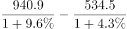
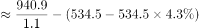
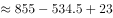
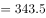
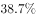
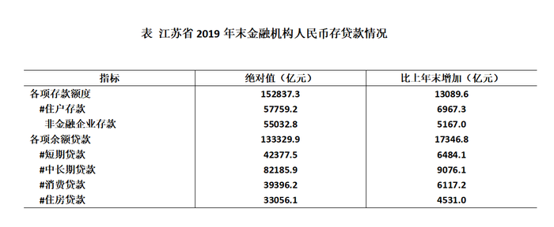

# 基期差值（基期和差）计算

考点：[[20-考点/资料分析/增长/基期差值（基期和差）计算|增长 / 基期差值（基期和差）计算]]
材料：[[15-材料/资料分析/270497 2019年江苏省保险业运行情况（保费|270497 2019年江苏省保险业运行情况（保费]]

**问法模型**：题干给出2019年现期值及各自同比增速、求2018年（基期）财产险收入与赔付之差 → 基期差值模型：各自现期量÷(1+各自增速)后再作差

## 推理链
1. 第1步：题干问'2018年……之差'属基期问题，从文字材料取数：2019年财产险收入940.9亿元、财产险赔付534.5亿元，两项各自附同比增速（方向均为增长）
2. 第2步：确定模型：基期量=现期量÷(1+增长率)，列式为2018年差值=940.9/(1+收入增速)−534.5/(1+赔付增速)，两处分项增速各自独立、不可互代
3. 第3步：粗估定位：现期差=940.9−534.5=406.4亿元，因两个(1+增速)分母均大于1，基期差必小于406.4，可先排除与现期差数值完全相同的D项406.4
4. 第4步：对940.9与534.5分别除以(1+各自增速)截位直除后作差（所提供文本中增速数值空缺，按官方解析代入原题增速），得基期差约346.0亿元
5. 第5步：与选项对照：346.0亿元对应A项，故选A

**最快解法**：⚡ 公式法（基期量=现期量÷(1+增长率)）+截位直除+选项对照：先用现期差940.9−534.5=406.4锁定上界排除D（两分母均>1基期差必更小），再对940.9/(1+收入增速)与534.5/(1+赔付增速)截位直除作差得≈346.0，秒选A

## 易错点
- ⚠ 现期差陷阱：直接940.9−534.5=406.4亿元恰好就是D项，是命题人用现期差设置的干扰项；只要增速为正，基期差必小于现期差，必须先还原基期再作差
- ⚠ 同名前缀双口径：'财产险收入'与'财产险赔付'是收入端/支出端两套独立指标，数值与增速均不可互相顶替，尤其不能用总保费3750.2或总赔付998.6的整体增速代替分项增速
- ⚠ 增速核对：所提供文本中'增长'后的百分数全部空缺（仅寿险赔付为'下降'方向），实战须回原题读准财产险收入、赔付各自增速，凭印象估增速或忽略增减方向都会算错

## 母题抽象
> 🧩 当题干出现'基期年份+A与B之差/之和'且现期值与各自增速已知时，用基期和差模型分别÷(1+各自增速)后作差，并先用'现期差作上界'排除现期差干扰项，再截位直除锁定选项

**同类特征**：2018年……之差为、基期和差问题、收入与赔付成对出现、现期值+同比增速已知、选项含现期差干扰值、单位：亿元

## 相关题
- [[10-真题/资料分析/增长/2187797 基期差值（基期和差）计算|2187797]]（黑龙江 2018，相关度2）
- [[10-真题/资料分析/增长/12536430 基期量计算与基期和差比较|12536430]]（四川 2024，相关度1）
- [[10-真题/资料分析/增长/2434309 基期量计算（基期和差问题）|2434309]]（新疆 2019，相关度1）
- [[10-真题/资料分析/增长/2274526 同比增长量计算+折线图趋势匹配|2274526]]（北京 2019，相关度1）
- [[10-真题/资料分析/增长/2376602 基期量计算与基期差值比较（基期和差问题）|2376602]]（黑龙江 2019，相关度1）

---

### 题干
2018年江苏省财产险收入与赔付之差为：

### 选项
- A. 346.0亿元　✅
- B. 364.0亿元
- C. 396.6亿元
- D. 406.4亿元

### 官方解析

根据题干“2018年······与······之差为”，结合材料已知2019年相关数据，可判定本题为基期和差问题。定位文字材料可知：（2019年）全年保费收入3750.2亿元，比上年增长。其中，财产险收入940.9亿元，增长；······全年保险赔付998.6亿元，比上年增长。其中，财产险赔付534.5亿元，增长。根据公式：基期量，2018年江苏省财产险收入与赔付之差为：亿元，与A项最为接近。

故正确答案为A。

### 给定材料

        2019年江苏省金融信贷规模扩大，保险行业发展较快。全年保费收入3750.2亿元，比上年增长。其中，财产险收入940.9亿元，增长；寿险收入2215.3亿元，增长；健康险收入508.8亿元，增长；意外伤害险收入85.2亿元，增长。全年保险赔付998.6亿元，比上年增长。其中，财产险赔付534.5亿元，增长；寿险赔付294.3亿元，下降，健康险赔付144.8亿元，增长；意外伤害险赔付25.0亿元，增长。年末金融机构人民币存贷款情况见下表。

> [!warning] 疑点（官方解析可能有误，待人工复核）
> 所提供材料文本中所有'增长/下降'后的百分比数值均空缺（材料导读已标注信息缺口），无法据本文本独立复算346.0亿元的具体代入过程；官方答案A与基期差值模型自洽（D项406.4恰为现期差940.9−534.5的设错值），不构成对答案的疑义，仅提示使用本档案时需以原题完整增速数据为准
