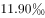
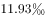
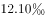
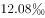
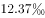
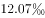
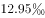
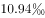
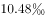

# 同比增加年份计数（逐年增减方向比较）

考点：[[20-考点/资料分析/增长/同比增加年份计数（逐年增减方向比较）|增长 / 同比增加年份计数（逐年增减方向比较）]]
材料：[[15-材料/资料分析/270514 2019年末我国80后-90后-00|270514 2019年末我国80后-90后-00]]

**问法模型**：题干出现'同比增加的年份数'→ 将2011-2019各年出生率与上一年逐一比较，统计当期＞上期的年份个数

## 推理链
1. 第1步：从图表折线（右轴，单位‰）读出2010-2019年人口出生率依次为11.90、11.93、12.10、12.08、12.37、12.07、12.95、12.43、10.94、10.48
2. 第2步：'同比增加'判定规则：当年出生率＞上一年出生率即计入，须相邻两年两两比较（2011比2010），不能与固定基期2010年比较
3. 第3步：逐对比较：2011年11.93＞11.90✓、2012年12.10＞11.93✓、2013年12.08＜12.10✗、2014年12.37＞12.08✓、2015年12.07＜12.37✗、2016年12.95＞12.07✓、2017年12.43＜12.95✗、2018年10.94＜12.43✗、2019年10.48＜10.94✗
4. 第4步：出生率高于上年的年份为2011、2012、2014、2016，共4个，落在题干2011-2019范围内，对照选项选A

**最快解法**：⚡ 折线目测升降法：同比增加＝折线上升段，直接数折线上升的区间——2010→2011、2011→2012、2013→2014、2015→2016共4段上升，对应年份2011/2012/2014/2016，无需任何计算即选A

## 易错点
- ⚠ 双轴混排陷阱：出生率是折线对应右轴（‰），若误读柱状图左轴的出生人口（万人），增加年份会多出2013年（1640＞1635）共5个而错选B
- ⚠ 比较基准陷阱：同比须逐年与上一年比，若误与固定基期2010年的11.90比较，则2011-2017年各年均'高于基期'，会错数成7个选D
- ⚠ 时间范围陷阱：2010年只作比较基准、不计入'增加年份'，题干范围是2011-2019年，首尾年份不可多算或漏算

## 母题抽象
> 🧩 当题干出现'某指标同比增加/高于上年的年份有几个'特征时，逐年与上一年两两比较（当期＞上期计入），并核对计数落在题干时间范围内；折线图可直接数上升段验证

**同类特征**：同比增加的年份数、逐年与上一年比较、折线指标右轴读数（‰）、计数型比较题、时间范围2011-2019

## 相关题
- [[10-真题/资料分析/其他/2133478 表格双指标逐行大小比较（计数型读表题）|2133478]]（国考 2018，相关度1）

---

### 题干
2011-2019年，我国人口出生率同比增加的年份数有：

### 选项
- A. 4个　✅
- B. 5个
- C. 6个
- D. 7个

### 官方解析

定位统计图材料可得：2010-2019年，我国人口出生率分别为、、、、、、、、、。人口出生率高于上年的有2011年、2012年、2014年和2016年，共4个。

故正确答案为A。

### 给定材料

        2019年末，我国80后、90后、00后人数分别为2.21亿人、2.08亿人、1.63亿人。

