# 两期比重结合求部分增长率（跨图表拼接+基期反推）

考点：[[20-考点/资料分析/增长/两期比重结合求部分增长率（跨图表拼接+基期反推）|增长 / 两期比重结合求部分增长率（跨图表拼接+基期反推）]]
材料：[[15-材料/资料分析/270515 2019年我国海洋经济统计：一张表给|270515 2019年我国海洋经济统计：一张表给]]

**问法模型**：题干求第三产业增加值年增长率但表中无此增速，只给总量增速（6.2%）与两期比重（59.1%→60.0%）→ 用比重关系式 (1+r部分)=(现期比重×(1+r总量))/基期比重 反解

## 推理链
1. 第1步：从表格提取2019年海洋生产总值89415亿元、同比增速6.2%（以2018年为基期）；从柱状图提取第三产业占海洋生产总值比重：2018年59.1%、2019年60.0%
2. 第2步：公式'部分量=总量×比重'：2019年三产增加值=89415×60.0%=53649亿元；2018年总量需基期反推=89415/1.062≈84195亿元，2018年三产增加值≈84195×59.1%≈49759亿元
3. 第3步：公式'增长率=现期/基期-1'：r=53649/49759-1，因两期总量89415可约去，化简为r=(60.0×1.062)/59.1-1=63.72/59.1-1≈0.078，即约7.8%
4. 第4步：与选项对照，C项（约7.8%）与计算结果一致，故选C

**最快解法**：⚡ 比重关系式秒杀（分子分母中总量89415自动约掉，无需算绝对额）：r三产=(现期比重×(1+r总))/基期比重-1=(60.0%×1.062)/59.1%-1=63.72/59.1-1，截位直除63.72/59.1≈1.078，得r≈7.8%，直接锁定C

## 易错点
- ⚠ 图中59.1%、60.0%是'占海洋生产总值比重'而非增速，误把60.0%当增长率、或把两期比重差0.9个百分点当增长率是本题最大陷阱
- ⚠ 求2018年三产增加值漏做基期反推（忘除1.062），直接用89415×59.1%当基期值，会把r错算成约1.5%量级
- ⚠ 比重分母必须是海洋生产总值89415，不能错用海洋产业57315或主要海洋产业35724；表（产值+增速）与图（仅比重）口径不同不可混读

## 母题抽象
> 🧩 当题干要求某部分增长率、而材料只给'总体增速+两期比重'时，用 (1+r部分)=(现期比重×(1+r总体))/基期比重 反解，总体量在分子分母约掉，验证结果为个位数百分数

**同类特征**：求'年增长率'但表格中无该指标增速、需跨图表拼接：表格总量与增速+柱状图两期比重、基期（2018年）数据需用增速6.2%反推89415/1.062、现期比重60.0%、基期比重59.1%、选项为个位数百分数，适合截位直除或比重关系式

## 相关题
（暂无）

---

### 题干
2019年我国海洋第三产业增加值年增长率为：

### 选项
- A. 

- B. 

- C. 

　✅
- D. 

### 官方解析

根据题干“2019年······年增长率为”，可判定本题为一般增长率问题。定位表格材料，2019年我国海洋生产总值为89415亿元，同比增长，则2018年海洋生产总值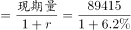。定位柱状图可得，2019年和2018年我国海洋第三产业增加值占海洋生产总值的比重分别为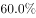和。

方法一：根据公式“部分量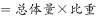”，则2019年和2018年我国海洋第三产业增加值分别为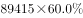、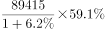。根据公式“增长率”，则2019年我国海洋第三产业增加值同比增长：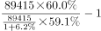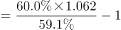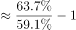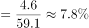。

方法二：根据公式“基期比重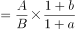”，其中基期比重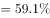，现期比重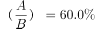，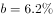，代入可得：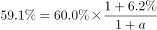，则：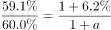，解得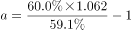。

故正确答案为C。

### 给定材料

