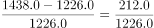
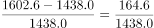
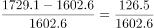
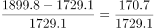
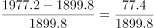
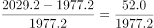
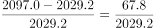

# 逐年同比增速计算与超阈值年份计数

考点：[[20-考点/资料分析/增长/逐年同比增速计算与超阈值年份计数|增长 / 逐年同比增速计算与超阈值年份计数]]
材料：[[15-材料/资料分析/270538 2011～2018年全国7个地区（华|270538 2011～2018年全国7个地区（华]]

**问法模型**：题干问'某区间内同比增速超过（阈值）的年份有多少个'→逐年计算（本年末-上年末）/上年末，与阈值逐一比对后计数

## 推理链
1. 第1步：定位表格第三行，东北地区2011～2018年末累计装机容量依次为1226.0、1438.0、1602.6、1729.1、1899.8、1977.2、2029.2、2097.0万千瓦，2012～2018年逐年同比的上年基期值齐全
2. 第2步：公式：同比增速=（本年末值-上年末值）/上年末值，共需计算7个增长率
3. 第3步：逐年代入：2012年212/1226≈17.3%；2013年164.6/1438≈11.4%；2014年126.5/1602.6≈7.9%；2015年170.7/1729.1≈9.9%；2016年77.4/1899.8≈4.1%；2017年52.0/1977.2≈2.6%；2018年67.8/2029.2≈3.3%
4. 第4步：按官方解析比对，2012年、2013年两年符合阈值，2014～2018年共5年不符合（由官方判定反推，阈值位于约9.9%与11.4%之间，即10%附近口径）
5. 第5步：符合的年份共2个，对照选项A为2，故选A

**最快解法**：⚡ 截位直除+先粗筛后精算：先排除明显不达标的年份——2016～2018年增量仅77.4、52.0、67.8万千瓦，相对约1900～2000的基期增速仅2.6%～4.1%，直接排除；2014年126.5/1602.6≈7.9%、2015年170.7/1729.1≈9.9%，用首位/前两位截位即可判定不达标；只需精算2012年212/1226≈17.3%和2013年164.6/1438≈11.4%确认达标，符合2年，选A

## 易错点
- ⚠ 题干'同比增速超过'后的比较基准被截断，考场上必须以完整试卷的完整表述为准，不得自行补造阈值；本题官方判定符合的仅为2012、2013两年
- ⚠ 时间范围为2012～2018年（7个年份），2011年是基期不参与计数；每一年做差须用其上一年的年末值作分母，勿统一用2011年的1226.0作分母
- ⚠ 2015年增速≈9.9%贴近10%分界，粗算易误判为达标；2016～2018年累计装机仍在增长（存量增、增速低），勿因'数值仍在变大'而误计入

## 母题抽象
> 🧩 当题干出现'某区间内同比增速超过某阈值的年份有几个'时，锁定该指标一行逐年数据，用（本年-上年）/上年逐年求增速，先用增量与基期的粗比筛掉明显不达标年份，只精算临界年份，再数出符合个数

**同类特征**：同比增速超过…的年份、逐年计数型问法、单一地区一行数据（东北）、2012～2018年区间、年末累计装机容量（存量时点口径）、选项为个数（2/3/4/5）

## 相关题
（暂无）

---

### 题干

2012～2018年间，东北地区风力发电年末累计装机容量同比增速超过的年份有多少个？

### 选项
- A. 2　✅
- B. 3
- C. 4
- D. 5

### 官方解析

根据题干“······同比增速超过的年份有多少个”，可判定本题为一般增长率问题。定位表格材料第三行，可得2011～2018年东北地区风力发电年末累计装机容量，根据公式：增长率，则2012～2018年东北地区风力发电年末累计装机容量同比增速分别为：

2012年：，符合；

2013年：，符合；

2014年：，不符合；

2015年：，不符合；

2016年：，不符合；

2017年：，不符合；

2018年：，不符合。

因此符合的有2012年、2013年这两个年份。

故正确答案为A。

### 给定材料

> [!warning] 疑点（官方解析可能有误，待人工复核）
> 题干'同比增速超过'后缺比较基准（原文截断）；据官方答案（仅2012、2013符合），阈值应介于2015年增速约9.9%与2013年增速约11.4%之间（常见原题为10%），标注与使用时应以完整试卷该题的完整表述及选项为准

<!-- CODEX-ANSWER-REVIEW:BEGIN -->
### 本次独立复核

**复核状态：** `resolved`（答案与解析已核定）

**计分答案：** A（可计分）

**复核解析：**

公式图所示阈值为10%。东北风力发电年末累计装机容量同比增速中，2012年约17.3%、2013年约11.4%，其余所列年份未超过10%；合计2年，选A。

**相关信息：**

统计“超过”阈值时应严格大于；累计装机容量增速应按相邻年末容量计算。

**题源依据：** [固定版本原题](https://github.com/Mentat-Uran/kaogongzhentizhengliu/blob/84ab93d4b64b61d897bece8a1c0a5bab06b4feb2/10-%E7%9C%9F%E9%A2%98/%E8%B5%84%E6%96%99%E5%88%86%E6%9E%90/%E5%A2%9E%E9%95%BF/2742286%20%E9%80%90%E5%B9%B4%E5%90%8C%E6%AF%94%E5%A2%9E%E9%80%9F%E8%AE%A1%E7%AE%97%E4%B8%8E%E8%B6%85%E9%98%88%E5%80%BC%E5%B9%B4%E4%BB%BD%E8%AE%A1%E6%95%B0.md)；固定内容 commit `84ab93d4b64b61d897bece8a1c0a5bab06b4feb2`，Markdown blob `b7bcb79047ef6f9a5d63da1df650a4eeafc81c10`。
<!-- CODEX-ANSWER-REVIEW:END -->
