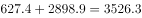
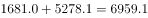
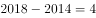
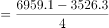
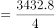
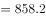

# 年均增长量计算

考点：[[20-考点/资料分析/增长/年均增长量计算|增长 / 年均增长量计算]]
材料：[[15-材料/资料分析/270538 2011～2018年全国7个地区（华|270538 2011～2018年全国7个地区（华]]

**问法模型**：题干出现'2014年末～2018年末……年均增长'且选项为带'万千瓦'单位的区间 → 判定求年均增长量=（末期值-基期值）÷年份差n=4

## 推理链
1. 第1步：材料表中无'西部'行，需自行合并：2014年末西南627.4、西北2898.9万千瓦；2018年末西南1681.0、西北5278.1万千瓦
2. 第2步：加总得基期与末期：2014年末西部=627.4+2898.9=3526.3万千瓦；2018年末西部=1681.0+5278.1=6959.1万千瓦
3. 第3步：公式为年均增长量=（末期-基期）/n，2014年末到2018年末共8-4=4个间隔，n=4（勿误用5）
4. 第4步：代入计算：（6959.1-3526.3）/4=3432.8/4=858.2万千瓦
5. 第5步：与选项对照：858.2落在850～900万千瓦区间，对应C项

**最快解法**：⚡ 截位加总+年均增长量公式：两期各自两行相加（2014年末约627+2899≈3526，2018年末约1681+5278≈6959），作差约3433再÷4≈858，直接锁定C区间，无需保留小数

## 易错点
- ⚠ 年份差错算为5年（2014～2018间隔实为n=4），或基期错取2013年末，会把858.2误算为约686.6而误选B
- ⚠ 材料无'西部'合并行，漏加西南一行（只算西北约（5278.1-2898.9）/4≈594.6，误选A）或漏加西北一行，导致结果严重偏小
- ⚠ 混淆年均增长量与年均增长率：本题选项为带'万千瓦'单位的区间，应求增长量作差除以n，而非开4次方求增速

## 母题抽象
> 🧩 当题干出现'某年末～某年末……年均增长'且选项为带单位区间时，先按单位判定求增长量，将无现成合计行的部分自行加总，再用（末期-基期）/n（n=末年-基年，即年份差为间隔数4）验证落在哪个区间

**同类特征**：2014年末～2018年末、西部地区（含西南和西北）、年均增长、选项为带万千瓦单位的区间、需自行合并两行数据、存量累计值口径

## 相关题
- [[10-真题/资料分析/增长/15419190 年均增长量计算|15419190]]（湖北 2025，相关度3）
- [[10-真题/资料分析/增长/2374711 年均增长量计算|2374711]]（广东 2019，相关度2）
- [[10-真题/资料分析/增长/2742310 年均增长量计算|2742310]]（北京 2021，相关度2）
- [[10-真题/资料分析/增长/12881983 年均增长量计算|12881983]]（广东 2025，相关度2）
- [[10-真题/资料分析/增长/13319337 年均增长量计算|13319337]]（江苏 2025，相关度2）

---

### 题干
2014年末～2018年末，西部地区（含西南和西北）风力发电累计装机容量年均增长：

### 选项
- A. 不到800万千瓦
- B. 在800～850万千瓦之间
- C. 在850～900万千瓦之间　✅
- D. 超过900万千瓦

### 官方解析

根据题干“2014～2018年末······年均增长”，结合选项有具体单位，可判定本题为年均增长量问题。定位表格材料倒数两行，可得2014年末西部地区（含西南和西北）风力发电累计装机容量为万千瓦，2018年末西部地区（含西南和西北）风力发电累计装机容量为万千瓦。根据公式：年均增长量，年份差为。则2014年末～2018年末，西部地区（含西南和西北）风力发电累计装机容量年均增长量万千瓦。

故正确答案为C。

### 给定材料

> [!warning] 疑点（官方解析可能有误，待人工复核）
> 官方解析正文数值缺失（'装机容量为万千瓦'处基期/末期数字及年份差、最终结果均为空白），但按本表数据计算（6959.1-3526.3）/4=858.2万千瓦，落在850～900区间，与官方答案C一致，不影响结论

<!-- CODEX-ANSWER-REVIEW:BEGIN -->
### 本次独立复核

**复核状态：** `resolved`（答案与解析已核定）

**计分答案：** C（可计分）

**复核解析：**

西部风电累计装机：2014年末627.4+2898.9=3526.3万千瓦；2018年末1681.0+5278.1=6959.1万千瓦；四年年均增加(6959.1−3526.3)/4≈858.2万千瓦，C。

**相关信息：**

增长量=现期×增长率/(1+增长率)；年均增长量除以年份差；年均增长率在年份间隔相同情况下可比较末值/基期值。

**题源依据：** [固定版本原题](https://github.com/Mentat-Uran/kaogongzhentizhengliu/blob/84ab93d4b64b61d897bece8a1c0a5bab06b4feb2/10-%E7%9C%9F%E9%A2%98/%E8%B5%84%E6%96%99%E5%88%86%E6%9E%90/%E5%A2%9E%E9%95%BF/2742290%20%E5%B9%B4%E5%9D%87%E5%A2%9E%E9%95%BF%E9%87%8F%E8%AE%A1%E7%AE%97.md)；固定内容 commit `84ab93d4b64b61d897bece8a1c0a5bab06b4feb2`，Markdown blob `024e6e7c4c0b61c5366da468afdfec1598d0aebd`。
<!-- CODEX-ANSWER-REVIEW:END -->
