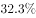
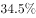
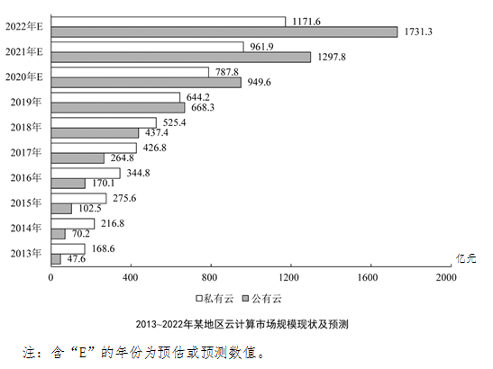

# 整体同比增长率计算（整体=私有云+公有云加总后求增速）

考点：[[20-考点/资料分析/增长/整体同比增长率计算（整体=私有云+公有云加总后求增速）|增长 / 整体同比增长率计算（整体=私有云+公有云加总后求增速）]]
材料：[[15-材料/资料分析/270539 2013-2022年某地区云计算市场|270539 2013-2022年某地区云计算市场]]

**问法模型**：题干问'2022年整体规模同比增长'且整体量未直接给出 → 先将私有云与公有云加总得现期与基期，再用'增长率=现期/基期-1'计算

## 推理链
1. 第1步：由条形图读数：2022E私有云1171.6亿元、公有云1731.3亿元；2021E私有云961.9亿元、公有云1297.8亿元（带E均为预测值）
2. 第2步：整体规模=私有云+公有云；同比增长率=现期/基期-1
3. 第3步：2022E整体=1171.6+1731.3=2902.9亿元；2021E整体=961.9+1297.8=2259.7亿元
4. 第4步：增长率=2902.9/2259.7-1=643.2/2259.7≈28.5%
5. 第5步：与选项对照，28.5%与B项最接近，故选B

**最快解法**：⚡ 截位直除：先加总得增量643.2、基期2259.7，将643.2/2259.7截位为643/2260，首位商2得28%+，2260×28.5%≈644吻合，即约28.5%，直选B

## 易错点
- ⚠ 整体规模图中未直接给出，必须把私有云与公有云两根条形相加，只取公有云（1731.3/1297.8）或私有云单边计算必错
- ⚠ 643.2亿元只是增长量，选项为百分数，需再除以基期2259.7，勿把增长量与增长率混淆
- ⚠ 读数时须对照图例区分白色(私有云)与灰色(公有云)，且2021E、2022E两组相邻条形数值大、间距近，抄错一位即失算；两年均为预测值(E)，口径一致，基期不取实际值年份

## 母题抽象
> 🧩 当题干出现'整体(合计)规模同比增长'而材料只给分项数据时，先'分项加总'得现期与基期，再用(现期-基期)/基期截位直除，对照百分数选项验证

**同类特征**：根据预测、2022年、整体市场规模、同比增长、整体=私有云+公有云需跨条形加总、选项为百分数

## 相关题
- [[10-真题/资料分析/其他/2742291 简单加总·部分求整体（整体=私有云+公有云）|2742291]]（北京 2021，相关度2）
- [[10-真题/资料分析/增长/5509648 同比增长率计算（柱状图直接给基期、现期）|5509648]]（吉林 2023，相关度2）
- [[10-真题/资料分析/增长/9629 一般增长率计算（现期需由增量倒推）|9629]]（安徽 2009，相关度1）
- [[10-真题/资料分析/比重/2604234 现期比重计算|2604234]]（广东 2020，相关度1）
- [[10-真题/资料分析/增长/27835 一般增长率计算（已知现期量与增长量求增长率）|27835]]（河北 2012，相关度1）

---

### 题干
根据预测，2022年该地区云计算市场整体规模同比增长：

### 选项
- A. 

- B. 

　✅
- C. 

- D. 

### 官方解析
根据题干“2022年······同比增长”，结合选项为百分数，可判定本题为一般增长率计算问题。定位条形图可得： 2022年该地区云计算市场整体规模预测数值为亿元，2021年该地区云计算市场整体规模预测数值为亿元，则2022年该地区云计算市场整体规模同比增长率，与B项最为接近。
故正确答案为B。

### 给定材料

