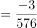
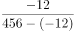

# 增长率比较（降幅-负增长率比较）

考点：[[20-考点/资料分析/增长/增长率比较（降幅-负增长率比较）|增长 / 增长率比较（降幅/负增长率比较）]]
材料：[[15-材料/资料分析/272114 某年8月份（含1—8月累计）我国能源|272114 某年8月份（含1—8月累计）我国能源]]

**问法模型**：题干问'较7月底降幅最大和最小的分别是'→ 将'降幅'视为负增长率，用 降幅=下降额÷基期量=下降额÷(现期+下降额) 分别求三档煤价降幅后比较大小

## 推理链
1. 第1步：从材料第一部分第四段提取数据：8月底5500大卡573元/吨比7月底下降3元、5000大卡510元/吨下降17元、4500大卡456元/吨下降12元
2. 第2步：所用公式为降幅（率）=下降额÷基期量，其中基期量（7月底价格）=现期量+下降额
3. 第3步：代入计算：5500大卡降幅=3/(573+3)=3/576≈0.52%；5000大卡降幅=17/(510+17)=17/527≈3.2%；4500大卡降幅=12/(456+12)=12/468≈2.6%
4. 第4步：比较三个降幅：3.2%（5000大卡）>2.6%（4500大卡）>0.52%（5500大卡），故降幅最大为5000大卡、最小为5500大卡
5. 第5步：与选项对照，'5000大卡煤炭和5500大卡煤炭'对应D项

**最快解法**：⚡ 截位直除+数量级观察：三个降幅的首位商直接定序——17/527首位商3、12/468首位商2、3/576首位商0.5，秒得最大5000大卡、最小5500大卡；辅助验证：三档基期量相近（468~576），下降额3<12<17的排序与降幅率排序一致，可先比下降额再抽查验证

## 易错点
- ⚠ 把'降幅'误当作8月底现期价格高低（573/510/456）来比较，或误以为比的是价格水平而非下降幅度
- ⚠ 分母口径错误：基期量应为7月底价格=现期+下降额（如576、527、468），若直接用8月底现期作分母虽本题排序不变但口径错误
- ⚠ 时间口径混淆：本题是8月底对比7月底的环比变化，材料中所有同比增速均留空，切勿去找同比数据；另注意5500/5000/4500大卡三档是不同煤种，不能混算

## 母题抽象
> 🧩 当题干出现'某价格/量较上期降幅最大（最小）'时，把降幅当作负增长率，用 降幅=下降额÷(现期+下降额) 逐项计算比较；若各基期量相近，可直接比下降额快速锁定再验证

**同类特征**：降幅最大/最小、8月底较7月底、秦皇岛煤炭综合交易价格、5500/5000/4500大卡三档、下降N元、负增长率比较

## 相关题
（暂无）

---

### 题干
本年度8月底，秦皇岛煤炭综合交易价格较7月底降幅最大的和最小的分别是：

### 选项
- A. 5500大卡煤炭和5000大卡煤炭
- B. 5000大卡煤炭和4500大卡煤炭
- C. 4500大卡煤炭和5500大卡煤炭
- D. 5000大卡煤炭和5500大卡煤炭　✅

### 官方解析

根据题干“······降幅最大的和最小的······”，可判定本题为一般增长率比较问题。定位文字材料第一部分第四段可知：8月底，秦皇岛5500大卡煤炭综合交易价格为573元/吨，比7月底下降3元；5000大卡煤炭价格为510元/吨，比7月底下降17元；4500大卡煤炭价格为456元/吨，比7月底下降12元。根据增长率，8月底，秦皇岛5500大卡煤炭综合交易价格较7月底的增长率为；5000大卡煤炭价格较7月底的增长率为；4500大卡煤炭价格较7月底的增长率为。比较可知8月底，秦皇岛煤炭综合交易价格环比降幅最大的是5000大卡煤炭，最小的是5500大卡煤炭。

故正确答案为D。

### 给定材料

8月份，规模以上工业原煤生产增速回升，煤炭进口保持较高水平；原油生产增速由负转正，进口继续增加；天然气生产保持较快增长，进口持续高速增长；电力生产加快。

一、原煤生产增速回升，煤炭进口保持较高水平，市场价格小幅波动

8月份，原煤产量3.0亿吨，同比增长，上月为下降；日均产量957万吨，环比增加49万吨。1—8月份，原煤产量22.8亿吨，同比增长。

8月份，煤炭主产区生产均开始回升。其中，内蒙古同比增长，上月为下降；山西同比下降，降幅较上月收窄2.2个百分点；陕西同比增长，增速较上月加快7.6个百分点；新疆同比增长，上月为下降。

8月份，煤炭进口2868万吨，比上月略降33万吨，但仍保持较高水平，同比增长。1—8月份，煤炭进口2.0亿吨，同比增长。

8月底，秦皇岛5500大卡煤炭综合交易价格为573元/吨，比7月底下降3元；5000大卡煤炭价格为510元/吨，比7月底下降17元；4500大卡煤炭价格为456元/吨，比7月底下降12元。

二、原油生产增速由负转正，进口持续增加

8月份，原油生产1600万吨，同比增长，上月为下降，为2015年11月以来首次正增长；日均产量51.6万吨，环比增加0.5万吨。1—8月份，原油产量12595万吨，同比下降。

原油进口持续增加，8月份进口原油3838万吨，比上月增加236万吨，同比增长。1—8月份，进口原油29919万吨，同比增长。

国际原油价格震荡上行，截至8月底，布伦特原油现货离岸价格为76.94美元/桶，比7月底上涨2.78美元/桶。

三、原油加工量增速有所放缓

8月份，原油加工量5031万吨，同比增长，增速比上月回落6.0个百分点；日均加工162.3万吨，环比减少1.4万吨。1—8月，原油加工量40041万吨，同比增长。

四、天然气生产保持较快增长，进口持续高速增长

8月份，天然气产量129亿立方米，同比增长，增速比上月回落0.8个百分点；日均生产4.2亿立方米，与上月基本持平。1—8月份，天然气产量1040亿立方米，同比增长。

天然气进口持续高速增长。8月份，进口天然气777万吨（1吨约为1380立方米），比上月增加39万吨，同比增长。1—8月份，进口天然气5718万吨，同比增长。

五、电力生产加快

8月份，发电量6404.9亿千瓦时，同比增长，增速比上月加快1.6个百分点；日均发电206.6亿千瓦时，再创新高。1—8月份，发电量同比增长，比去年同期加快1.2个百分点。

8月份，除风电外，其他品种电力生产同比增速较7月份均有所加快。其中火电同比增长，比上月加快1.7个百分点；水电增长，加快5.5个百分点；核电增长，加快2.7个百分点；太阳能发电增长，加快1.3个百分点。

因台风、降雨等气候因素影响，8月份风电大幅减少，增速比上月回落24.1个百分点，同比增长。

