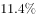
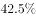

# 一般增长率计算（已知现期量与增长量求增长率）

考点：[[20-考点/资料分析/增长/一般增长率计算（已知现期量与增长量求增长率）|增长 / 一般增长率计算（已知现期量与增长量求增长率）]]

**问法模型**：题干'2011年……比上年增长多少'且选项为百分数 → 用'增长率=增长量÷基期量'模型直接求解

## 推理链
1. 第1步：从材料第一段提取条件：2011年全国农村居民人均纯收入6977元（现期量），比上年增加1058元（增长量）
2. 第2步：确定公式：增长率=增长量÷基期量，其中基期量=现期量−增长量=6977−1058
3. 第3步：代入计算：基期量=6977−1058=5919元，增长率=1058÷5919≈17.87%≈17.9%
4. 第4步：与选项对照：17.9%对应A项，故正确答案为A

**最快解法**：⚡ 截位直除：先求基期6977−1058=5919，再算1058÷5919；由于5919×18%≈1065略大于1058，故结果略低于18%，约为17.9%，直接锁定A（可截位为1058/5920≈1060/5920速算验证）

## 易错点
- ⚠ 误用现期量作分母：1058÷6977≈15.2%，会错选D，增长率分母必须是基期量5919
- ⚠ 把'比上年增加1058元'误当作基期收入或忽略该条件，导致无法正确列式
- ⚠ 混淆名义增速与材料中'剔除价格因素'后的实际增速口径，实际增速数值更小，不用于本题作答

## 母题抽象
> 🧩 当题干出现'现期值+比上年增加X元+求比上年增长百分之几'特征时，用 增长率=增长量÷(现期−增长量)，验证 分母必须是基期量且结果与选项量级一致

**同类特征**：比上年增长多少、人均纯收入、已知'比上年增加'的数值、现期值直接给出、选项为百分数

## 相关题
- [[10-真题/资料分析/增长/9629 一般增长率计算（现期需由增量倒推）|9629]]（安徽 2009，相关度1）
- [[10-真题/资料分析/比重/2604234 现期比重计算|2604234]]（广东 2020，相关度1）
- [[10-真题/资料分析/平均数/10204497 平均数增长率（均价=值-量的比值增长率）|10204497]]（海南 2024，相关度1）
- [[10-真题/资料分析/增长/12536395 隔年（间隔）增长率|12536395]]（四川 2024，相关度1）
- [[10-真题/资料分析/增长/1758938 已知增长量与现期求增长率|1758938]]（上海 2016，相关度1）

---

### 题干
2011年全国农村居民人均纯收入比上年增长多少：

### 选项
- A. 
17.9%
　✅
- B. 
17.8%

- C. 
15.7%

- D. 
15.2%

### 官方解析

根据题干“2011年······比上年增长多少”，结合选项为百分数，可判定本题为一般增长率问题。定位材料第一段可得：“2011年全国农村居民人均纯收入6977元，比上年增加1058元。根据公式：增长率，则2011年全国农村居民人均纯收入比上年增长了。

故正确答案为A。

### 给定材料

根据下面提供的信息完成各题。

        国家统计局公布的《2011年城乡居民收入增长情况》称，通过对全国31个省(自治区、直辖市)7.4万户农村居民家庭和6.6万户城镇居民家庭进行抽样调查，2011年全国农村居民人均纯收入6977元，比上年增加1058元。剔除价格因素影响，实际增长，增速同比提高0.5个百分点。其中：人均工资性收入2963元，同比增长。

        人均家庭经营第一产业纯收入2520元，增加289元，增长；人均家庭经营二三产业纯收入702元，增加101元，增长；人均转移性收入563元，增加110元，增长。

        工资性收入对全年农村居民增收的贡献率达。工资性收入占农村居民纯收入的比重达，同比提高1.4个百分点。工资性收入快速增长主要是由于农民工工资水平上涨较多。人均农业纯收入1897元，增加173元，增长。收成好、价格高是农业收入保持较快增长的主要原因。2011年农村居民出售农产品增加的收入中，六成来自于价格上涨因素，四成来自于出售数量增加因素。

