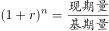
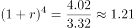
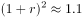
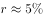

# 年均增长率计算

考点：[[20-考点/资料分析/增长/年均增长率计算|增长 / 年均增长率计算]]
材料：[[15-材料/资料分析/277850 疫情背景下2020年全国及G省社会消|277850 疫情背景下2020年全国及G省社会消]]

**问法模型**：题干出现'2016年-2020年……年均增长率约为'→ 用年均增长率公式 r=(现期/基期)^(1/n)-1，n=末年-首年=4，代入图中柱值求解。

## 推理链
1. 第1步：题干'2016年-2020年……年均增长率约为'判定为年均增长率问题；定位统计图蓝柱（左轴，单位万亿元）读出G省社零总额：2016年为3.32万亿元，2020年为4.02万亿元
2. 第2步：确定基期与年份差：基期取2016年值3.32万亿元（不是2015年，材料无2015年数据），现期为2020年值4.02万亿元，n=2020-2016=4（不是数据个数5）；两项均取自图，单位口径一致，无图文换算需求
3. 第3步：代入年均增长率公式 (1+r)^4=4.02/3.32，计算总增幅 4.02/3.32≈1.211，即四年累计增长约21.1%
4. 第4步：幂值验证：1.05^4≈1.216略大于1.211，微调至1.049^4≈1.211恰与目标吻合，故 r≈4.9%，约为5%
5. 第5步：对照选项，B项数值约为5%，与计算结果一致，故正确答案为B

**最快解法**：⚡ 公式法+幂值代入验证：n=4，(1+r)^4=4.02/3.32≈1.211；熟记常用幂值1.05^4≈1.2155、1.1^2≈1.21，试1.05偏大、微调至1.049得r≈4.9%≈5%，直接锁定B；粗估可用总增幅21.1%÷4≈5.3%再取略小值。

## 易错点
- ⚠ 年份差陷阱：n=末年-首年=2020-2016=4，若误把2016-2020共5个年份数据当n=5，开5次方会使结果明显偏小
- ⚠ 单位量级陷阱：图中为万亿元、文字段为亿元（40207亿元），本题两年数据同取自图无需换算；若与文字数据混拼必须先统一量级（4.02万亿元=40207亿元）
- ⚠ 混淆手段：不能用图中各年同比增速（10.2%、10.0%、8.8%、8.0%、-6.4%）的算术平均代替年均增长率，尤其2020年-6.4%为负值（右轴读数），直接平均必错

## 母题抽象
> 🧩 当题干出现'某年-某年……年均增长率约为'特征时，用 r=(现期/基期)^(1/n)-1（n=末年-首年），先算总增幅，再以1.05^4≈1.216、1.10^2≈1.21等幂值代入验证，选最接近的选项。

**同类特征**：2016年-2020年、年均增长率约为、G省社会消费品零售总额、统计图柱值取数、基期2016年、年份差n=4

## 相关题
- [[10-真题/资料分析/增长/2385115 年均增长率计算|2385115]]（深圳市考 2019，相关度2）
- [[10-真题/资料分析/增长/2444068 年均增长率计算|2444068]]（江西 2019，相关度2）
- [[10-真题/资料分析/综合/5514932 综合分析（年均增长率+部分=整体×比重+比重变化比较，四选项逐项验证）|5514932]]（广东 2023，相关度1）
- [[10-真题/资料分析/增长/2049374 年均增长率（基期需自算，n=5次方）|2049374]]（河南 2017，相关度1）
- [[10-真题/资料分析/增长/4673145 年均增长率|4673145]]（广东 2022，相关度1）

---

### 题干
2016年-2020年，G省社会消费品零售总额年均增长率约为（    ）。

### 选项
- A. 

- B. 

　✅
- C. 

- D. 

### 官方解析

根据题干“2016年-2020年，······年均增长率约为”，可判定本题为年均增长率问题。定位图形材料可得：2016年G省社会消费品零售总额为3.32万亿元，2020年为4.02万亿元。根据年均增长率计算公式：，可得，即，解得。

故正确答案为B。

### 给定材料

        受疫情影响，2020年全国社会消费品零售总额391981亿元，同比下降，居家消费需求明显增长，“宅经济”带动新型消费模式加快发展。2020年，全国网上零售额比上年增长，增速比前三季度加快1.2个百分点。其中实物商品网上零售额增长，占社会消费品零售总额的比重为。在线上消费快速增长带动下，全年快递业务量超过830亿件，比上年增长超过。

        G省消费市场受新冠肺炎疫情冲击更为明显，2020年全省社会消费品零售总额40207亿元，同比下降。一季度，消费市场受疫情明显冲击，市场销售大幅下降。随着疫情防控形势不断好转及多项政策措施持续显效。市场主体加快复商复产，居民消费需求稳步释放。二季度市场销售降幅较一季度收窄10个百分点，三季度消费品零售总额与去年同期基本持平。四季度，社会消费品零售总额同比增长，整体回升态势明显。

        其中，G省城镇消费品零售额35904亿元，同比下降；农村消费品零售额4303亿元，同比下降。2020年12月城镇消费品零售额3480亿元，同比增长；农村消费品零售额436亿元，同比增长，消费情况明显回暖。 

