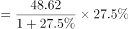
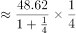
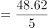
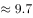

# 增长量计算（已知现期与同比增速）

考点：[[20-考点/资料分析/增长/增长量计算（已知现期与同比增速）|增长 / 增长量计算（已知现期与同比增速）]]
材料：[[15-材料/资料分析/277849 2020年前三季度G省智能机器人产业|277849 2020年前三季度G省智能机器人产业]]

**问法模型**：题干出现'××营业收入同比增长约（ ）亿元'→ 采用增长量模型：增长量=现期×r/(1+r)

## 推理链
1. 第1步：题干要求'工业机器人制造业营业收入同比增长约（ ）亿元'，单位为亿元，判定为增长量计算问题
2. 第2步：定位表2，工业机器人制造业营业收入现期为48.62亿元，同比增速为27.5%（注意表1同行业产值为76.88、增速57.4%，不可混用）
3. 第3步：使用公式：增长量=现期×r/(1+r)，即先反推基期=现期÷(1+r)，不能直接用现期×r
4. 第4步：代入计算：48.62×27.5%/127.5%≈48.62×0.2157≈10.5亿元
5. 第5步：与选项对照：10.5与B项10最接近；若误用48.62×27.5%≈13.4则会偏向C项15，验证须带(1+r)分母
6. 第6步：确定正确答案为B（约10亿元）

**最快解法**：⚡ 百化分速算：27.5%≈1/3.6，则增长量≈现期/(1+n)=48.62/4.6≈10.6，秒选B；或27.5%=11/40，增长量=48.62×11/51≈10.5

## 易错点
- ⚠ 误用现期×r：48.62×27.5%≈13.4，会误选C（15）；正确必须乘r/(1+r)，即再÷1.275
- ⚠ 跨表口径混用：表1工业机器人制造业总产值为76.88亿元（增速57.4%），表2营业收入为48.62亿元（增速27.5%），本题问营业收入必须用表2数据
- ⚠ 题型误判：问'增长约（ ）亿元'是增长量而非增长率，勿算成百分比；且文字段中该行业营收增速并未直接给出，只能取表2的27.5%

## 母题抽象
> 🧩 当题干出现'××同比增长约（ ）亿元/增长量为多少'特征时，用增长量公式现期×r/(1+r)（百化分r≈1/n时增长量≈现期/(1+n)），验证与选项最接近者即为答案

**同类特征**：同比增长约（ ）亿元、营业收入、单一行业、表2效益数据、增长量计算、增速为百分数求绝对量

## 相关题
- [[10-真题/资料分析/增长/2031170 增长量计算（已知现期与同比增速）|2031170]]（北京 2017，相关度3）
- [[10-真题/资料分析/增长/5509770 增长量计算（已知现期与同比增速）|5509770]]（四川 2023，相关度3）
- [[10-真题/资料分析/增长/13319351 增长量计算（已知现期与同比增速）|13319351]]（江苏 2025，相关度2）
- [[10-真题/资料分析/增长/7159 增长量计算|7159]]（北京 2009，相关度1）
- [[10-真题/资料分析/增长/2571729 增长量计算——每增长1个百分点对应的增量（基期量×1%）|2571729]]（山东 2020，相关度1）

---

### 题干
2020年前三季度，G省工业机器人制造业营业收入同比增长约（    ）亿元。

### 选项
- A. 5
- B. 10　✅
- C. 15
- D. 20

### 官方解析

根据题干“2020年前三季度······同比增长约（    ）亿元”，可判定本题为增长量计算问题。定位表2，2020年前三季度，G省工业机器人制造业营业收入为48.62亿元，同比增长。由增长量，可得2020年前三季度，G省工业机器人制造业营业收入同比增长量亿元，与B项最为接近。

故正确答案为B。

### 给定材料

        智能机器人产业是G省战略性新兴产业之一。2020年前三季度，G省智能机器人产业纳入规模以上工业统计的法人单位共140家，完成总产值306.90亿元，占全部规模以上工业产值的，同比增长，增速高于全部规模以上工业产值32.8个百分点；前三季度平均用工人数3.12万人，同比增长。

        2020年前三季度，G省智能机器人产业实现营业收入326.62亿元，同比增长超，四大行业营业收入均实现正增长，经济效益好于全部规模以上工业企业。

