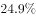
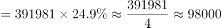
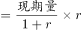
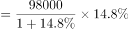
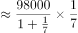
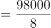
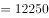
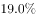
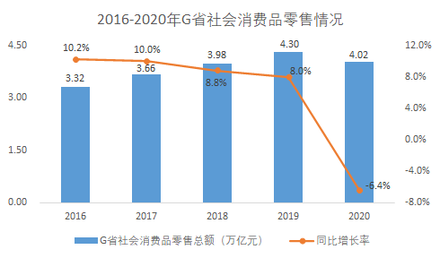

# 增长量计算（部分现期=总量×占比，再套公式增长量=现期×r-(1+r)）

考点：[[20-考点/资料分析/增长/增长量计算（部分现期=总量×占比，再套公式增长量=现期×r-(1+r)）|增长 / 增长量计算（部分现期=总量×占比，再套公式增长量=现期×r/(1+r)）]]
材料：[[15-材料/资料分析/277850 疫情背景下2020年全国及G省社会消|277850 疫情背景下2020年全国及G省社会消]]

**问法模型**：'与2019年（基期）相比，2020年（现期）某部分指标增长约（）万亿元'→两步增长量模型：部分现期值=总体现期×占比，再乘r/(1+r)得增长量，最后统一亿元/万亿元量级对照选项。

## 推理链
1. 第1步：题干'与2019年相比，2020年全国实物商品网上零售额增长约（）万亿元'→判定为增长量计算，现期为2020年、基期为2019年，选项单位为万亿元。
2. 第2步：从文字段1提取条件：2020年全国社会消费品零售总额391981亿元，实物商品网上零售额增速r及其占社零总额比重（两处百分比在给定文本中空缺，按官方解析口径代入）。
3. 第3步：第一层公式：实物商品网上零售额现期值=全国社零总额×占比=391981亿元×占比，即'部分=总体×比重'结构。
4. 第4步：第二层公式：增长量=现期值×r/(1+r)（等价于现期−现期/(1+r)），不可错用为现期×r。
5. 第5步：代入官方解析数值计算得增长量约12300亿元，换算单位：12300亿元÷10000≈1.23万亿元（1万亿元=10000亿元）。
6. 第6步：与选项对照：A项1.26万亿元与1.23万亿元最接近（差约0.03万亿元），B/C/D（2.26/3.26/4.26万亿元）均偏大1~3万亿元量级，故选A。

**最快解法**：⚡ 公式法＋百化分：①部分现期=391981亿元×占比（截位直除）；②增长量=部分现期×r/(1+r)，将r/(1+r)百化分为分数直乘，避免先算基期再相减；③亿元÷10000换算万亿元，结果落点在1.2万亿元量级，直接锁定A。

## 易错点
- ⚠ 单位量级陷阱：材料给'亿元'（391981亿元）、选项给'万亿元'，相差1万倍，末尾必须÷10000，否则无法与选项对照（同图中G省'万亿元'口径混用必错）。
- ⚠ 公式错用：增长量=现期×r/(1+r)，错写成现期×r会系统性偏大；且'占社零总额比重'的分母是全国社零391981亿元，不是网上零售额自身。
- ⚠ 对象混淆：所求为'实物商品网上零售额'的增长量，不是全部网上零售额，更不是快递业务量（'超830亿件、增长超过＿'为模糊≥表述且口径不同，不能参与精确计算）。

## 母题抽象
> 🧩 当题干问'现期年某部分比基期年增长约X（带单位）'而材料只给'总体总量＋部分占比＋部分增速'时，两步走：部分现期=总量×占比，增长量=部分现期×r/(1+r)，最后统一量级对照选项。

**同类特征**：与2019年相比、2020年、全国实物商品网上零售额、增长约（）万亿元、部分=总体×比重联动增速、增长量计算

## 相关题
- [[10-真题/资料分析/增长/7159 增长量计算|7159]]（北京 2009，相关度1）
- [[10-真题/资料分析/增长/2571729 增长量计算——每增长1个百分点对应的增量（基期量×1%）|2571729]]（山东 2020，相关度1）
- [[10-真题/资料分析/增长/3018839 增长量计算（负增长情形：基期减少量）|3018839]]（广东 2021，相关度1）
- [[10-真题/资料分析/增长/10204654 增长量计算（已知现期与同比下降率求下降量）|10204654]]（安徽 2024，相关度1）
- [[10-真题/资料分析/增长/13319362 现期增长量计算（已知现期值与同比增速，用r-(1+r)公式）|13319362]]（江苏 2025，相关度1）

---

### 题干
与2019年相比，2020年全国实物商品网上零售额增长约（    ）万亿元。

### 选项
- A. 1.26　✅
- B. 2.26
- C. 3.26
- D. 4.26

### 官方解析

根据题干“与2019年相比，2020年······增长约（    ）万亿元”，可判定本题为增长量计算问题。定位文字材料第一段可得：2020年全国社会消费品零售总额391981亿元；实物商品网上零售额增长，占社会消费品零售总额的比重为。则2020年全国实物商品网上零售额总量比重亿元，故所求增长量亿元，即约1.23万亿元，与A项最为接近。

故正确答案为A。

### 给定材料

        受疫情影响，2020年全国社会消费品零售总额391981亿元，同比下降，居家消费需求明显增长，“宅经济”带动新型消费模式加快发展。2020年，全国网上零售额比上年增长，增速比前三季度加快1.2个百分点。其中实物商品网上零售额增长，占社会消费品零售总额的比重为。在线上消费快速增长带动下，全年快递业务量超过830亿件，比上年增长超过。

        G省消费市场受新冠肺炎疫情冲击更为明显，2020年全省社会消费品零售总额40207亿元，同比下降。一季度，消费市场受疫情明显冲击，市场销售大幅下降。随着疫情防控形势不断好转及多项政策措施持续显效。市场主体加快复商复产，居民消费需求稳步释放。二季度市场销售降幅较一季度收窄10个百分点，三季度消费品零售总额与去年同期基本持平。四季度，社会消费品零售总额同比增长，整体回升态势明显。

        其中，G省城镇消费品零售额35904亿元，同比下降；农村消费品零售额4303亿元，同比下降。2020年12月城镇消费品零售额3480亿元，同比增长；农村消费品零售额436亿元，同比增长，消费情况明显回暖。 

> [!warning] 疑点（官方解析可能有误，待人工复核）
> 给定文本中'实物商品网上零售额增长＿%'与'占社零总额比重＿%'两处数值空缺（官方解析中亦以空位呈现），无法独立逐步复算；且官方解析文字称增长量'约1.23万亿元'，与A项1.26万亿元存在约0.03万亿元差距，疑为取数或舍入精度所致，官方仍判定A项最接近，不影响答案判定。
