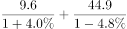
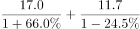
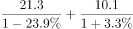
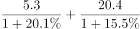

# 基期量比较（基期进出口总额=现期-(1+增速)分项反推后求和）

考点：[[20-考点/资料分析/增长/基期量比较（基期进出口总额=现期-(1+增速)分项反推后求和）|增长 / 基期量比较（基期进出口总额=现期/(1+增速)分项反推后求和）]]
材料：[[15-材料/资料分析/277851 2020年上半年我国农产品进出口情况|277851 2020年上半年我国农产品进出口情况]]

**问法模型**：题干出现'2019年上半年……进出口总额最高的是'→用基期量=现期量/(1+增速)分别反推各类别基期进口额与基期出口额，相加后比较大小

## 推理链
1. 第1步：题干问2019年上半年（基期）进出口总额最高的类别，从表格提取四类2020年上半年（现期）数据：食用蔬菜进口9.6/+4.0%、出口44.9/-4.8%；禽类17.0/+66.0%、11.7/-24.5%；饮料、酒及醋21.3/-23.9%、10.1/+3.3%；咖啡茶等5.3/+20.1%、20.4/+15.5%
2. 第2步：规则：基期量=现期量/(1+增长率)，增速为负时代入(1-|增速|)；进出口总额=基期进口额+基期出口额
3. 第3步：食用蔬菜：9.6/1.04+44.9/0.952≈9.2+47.2=56.4亿美元
4. 第4步：禽类产品：17.0/1.66+11.7/0.755≈10.2+15.5=25.7亿美元
5. 第5步：饮料、酒及醋：21.3/0.761+10.1/1.033≈28.0+9.8=37.8亿美元
6. 第6步：咖啡、茶、马黛茶及调味香料：5.3/1.201+20.4/1.155≈4.4+17.7=22.1亿美元
7. 第7步：比较56.4>37.8>25.7>22.1，食用蔬菜的基期进出口总额最高，与官方答案A一致

**最快解法**：⚡ 截位直除+提前锁定：先只算食用蔬菜的基期出口额44.9/0.952≈47.2亿美元，仅此一项已超过其余三个选项基期总额的上界（酒醋基期最多约28.0+9.8=37.8，禽类约25.7，咖啡茶约22.1），无需算完四类即可锁定A；常规做法是对四类各做两次'现期/(1±增速)'截位直除后加和比较

## 易错点
- ⚠ 负增长代入符号错误：蔬菜出口-4.8%、禽类出口-24.5%、酒醋进口-23.9%须除以(1-|增速|)，若误用(1+|增速|)会把酒醋基期进口算成21.3/1.239≈17.2，导致其总额被低估至约27亿、比较失真
- ⚠ 基期现期混淆：直接拿现期总额比较（蔬菜54.5、酒醋31.4、禽类28.7、咖啡茶25.7）；本题现期排序恰与基期一致（A仍最大）纯属巧合，但禽类/咖啡茶的基期排序变化说明必须反推，不能养成看现期的习惯
- ⚠ 只算单边就下结论：必须'基期进口+基期出口'两项相加，如酒醋靠基期进口28.0撑起总额37.8，漏算进口额会误判其排位

## 母题抽象
> 🧩 当题干出现'上年同期（基期）+两项之和的总量（如进出口总额）最高的类别'时，对每个候选类别用现期/(1+增速)（负增长用1−|增速|）分别反推两个分项的基期值再求和比较；可先用'最大分项的基期值是否已超过其余选项基期总额上界'实现提前排除

**同类特征**：2019年上半年（基期时间前置）、进出口总额最高的是、选项为统计表中的产品类别行、进口额、出口额及两个同比增速四列全用、基期量比较/大小排序、需分项反推再求和

## 相关题
（暂无）

---

### 题干
以下农产品类别中，2019年上半年我国进出口总额最高的是：

### 选项
- A. 食用蔬菜　✅
- B. 禽类产品
- C. 饮料、酒及醋
- D. 咖啡、茶、马黛茶及调味香料

### 官方解析

根据题干“2019年上半年······我国进出口总额最高的是”，结合材料已知2020年上半年相关数据，可判定本题为基期比较问题。定位表格材料可得：食用蔬菜，禽类产品，饮料、酒及醋，咖啡、茶、马黛茶及调味香料的进口额及同比增长率，出口额及同比增长率。根据进出口总额进口额出口额，基期量，可得2019年上半年我国下列农产品的进出口总额分别为：

食用蔬菜：亿美元；

禽类产品：亿美元；

饮料、酒及醋：亿美元；

咖啡、茶、马黛茶及调味香料：亿美元。

比较可知，2019年上半年我国进出口总额最高的农产品是食用蔬菜。

故正确答案为A。

### 给定材料

        2020年上半年，我国农产品进出口总额达1159.0亿美元。农产品进口额为807.5亿美元，同比增长。受新冠肺炎疫情影响，我国农产品出口额同比下降，为351.5亿美元。

        在我国的农产品进口中，除大洋洲农产品进口额同比下降1.9个百分点外，其余各大洲的农产品进口额均有所增加；欧洲国家或地区农产品进口额增幅最大，达。农产品出口中，对亚洲国家或地区的出口额最高，达229.7亿美元，较2019年同期下降了3.7个百分点。

随着我国居民饮食结构的调整，居民对肉类食品的需求量逐年增加。2020年上半年畜类产品进口额同比增长，对农产品进口额的增长贡献超7成。我国农产品出口最多的两大类别分别是食用蔬菜和水、海产品，合计出口额达93.6亿美元，占农产品出口总额的。 

