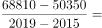
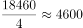
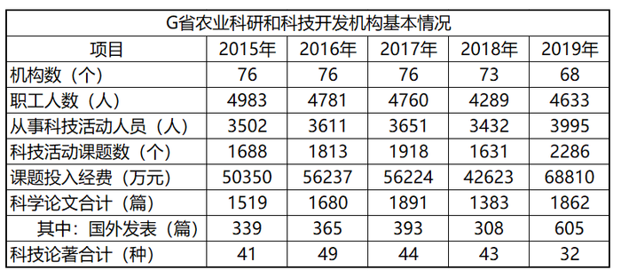

# 年均增长量计算

考点：[[20-考点/资料分析/增长/年均增长量计算|增长 / 年均增长量计算]]
材料：[[15-材料/资料分析/277880 G省农业科研和科技开发机构2015—|277880 G省农业科研和科技开发机构2015—]]

**问法模型**：题干出现'2015—2019年……平均每年增加……万元'→ 用年均增长量公式：年均增长量=（末期值−基期值）÷间隔年数（年份差，即4）

## 推理链
1. 第1步：从统计表'课题投入经费（万元）'一行提取首尾两年数据：2015年50350万元，2019年68810万元
2. 第2步：判定间隔年数：2015到2019年份差为2019−2015=4个间隔（虽然表内共5个年份数据，但只除4）
3. 第3步：套用公式：年均增长量=(68810−50350)÷4=18460÷4
4. 第4步：计算得18460÷4=4615万元（整除，无余数）
5. 第5步：与选项对照：A.3152、B.4615、C.5517、D.7890，4615与B项完全一致，故选B

**最快解法**：⚡ 公式法+首尾差直除：只看首尾两年（50350、68810），差18460直接÷4，口算4615秒选B；可用尾数验算：18460÷4尾数为5，锁定4615

## 易错点
- ⚠ 间隔年数陷阱：表内共5个年份（2015—2019），间隔只有4年，若除以5得3692（本题选项未设此干扰，但同类题常设）
- ⚠ 中途下降干扰：2017→2018经费由56224万元降至42623万元，若误逐段累加各年增长量或对下降段纠结即掉坑，年均增长量只需首尾差
- ⚠ 基期/指标错位：勿取2016年（56237）作基期，或误读成'科技活动课题数'等其他指标行；首尾年份取反会得负值

## 母题抽象
> 🧩 当题干出现'某年—某年……平均每年增加/增长……'特征时，用年均增长量公式（末期值−基期值）÷间隔年数（=年份差，即数据年份数减1），先锁定首尾两个数据再直除验证选项

**同类特征**：2015-2019年、平均每年增加、课题投入经费、万元、首尾差除以间隔、年均增长量

## 相关题
- [[10-真题/资料分析/增长/15419190 年均增长量计算|15419190]]（湖北 2025，相关度3）
- [[10-真题/资料分析/增长/2742310 年均增长量计算|2742310]]（北京 2021，相关度3）
- [[10-真题/资料分析/增长/12881983 年均增长量计算|12881983]]（广东 2025，相关度3）
- [[10-真题/资料分析/增长/13319337 年均增长量计算|13319337]]（江苏 2025，相关度3）
- [[10-真题/资料分析/增长/16070255 年均增长量计算|16070255]]（湖北 2026，相关度3）

---

### 题干
2015-2019年，G省农业科研和科技开发机构课题投入经费平均每年增加（    ）万元。

### 选项
- A. 3152
- B. 4615　✅
- C. 5517
- D. 7890

### 官方解析

根据题干“2015-2019年，G省······平均每年增加······万元”，可判定本题为年均增长量计算问题。定位表格材料可得：2015年课题投入经费50350万元，2019年课题投入经费68810万元。根据公式：年均增长量，则2015-2019年，课题投入经费平均每年增加万元，与B项最为接近。

故正确答案为B。

### 给定材料

        2019年G省共有农业科研和科技开发机构68个，职工人数4633人，其中1254人有高级职称，1148人有中级职称。全省共有农村科普示范基地554个、科普示范街道（乡镇）145个、科普示范社区（村）1341个。

