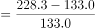
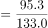

# 定基指数间的一般增长率计算

考点：[[20-考点/资料分析/增长/定基指数间的一般增长率计算|增长 / 定基指数间的一般增长率计算]]
材料：[[15-材料/资料分析/280092 中国创新指数情况：以2005年为基期|280092 中国创新指数情况：以2005年为基期]]

**问法模型**：题干'A年比B年约增长'+选项为百分数 → 增长率=(现期指数−基期指数)/基期指数，直接相除不换算

## 推理链
1. 第1步：题干锁定'中国创新指数'总指数行，问2019年比2010年约增长，选项为百分数，判定为一般增长率计算
2. 第2步：从表格'中国创新指数'行取数：2019年=228.3，2010年=133.0（均为以2005年=100的定基指数）
3. 第3步：套用增长率公式：增长率=(228.3−133.0)/133.0=95.3/133.0
4. 第4步：截位直除：95.3/133.0，首位商7，≈0.717，即约71.7%
5. 第5步：与选项对照，约71.7%对应B选项，故选B

**最快解法**：⚡ 截位直除：先心算差值228.3−133.0=95.3，再算95.3/133.0，首位商7、次位约1，直接锁定≈71.7%对应B，无需精算到小数点后多位

## 易错点
- ⚠ 误用'指数差=增长率'：228.3−133.0=95.3只是增长幅度（指数点差），必须再除以基期133.0才是增长率
- ⚠ 基期列错位：本题基期是2010年（133.0），不是表格默认基期2005年（100.0）；若误用2005年会错算成128.3%
- ⚠ 层级/同名陷阱：须逐字核对取'中国创新指数'总行，勿错取分类指数（如创新环境249.9）或明细指标行

## 母题抽象
> 🧩 当材料为'以某年为100'的定基指数、题干出现'A比B年约增长'时，直接用(后期指数−前期指数)/前期指数求增长率，两期指数可直接相除，无需开方、换算实际量或考虑中间缺失年份

**同类特征**：2019年比2010年、约增长、选项为百分数、中国创新指数（总指数）、定基指数表取两列、一般增长率

## 相关题
- [[10-真题/资料分析/增长/15419179 一般增长率计算（各分项加总求总量增长率）|15419179]]（湖北 2025，相关度2）
- [[10-真题/资料分析/增长/9629 一般增长率计算（现期需由增量倒推）|9629]]（安徽 2009，相关度1）
- [[10-真题/资料分析/比重/2604234 现期比重计算|2604234]]（广东 2020，相关度1）
- [[10-真题/资料分析/增长/27835 一般增长率计算（已知现期量与增长量求增长率）|27835]]（河北 2012，相关度1）
- [[10-真题/资料分析/平均数/10204497 平均数增长率（均价=值-量的比值增长率）|10204497]]（海南 2024，相关度1）

---

### 题干
2019年中国创新指数比2010年约增长：

### 选项
- A. 

- B. 

　✅
- C. 

- D. 

### 官方解析

根据题干“······约增长”，结合选项为百分数，可判定本题为一般增长率问题。定位表格材料可得：2019年中国创新指数为228.3，2010年为133.0。故2019年中国创新指数相对于2010年的增长率。

故正确答案为B。

### 给定材料

