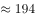

# 基期量计算（已知现期值与同比增长率）

考点：[[20-考点/资料分析/增长/基期量计算（已知现期值与同比增长率）|增长 / 基期量计算（已知现期值与同比增长率）]]
材料：[[15-材料/资料分析/280095 2019年第一季度131家证券公司经|280095 2019年第一季度131家证券公司经]]

**问法模型**：题干问'2018年第一季度……约为'（时间前移一年）而材料给的是2019年第一季度现期值+同比增速 → 用基期量=现期量/(1+增长率)一步直除

## 推理链
1. 第1步：题干时间是2018年第一季度（基期），材料现期为2019年第一季度，定位'代理买卖证券业务净收入（含席位租赁）221.49亿元，同比增长（约13.77%，原卷增速，文本中数值空缺）'
2. 第2步：本题特征为'已知现期值和同比增长率求基期'，套用公式：基期量=现期量/(1+r)=221.49/(1+13.77%)
3. 第3步：截位直除：221.49/1.1377≈194.69≈194.7亿元（若用1.14粗估得约194.3，同样落在C附近）
4. 第4步：与选项对照：194.7亿元即C项；B(190.1)与D(204.2)分别对应增长率约16.5%、8.5%，均与13.77%不符，排除后锁定C

**最快解法**：⚡ 截位直除+基期公式法：r≈13.77%，分母1+13.77%≈1.14，221.49/1.14≈194（首两位商'19'且余数判断落在194~195），直接锁定C. 194.7亿元，无需精算

## 易错点
- ⚠ 现期基期混淆：题干问的是2018年第一季度，若直接把221.49亿元当作答案或误乘/误除增速方向即错；D(204.2)对应把增速算反（除以1−13.77%附近方向错误）的陷阱
- ⚠ 增速数值空缺：所给材料文本'同比增长'后无数字，必须以原卷增速（约13.77%）代入，不可把'同比增长'误当增长量，也不可臆造增速
- ⚠ 口径张冠李戴：221.49亿元是营业收入1018.94亿元的构成项之一，勿与承销保荐66.73亿元、利息净收入69.04亿元或净利润440.16亿元等相邻数据混淆

## 母题抽象
> 🧩 当题干出现'上年同期/基期时间+某指标约为多少'且材料给出'现期值，同比增长r'时，用基期=现期/(1+r)截位直除，将结果与选项间距比对即可锁定答案

**同类特征**：2018年第一季度（基期时间前置）、代理买卖证券业务净收入（含席位租赁）、约为、现期值221.49亿元、同比增长率已知、基期量计算

## 相关题
- [[10-真题/资料分析/增长/12019697 基期量计算（现期累计值−当期新增值）|12019697]]（广东 2026，相关度1）
- [[10-真题/资料分析/平均数/13504655 日均发电量×当月天数求季度总量（平均数×天数=总数）|13504655]]（辽宁 2025，相关度1）
- [[10-真题/资料分析/增长/13504658 基期量计算|13504658]]（辽宁 2025，相关度1）
- [[10-真题/资料分析/平均数/19797282 现期平均数（年均生产总值=多个年度GDP算术平均）|19797282]]（山西 2024，相关度1）
- [[10-真题/资料分析/增长/2033794 基期量计算|2033794]]（江苏 2016，相关度1）

---

### 题干
2018年第一季度，131家证券公司代理买卖证券业务净收入（含席位租赁）约为：

### 选项
- A. 184.6亿元
- B. 190.1亿元
- C. 194.7亿元　✅
- D. 204.2亿元

### 官方解析

根据题干“2018年第一季度······代理买卖证券业务净收入（含席位租赁）约为”，结合材料时间为2019年第一季度，可判定本题为基期计算问题。定位文字材料第二段可得“代理买卖证券业务净收入（含席位租赁）221.49亿元，同比增长”。根据基期量，故2018年第一季度，131家证券公司代理买卖证券业务净收入（含席位租赁）亿元，与C项最接近。

故正确答案为C。

### 给定材料

        截至2019年3月31日，证券业协会对证券公司2019年第一季度经营数据进行了统计，131家证券公司当期实现营业收入1018.94亿元，同比增长。

        其中，各主营业务收入分别为代理买卖证券业务净收入（含席位租赁）221.49亿元，同比增长；证券承销与保荐业务净收入66.73亿元，同比增长；财务顾问业务净收入20.95亿元，同比增长；投资咨询业务净收入7.15亿元，同比增长；资产管理业务净收入57.33亿元，同比下降；证券投资收益（含公允价值变动）514.05亿元，同比增长；利息净收入69.04亿元，同比增长；当期实现净利润440.16亿元，同比增长；119家公司实现盈利，同比增长。

        2019年第一季度，131家证券公司总资产为7.05万亿元，比上年一季度同期增加0.64万亿元；净资产为1.94万亿元，比上年一季度同期增加0.05万亿元；净资本为1.62万亿元，比上年一季度同期增加0.02万亿元。

        另外，2019年第一季度131家证券公司客户交易结算资金余额（含信用交易资金）1.50万亿元，比上年一季度同期增加0.32万亿元；受托管理资金本金总额14.11万亿元，比上年一季度同期下降2.82万亿元。

> [!warning] 疑点（官方解析可能有误，待人工复核）
> 材料文本中'同比增长'后的百分比数值空缺，官方解析亦未写出具体增速；按官方答案C（194.7亿元）反推增速≈13.77%（与原卷一致），代入221.49/(1+13.77%)≈194.7，与官方解析完全吻合，无矛盾，仅提示作答时须以原卷补齐该增速

<!-- CODEX-ANSWER-REVIEW:BEGIN -->
### 本次独立复核

**复核状态：** `confirmed`（独立复算确认答案）

**计分答案：** C（可计分）

**复核解析：**

2019年第一季度证券公司经纪业务净收入为221.49亿元，同比增长13.77%。上年同期收入=221.49÷1.1377≈194.68亿元，选C。

**相关信息：**

资料分析—基期量；增长率用小数参与计算，保留单位亿元。

**题源依据：** [固定版本原题](https://github.com/Mentat-Uran/kaogongzhentizhengliu/blob/84ab93d4b64b61d897bece8a1c0a5bab06b4feb2/10-%E7%9C%9F%E9%A2%98/%E8%B5%84%E6%96%99%E5%88%86%E6%9E%90/%E5%A2%9E%E9%95%BF/3522358%20%E5%9F%BA%E6%9C%9F%E9%87%8F%E8%AE%A1%E7%AE%97%EF%BC%88%E5%B7%B2%E7%9F%A5%E7%8E%B0%E6%9C%9F%E5%80%BC%E4%B8%8E%E5%90%8C%E6%AF%94%E5%A2%9E%E9%95%BF%E7%8E%87%EF%BC%89.md)；固定内容 commit `84ab93d4b64b61d897bece8a1c0a5bab06b4feb2`，Markdown blob `7dbea80d2dd9a6212af3ef09b048681612d51c4c`。
<!-- CODEX-ANSWER-REVIEW:END -->
