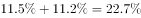
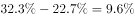

# 两期增速差比较（百分点差还原）

考点：[[20-考点/资料分析/增长/两期增速差比较（百分点差还原）|增长 / 两期增速差比较（百分点差还原）]]
材料：[[15-材料/资料分析/280160 2020年我国规模以上互联网和相关服|280160 2020年我国规模以上互联网和相关服]]

**问法模型**：题干问基期2019年两个分项（接入及相关服务 vs 信息服务）增速相差多少个百分点 → 先用'低于上年同期X个百分点'把两个2020年增速各自还原成2019年增速，再作差，按差值符号定'高/低'、按与10个百分点的分界定'不到/以上'匹配选项

## 推理链
1. 第1步：材料第三段：2020年信息服务收入7068亿元，同比增速低于上年同期11.2个百分点；互联网接入及相关服务收入447.5亿元，同比增速低于上年同期20.8个百分点（两个2020年增速的具体数值在本文本中缺失）
2. 第2步：规则：'增速低于上年同期X个百分点'→2019年增速=2020年增速+X个百分点（'低于/回落'做加法），增速比较用百分点直接相减
3. 第3步：2019年接入及相关服务增速=2020年接入增速+20.8个百分点；2019年信息服务增速=2020年信息服务增速+11.2个百分点
4. 第4步：2019年两增速之差=(2020年接入增速−2020年信息服务增速)+(20.8−11.2)=2020年增速差+9.6个百分点
5. 第5步：代入2020年两个增速作差（原始试卷中数值可读），官方解析结论：该差为正且不足10个百分点
6. 第6步：与选项对照：'高'且'不到10个百分点'→选A

**最快解法**：⚡ 百分点差平移口算：2019年增速差=2020年增速差+9.6个百分点（9.6=20.8−11.2），只需读出2020年两个增速相减再加9.6，先看符号定'高/低'，再看是否达到10个百分点定'不到/以上'，无需分别还原出两个2019年增速的完整数值

## 易错点
- ⚠ 还原方向弄反：'低于上年同期'必须做加法（'提高'才做减法），若把20.8、11.2都减掉，差值方向与大小全错
- ⚠ 两指标必须还原到同一年（2019年）再比较：差=2020年增速差+9.6，若误用2020年增速差直接作答、或只加其中一边的百分点差即错
- ⚠ 单位口径与分界线：比较的是'个百分点'不是'%'，且本文本版2020年增速数值缺失，切勿凭空编造数值硬算，应按'2020年差+9.6'的结构式结合官方结论锁定区间

## 母题抽象
> 🧩 当题干出现'基期年份A指标增速比B指标增速高/低多少个百分点'且材料只给'当年增速低于/提高上年X个百分点'型百分点差时，用'基期增速=现期增速±X'把两个增速还原到同一年再作差，差值=现期差+（两点差之差），按符号定高低、按10个百分点分界定档

**同类特征**：基期年份增速比较（2019年…比同年…）、两个分项指标：互联网接入及相关服务 vs 信息服务、问法为'高/低…个百分点'，选项按10个百分点分档、材料只给'低于上年同期X个百分点'型增速差、同一年份两增速作差、用'个百分点'而非百分数比较

## 相关题
（暂无）

---

### 题干
2019年，互联网企业互联网接入及相关服务收入同比增速比同年信息服务收入同比增速：

### 选项
- A. 高不到10个百分点　✅
- B. 高10个百分点以上
- C. 低不到10个百分点
- D. 低10个百分点以上

### 官方解析

定位文字材料第三段，“2020年，互联网企业信息服务收入······同比增长，增速低于上年同期11.2个百分点。互联网接入及相关服务收入······同比增长，增速低于上年同期20.8个百分点”。因此，2019年，互联网接入及相关服务收入同比增速为；互联网企业信息服务收入同比增速为。，则2019年，互联网企业互联网接入及相关服务收入同比增速比同年信息服务收入同比增速高不到10个百分点。

故正确答案为A。

### 给定材料

        2020年，我国规模以上互联网和相关服务企业（以下简称互联网企业）业务收入12838亿元，同比增长，增速低于上年同期8.9个百分点。

        2020年，互联网企业实现营业利润1187亿元，同比增长，增速低于上年同期3.7个百分点；得益于成本控制较好，营业成本仅增长，行业营业利润高出同期收入增速0.7个百分点。

        2020年，互联网企业信息服务收入共7068亿元，同比增长，增速低于上年同期11.2个百分点。互联网接入及相关服务收入447.5亿元，同比增长，增速低于上年同期20.8个百分点；互联网数据服务（包括云服务、大数据服务等）收入199.8亿元，同比增长，增速较上年同期提高3.9个百分点。

        2020年，东部地区互联网业务收入11227亿元，同比增长，增速较上年同期回落9个百分点，中部地区互联网业务收入448.1亿元，同比增长，增速较上年同期回落53.1个百分点。西部地区互联网业务收入497.2亿元，同比增长，增速较上年同期回落15.2个百分点。东北地区互联网业务收入47.1亿元，同比增长。

        2020年，互联网业务累计收入居前5名的广东（增长）、北京（增长）、上海（增长）、浙江（增长）和江苏（增长）共完成互联网业务收入10706亿元，同比增长，增速超过全国平均水平2.6个百分点，占全国（扣除跨地区企业）比重达，占比较上年同期提高0.8个百分点。

> [!warning] 疑点（官方解析可能有误，待人工复核）
> 所给文本中2020年各项同比增速数值均缺失（疑为原图未转出），官方解析中的两处增速数值同样空缺，故无法从给定材料复算出确切差值；只能确认结构式'2019年差=2020年增速差+9.6个百分点'及官方结论'差为正且不到10个百分点'，与正确答案A一致。待补齐原卷增速数值后，应复核该差值确落在0～10个百分点区间
