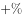
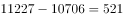
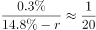
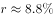
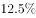
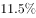
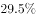
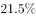
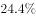
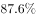

# 混合增长率（线段法）反推剩余部分增速与增减方向

考点：[[20-考点/资料分析/增长/混合增长率（线段法）反推剩余部分增速与增减方向|增长 / 混合增长率（线段法）反推剩余部分增速与增减方向]]
材料：[[15-材料/资料分析/280160 2020年我国规模以上互联网和相关服|280160 2020年我国规模以上互联网和相关服]]

**问法模型**：题干问'整体（东部11227亿元）中扣除已知部分（前5名省市10706亿元）后的剩余部分'2020年比2019年增减多少 → 先用现期差值求剩余部分现期量，再用混合增长率线段法反解其增速并判定增长/减少方向

## 推理链
1. 第1步：从第4段提取2020年东部地区互联网业务收入11227亿元（增速较上年回落9个百分点），从第5段提取累计收入居前5名的广东、北京、上海、浙江、江苏共完成10706亿元（增速超过全国平均水平2.6个百分点）
2. 第2步：题干求'东部除广东、北京、上海、浙江、江苏之外的省市'与2019年比较，先算其2020年现期收入=11227−10706=521亿元
3. 第3步：识别模型：东部整体（11227亿元，增速g东）=前五省（10706亿元，增速g五）+其他省市（521亿元，设增速g他），构成混合增长率问题
4. 第4步：线段法规则（一般用现期量近似代替基期量）：距离与量成反比，|g东−g五|:|g他−g东|=521:10706≈1:20.5，即g他≈g东+(g东−g五)×20.5
5. 第5步：按官方解析代入材料所给东部增速与前五省增速（原卷数值为图片嵌入，此处依官方解析代入值），解得g他为正（即较2019年增长），增长量可由521×g他/(1+g他)给出
6. 第6步：与选项对照：结果为'增长'且幅度与A项公式最接近（A与C同幅度、仅增减方向不同，先以正负排除C、D），故正确答案为A

**最快解法**：⚡ 线段法（混合增长率）：先口算其他地区现期量11227−10706=521亿元，权重比10706:521≈20.5:1，由'距离与量成反比'直接写出g他=g东+(g东−g五)×20.5，代入东部与前五省增速即得g他的符号与大小；正号即选'增长'，先排除同幅度的C（减少），再按幅度匹配锁定A项

## 易错点
- ⚠ '累计收入居前5名'中的'累计'仅指全年排名口径，10706亿元是2020年当年收入，勿误解为多年累计值而无法与2019年比较
- ⚠ 跨段拼接口径：11227（东部）与10706（前五省）相减隐含'前五省均属东部、与东部统计口径一致'的假设，且勿混入第5段'占全国（扣除跨地区企业）'这一不同分母口径的数据
- ⚠ 线段法用现期量代基期量且两权重悬殊（约20.5:1），增速差被放大约20倍，读数微小偏差即成倍放大；还原增速时'低于/回落'做加法、'提高'做减法，方向弄反则g他正负反转、增减判断全错

## 母题抽象
> 🧩 当题干出现'整体中扣除某已知部分后的剩余部分'与基期比较时，先做现期差值（整体现期−部分现期）得剩余量，再用线段法（距离与量成反比）反解剩余部分增速，权重越悬殊、增速偏离被放大的倍数越大，先判正负再配幅度

**同类特征**：东部地区除广东、北京、上海、浙江和江苏之外、约比2019年（增长/减少）、整体−部分=剩余部分现期量、混合增长率/线段法、第4段与第5段跨段拼数据、选项按'增长/减少×不同幅度'四象限设置

## 相关题
- [[10-真题/资料分析/增长/2307735 混合增长率·线段法（由1-7月累计与7月当月增速反推1-6月增速）|2307735]]（辽宁 2018，相关度1）

---

### 题干
2020年，东部地区除广东、北京、上海、浙江和江苏之外的省市互联网业务收入约比2019年：

### 选项
- A. 
增长
　✅
- B. 
增长

- C. 
减少

- D. 
减少

### 官方解析

根据题干“2020年······比2019年······”，结合选项为增长/减少，且东部地区广东、北京、上海、浙江、江苏其他东部地区，可判定本题为混合增长率问题。定位文字材料第四段可知：2020年，东部地区完成互联网业务收入11227亿元，同比增长；定位文字材料第五段可知：2020年，互联网业务累计收入居前5名的广东、北京、上海、浙江和江苏共完成互联网业务收入10706亿元，同比增长。则2020年，东部地区除广东、北京、上海、浙江、江苏的其他地区完成互联网业务收入亿元。令东部地区除广东、北京、上海、浙江、江苏的其他地区完成互联网业务收入同比增速为，根据线段法：距离与量成反比（一般用现期量近似代替基期量），可得：，即，解得，最接近A项。

故正确答案为A。

### 给定材料

        2020年，我国规模以上互联网和相关服务企业（以下简称互联网企业）业务收入12838亿元，同比增长，增速低于上年同期8.9个百分点。

        2020年，互联网企业实现营业利润1187亿元，同比增长，增速低于上年同期3.7个百分点；得益于成本控制较好，营业成本仅增长，行业营业利润高出同期收入增速0.7个百分点。

        2020年，互联网企业信息服务收入共7068亿元，同比增长，增速低于上年同期11.2个百分点。互联网接入及相关服务收入447.5亿元，同比增长，增速低于上年同期20.8个百分点；互联网数据服务（包括云服务、大数据服务等）收入199.8亿元，同比增长，增速较上年同期提高3.9个百分点。

        2020年，东部地区互联网业务收入11227亿元，同比增长，增速较上年同期回落9个百分点，中部地区互联网业务收入448.1亿元，同比增长，增速较上年同期回落53.1个百分点。西部地区互联网业务收入497.2亿元，同比增长，增速较上年同期回落15.2个百分点。东北地区互联网业务收入47.1亿元，同比增长。

        2020年，互联网业务累计收入居前5名的广东（增长）、北京（增长）、上海（增长）、浙江（增长）和江苏（增长）共完成互联网业务收入10706亿元，同比增长，增速超过全国平均水平2.6个百分点，占全国（扣除跨地区企业）比重达，占比较上年同期提高0.8个百分点。

> [!warning] 疑点（官方解析可能有误，待人工复核）
> 所给材料文本中所有'同比增长 %'增速数值均为空白（原卷以图片嵌入未转出），官方解析中线段法方程、解得的增速及选项幅度公式亦为图片无法读取，故第5步只能按官方解析定性引用（解得为正、最接近A），无法从所给文本独立复核具体数字；另外解析正文'其他地区完成互联网业务收入亿元'处缺失的数值应为11227−10706=521亿元。以上为材料转录完整性问题，不影响官方答案A的权威性。
