# 环比增长率计算与带符号差值（百分点）比较

考点：[[20-考点/资料分析/增长/环比增长率计算与带符号差值（百分点）比较|增长 / 环比增长率计算与带符号差值（百分点）比较]]
材料：[[15-材料/资料分析/280232 2019年7月上旬流通领域部分生产资|280232 2019年7月上旬流通领域部分生产资]]

**问法模型**：题干问'环比涨跌幅相差最大'→先对选项涉及产品逐一还原上期价格并求环比增长率（涨跌额÷上期价格），再按带符号增长率两两做差取最大

## 推理链
1. 第1步：从表中提取选项涉及产品数据（本期价格, 涨跌额）：硫酸(250.0, −13.3)、纯苯(5211.9, +306.1)、甲醇(2080.2, −53.1)、顺丁胶(10505.0, −393.3)、涤纶长丝(8996.9, +446.9)
2. 第2步：公式：环比增长率=涨跌额÷上期价格，其中上期价格=本期价格−涨跌额（跌价产品为'本期+|涨跌额|'）
3. 第3步：逐项计算：纯苯 306.1÷(5211.9−306.1)=306.1÷4905.8≈+6.24%；硫酸 −13.3÷(250.0+13.3)=−13.3÷263.3≈−5.05%；涤纶长丝 446.9÷8550.0≈+5.23%；顺丁胶 −393.3÷(10505.0+393.3)=−393.3÷10898.3≈−3.61%；甲醇 −53.1÷2133.3≈−2.49%
4. 第4步：选项两两做带符号差（一涨一跌配对，差值=两绝对值之和）：A项 5.23%−(−3.61%)≈8.8个百分点；B项 6.24%−(−3.61%)≈9.8个百分点；C项 5.23%−(−2.49%)≈7.7个百分点；D项 6.24%−(−5.05%)≈11.3个百分点
5. 第5步：D项差值11.3个百分点最大，与官方答案D一致

**最快解法**：⚡ 基期还原+截位直除+正负端配对：全表正向涨幅最大是纯苯（306.1÷4905.8≈+6.2%），负向跌幅最大是硫酸（13.3÷263.3≈5.0%，因基数仅263.3极小、跌幅率反而最大），两者配对差值≈6.2+5.0≈11.3个百分点为最大；其余选项B≈9.8、A≈8.8、C≈7.7均小于D，直接锁定D

## 易错点
- ⚠ 把第二列涨跌额（元/吨）直接当涨跌幅使用或按涨跌额作差（如|306.1−(−13.3)|=319.4），实际必须先还原上期价格再算比率；表中本无涨跌幅(%)列
- ⚠ 跌价产品基期价方向算反：硫酸基期=250.0+13.3=263.3（比现期高）、顺丁胶基期=10505.0+393.3=10898.3，误按'本期−|涨跌额|'会算错跌幅率（硫酸基数小，此项错误影响最大）
- ⚠ '相差'须按带符号增长率做差（正减负=绝对值相加）；若误取涨跌幅绝对值之差比较，会误选A（|5.23|−|−3.61|≈1.6为最大的'绝对值差'）

## 母题抽象
> 🧩 当题干出现'环比涨跌幅相差最大/最小'且表格只给涨跌额（元/吨）时，先还原基期价（本期−涨跌额，跌价则本期+|涨跌额|）求带符号增长率，选项一涨一跌配对的差值=两个绝对值之和，优先锁定正端最大涨幅与负端最大跌幅率（注意小基数产品跌幅率易居首）的产品对

**同类特征**：环比涨跌幅相差最大、表中仅有涨跌额（元/吨）无涨跌幅列、需先还原上期（基期）价格、带符号增长率做差（百分点比较）、选项均为'一涨一跌'产品配对、跨大类产品比较（黑色金属/有色金属/化工）

## 相关题
（暂无）

---

### 题干
2019年7月上旬，表中价格环比涨跌幅相差最大的是：

### 选项
- A. 涤纶长丝与顺丁胶
- B. 纯苯与顺丁胶
- C. 涤纶长丝与甲醇
- D. 纯苯与硫酸　✅

### 官方解析

根据题干“价格环比涨跌幅相差最大”，可以判定本题为一般增长率问题。根据表格可知2019年7月上旬各类产品本期价格和比上期价格涨跌量。根据公式：增长率。A项，涤纶长丝的增长率为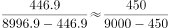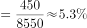，顺丁胶的增长率为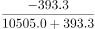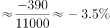，则涤纶长丝与顺丁胶涨跌幅度相差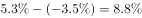，即8.8个百分点；B项，纯苯的增长率为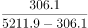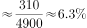，则纯苯与顺丁胶涨跌幅度相差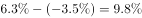，即9.8个百分点；C项，甲醇的增长率为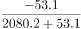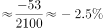，则涤纶长丝与甲醇涨跌幅度相差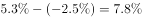，即7.8个百分点；D项，硫酸的增长率为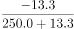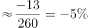，则纯苯与硫酸涨跌幅度相差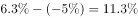，即11.3个百分点。综上可知，D项价格环比涨跌幅相差最大，当选。

故正确答案为D。

### 给定材料

