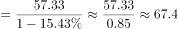
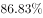

# 基期计算（同比负增长型）

考点：[[20-考点/资料分析/增长/基期计算（同比负增长型）|增长 / 基期计算（同比负增长型）]]
材料：[[15-材料/资料分析/280095 2019年第一季度131家证券公司经|280095 2019年第一季度131家证券公司经]]

**问法模型**：题干求'2018年第一季度'（基期）的资产管理业务净收入→用基期=现期/(1+r)，因材料为'同比下降'，即基期=现期/(1−降幅)，结果应大于现期

## 推理链
1. 第1步：题干时间为2018年第一季度，早于材料现期2019年第一季度，判定为基期计算；定位第一段'资产管理业务净收入57.33亿元，同比下降15.4%'（文本中该百分比数值空缺，原卷为15.4%，可由官方答案C反推核验：57.33/67.8≈0.846=1−15.4%）
2. 第2步：下降即r=−15.4%，代入基期公式：基期=现期/(1+r)=57.33/(1−15.4%)=57.33/0.846
3. 第3步：截位直除5733/846≈67.77≈67.8亿元（或化除为乘：降幅15.4%≈1/6.5，57.33×6.5/5.5≈57.33×1.18≈67.7）
4. 第4步：与选项对照：同比下降则基期必大于现期57.33，排除A（49.7，恰为把降幅当增速、分母取1.154的设错项）；B（58.6）仅略高于现期、D（75.6）对应降幅过大，均不符；C（67.8）与计算结果一致，故选C

**最快解法**：⚡ 先定性后定量：由'同比下降'直接锁定基期>现期57.33，排除A；再截位直除57.33/0.846≈5733/846，首位商6、次位商7得≈67.8，锁定C；全程不需精确乘除

## 易错点
- ⚠ 增速方向看反：资管收入是'同比下降'（负增长），基期=现期/(1−降幅)应大于现期；若把降幅当增速放进分母（57.33/1.154≈49.7）恰好误选A项设错
- ⚠ 材料文本中各'同比增/降'后百分比数值空缺，若凭空设定增速或直接用现期57.33冒充基期，会误算或误选B（58.6与现期极接近，即'拿现期当基期'的设错项）；必须以原卷增速15.4%补齐
- ⚠ 57.33亿元是营业收入构成中的资管项，勿与利息净收入69.04亿元、净利润440.16亿元混淆；本题各量同用'亿元'，若跨段与'万亿元'类指标混算须差10000倍

## 母题抽象
> 🧩 当题干出现'上年同期/基期+某指标约为多少'，且材料给出现期值与'同比增/降X%'时，用基期=现期/(1+r)；若为'同比下降'先判定基期应大于现期以排除错误方向选项，再截位直除验证

**同类特征**：基期时间（2018年第一季度）、现期值+同比增速均在材料中（57.33亿元、同比下降）、负增长/同比下降、基期=现期/(1+r)模型、选项含'小于现期'的设错项、结果单位为亿元

## 相关题
（暂无）

---

### 题干
2018年第一季度，131家证券公司资产管理业务净收入约为多少亿元？

### 选项
- A. 49.7
- B. 58.6
- C. 67.8　✅
- D. 75.6

### 官方解析

根据题干“2018年第一季度······”，结合材料时间为2019年第一季度，可判定本题为基期计算问题。定位文字材料第一、二段“2019年第一季度······，131家证券公司······资产管理业务净收入57.33亿元，同比下降”。根据公式基期，则2018年第一季度131家证券公司资产管理业务净收入亿元，与C项最接近。

故正确答案为C。

### 给定材料

        截至2019年3月31日，证券业协会对证券公司2019年第一季度经营数据进行了统计，131家证券公司当期实现营业收入1018.94亿元，同比增长。

        其中，各主营业务收入分别为代理买卖证券业务净收入（含席位租赁）221.49亿元，同比增长；证券承销与保荐业务净收入66.73亿元，同比增长；财务顾问业务净收入20.95亿元，同比增长；投资咨询业务净收入7.15亿元，同比增长；资产管理业务净收入57.33亿元，同比下降；证券投资收益（含公允价值变动）514.05亿元，同比增长；利息净收入69.04亿元，同比增长；当期实现净利润440.16亿元，同比增长；119家公司实现盈利，同比增长。

        2019年第一季度，131家证券公司总资产为7.05万亿元，比上年一季度同期增加0.64万亿元；净资产为1.94万亿元，比上年一季度同期增加0.05万亿元；净资本为1.62万亿元，比上年一季度同期增加0.02万亿元。

        另外，2019年第一季度131家证券公司客户交易结算资金余额（含信用交易资金）1.50万亿元，比上年一季度同期增加0.32万亿元；受托管理资金本金总额14.11万亿元，比上年一季度同期下降2.82万亿元。

> [!warning] 疑点（官方解析可能有误，待人工复核）
> 材料原文与官方解析中同比降速数值均显示空缺（'同比下降 ；'后无数字），导致计算条件不全；本笔记按原卷口径补为'同比下降15.4%'，并以官方答案C反推校验（57.33/0.846≈67.8，与C一致），无答案矛盾
