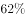
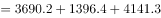
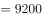
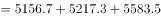
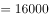
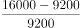
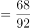

# 季度加总后求一般增长率（现期、基期均为多月加总值）

考点：[[20-考点/资料分析/增长/季度加总后求一般增长率（现期、基期均为多月加总值）|增长 / 季度加总后求一般增长率（现期、基期均为多月加总值）]]
材料：[[15-材料/资料分析/280257 2020年1-12月全国公路货物运输|280257 2020年1-12月全国公路货物运输]]

**问法模型**：题干为'第二季度……比第一季度增长了'+选项为百分数 → 先将各月当期值按季度加总得Q1、Q2，再用增长率=(现期-基期)/基期计算

## 推理链
1. 第1步：从折线图读取各月货物周转量（当月值）：1月3690.2、2月1396.4、3月4141.3、4月5156.7、5月5217.3、6月5583.5亿吨公里
2. 第2步：按季度拼组：第一季度=1-3月，第二季度=4-6月，逐月相加
3. 第3步：Q1=3690.2+1396.4+4141.3=9227.9亿吨公里；Q2=5156.7+5217.3+5583.5=15957.5亿吨公里
4. 第4步：代入增长率公式=(现期-基期)/基期=(15957.5-9227.9)/9227.9=6729.6/9227.9
5. 第5步：截位直除：6729.6/9227.9≈67.3/92.3≈0.729，即约增长73%
6. 第6步：与选项对照，最接近73%，故选D

**最快解法**：⚡ 加总+截位直除：Q1≈3690+1396+4141≈9228，Q2≈5157+5217+5584≈15958，差6729.6，除以9227.9时分子分母各截三位得67.3/92.3≈73%，直接对照选项选D

## 易错点
- ⚠ 不先加总，误用单月数据对比（如直接用6月5583.5与3月4141.3相比）导致增长率错误
- ⚠ 2月为断崖低谷（1396.4亿吨公里），加总Q1时漏加或误读该点会使基期明显偏差
- ⚠ 增长率基期为第一季度（分母是Q1=9227.9），误用Q2作分母或颠倒分子分母方向

## 母题抽象
> 🧩 当题干出现'某季度比某季度增长了（百分数）'且材料为月度当期值时，先把季度内各月逐一加总得现期与基期，再用(现期-基期)/基期求增长率并对照选项

**同类特征**：第二季度比第一季度、货物周转量、增长了+百分数选项、月度当期值需按季度拼组、折线图（双轴图）取数

## 相关题
（暂无）

---

### 题干
2020年第二季度，全国货物周转量约比第一季度增长了：

### 选项
- A. 

- B. 

- C. 

- D. 

　✅

### 官方解析

根据“2020年第二季度······比第一季度增长了”，结合选项为百分数，可判定本题为一般增长率计算问题。定位折线图可知：2020年第一季度全国货物周转量亿吨公里；第二季度全国货物周转量亿吨公里。根据增长率，可得2020年第二季度，全国货物周转量约比第一季度增长了，与D项最接近。

故正确答案为D。

### 给定材料

