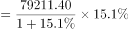
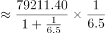
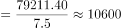

# 增长量计算（区间判定）

考点：[[20-考点/资料分析/增长/增长量计算（区间判定）|增长 / 增长量计算（区间判定）]]
材料：[[15-材料/资料分析/280259 2017年上海三个统计口径（上海口岸|280259 2017年上海三个统计口径（上海口岸]]

**问法模型**：题干'2017年……比上年增加'且选项为带单位的金额区间 → 套增长量=现期×r/(1+r)，对照万亿元分档阈值判定

## 推理链
1. 第1步：题干'比上年增加'且选项以万亿元分档，判定为增长量计算；定位文字材料第一段：2017年上海口岸货物进出口总额79211.40亿元（注意是'口岸'口径，不是关区59690.24或上海市32237.82）。
2. 第2步：所用公式为增长量=现期×r/(1+r)，其中r为口岸总额的同比增速（增速数值在所给文本中缺失，须回原卷读取，不得臆造）。
3. 第3步：统一单位并设A档阈值：1万亿元=10000亿元；假设增加额恰为1万亿元，则基期=79211.40−10000=69211.40亿元，临界增速=10000/69211.40≈14.4%。
4. 第4步：按官方解析代入原卷增速（高于约14.4%的两位数增速），增长量=79211.40×r/(1+r)＞10000亿元，即增长额超过1万亿元。
5. 第5步：与选项对照：实际增长量落在'1万亿元以上'，B（0.7–1万亿元）、C（0.4–0.7万亿元）、D（不到0.4万亿元）均低于实际值，故选A。

**最快解法**：⚡ 临界增速法＋单位换算：先算'恰好增加1万亿元'所需的临界增速=10000/(79211.40−10000)≈14.4%，原卷增速高于该阈值（官方解析代入后增长量破1万亿元），直接秒选A；也可用百化分，r≈1/6~1/7时增长量≈79211/(7~8)≈1.0~1.1万亿元，稳落A档。

## 易错点
- ⚠ 口径张冠李戴：必须用'上海口岸'79211.40亿元，误用'上海关区'59690.24或'上海市'32237.82会直接掉档（三套口径混排是本材料最大阅读陷阱）。
- ⚠ 单位量级换算：选项以'万亿元'计、材料为'亿元'，1万亿元=10000亿元，79211.40亿元≈7.9万亿元，换算出错会误选B/C/D。
- ⚠ 公式与数据来源：增长量=现期×r/(1+r)，漏除(1+r)（误用现期×r）会高估结果；且文字段中增速数值缺失，必须回原卷读取，不得凭'增长'二字自行编造增速。

## 母题抽象
> 🧩 当题干出现'某年A比上年增加'且选项是带单位的数值区间时，用增长量=现期×r/(1+r)：先统一单位（万亿元=10000亿元），再以'增长量阈值反推临界增速'或百化分快速定位所属区间。

**同类特征**：比上年增加、选项为区间且带单位（万亿元）、增长量计算、限定口径：上海口岸、现期值与同比增速来自文字段

## 相关题
- [[10-真题/资料分析/增长/2367786 增长量计算（增长量=现期×r-(1+r)）|2367786]]（江苏 2019，相关度2）
- [[10-真题/资料分析/增长/7159 增长量计算|7159]]（北京 2009，相关度1）
- [[10-真题/资料分析/增长/2571729 增长量计算——每增长1个百分点对应的增量（基期量×1%）|2571729]]（山东 2020，相关度1）
- [[10-真题/资料分析/增长/3018839 增长量计算（负增长情形：基期减少量）|3018839]]（广东 2021，相关度1）
- [[10-真题/资料分析/增长/10204654 增长量计算（已知现期与同比下降率求下降量）|10204654]]（安徽 2024，相关度1）

---

### 题干
2017年，上海口岸货物进出口总额比上年增加：

### 选项
- A. 1万亿元以上　✅
- B. 0.7-1万亿元之间
- C. 0.4-0.7万亿元之间
- D. 不到0.4万亿元

### 官方解析

根据题干“2017年，······比上年增加”，结合选项带单位，可判定本题为增长量计算问题。定位文字材料第一段可得：2017年全年，上海口岸货物进出口总额79211.40亿元，比上年增长。根据公式：增长量，则2017年上海口岸货物进出口总额同比增长量亿元万亿元，即增加1万亿元以上。

故正确答案为A。

### 给定材料

        2017年全年，上海口岸货物进出口总额79211.40亿元，比上年增长。其中，进口33445.10亿元，增长；出口45766.30亿元，增长。全年上海关区货物进出口总额59690.24亿元，比上年增长。其中，进口24684.20亿元，增长；出口35006.04亿元，增长。

        全年上海市货物进出口总额32237.82亿元，比上年增长。其中，进口19117.51亿元，增长；出口13120.31亿元，增长。

