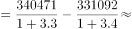

# 基期量计算与基期和差（增长倍数型反推）

考点：[[20-考点/资料分析/增长/基期量计算与基期和差（增长倍数型反推）|增长 / 基期量计算与基期和差（增长倍数型反推）]]
材料：[[15-材料/资料分析/280260 2015年我国汽车市场产销全景：涵盖|280260 2015年我国汽车市场产销全景：涵盖]]

**问法模型**：题干问上年（2014年）A比B高约多少，而材料给的是2015年现期值及'增长X倍'型增速 → 采用基期和差模型：基期量=现期量÷(1+倍数)，两个基期量作差后做单位换算

## 推理链
1. 第1步：定位材料第4段：2015年新能源汽车生产340471辆（同比增3.3倍），销售331092辆（同比增3.4倍）
2. 第2步：'增长X倍'即增长率为X×100%，故现期=基期×(1+X)，基期量=现期量÷(1+倍数)：产量除以4.3、销量除以4.4
3. 第3步：2014年产量=340471÷4.3≈79200辆；2014年销量=331092÷4.4≈75200辆
4. 第4步：作差 79200−75200=4000辆
5. 第5步：单位换算 4000辆=0.4万辆，对照选项选D
6. 第6步：量级校验：若直接用现期差9379辆≈0.9万辆，无对应选项，确认必须先反推基期

**最快解法**：⚡ 倍数换算+截位直除：直接以'万辆'口径计算避免末尾换算——34.05÷4.3≈7.9万辆，33.11÷4.4≈7.5万辆，7.9−7.5=0.4万辆，秒选D；注意增长3.3倍/3.4倍分别对应除以4.3/4.4

## 易错点
- ⚠ 倍数陷阱：'增长3.3倍'意味着现期是基期的4.3倍，直接除以3.3或按3.3倍理解必错
- ⚠ 单位量级陷阱：材料第4段单位是'辆'，选项是'万辆'，4000辆须除以10000换算成0.4万辆，漏换算会错选数量级
- ⚠ 产销增速错位对应：产对应增3.3倍、销对应增3.4倍，若互换则差值约为0.5万辆，误选其他项
- ⚠ 跳步陷阱：直接用2015年产销差(340471−331092=9379辆≈0.9万辆)当基期差，忘记先反推基期

## 母题抽象
> 🧩 当题干出现'上年（基期）A比B高/多约多少'且材料给现期值与'增长X倍'型增速时，用基期=现期÷(X+1)分别反推两量，作差后再按选项单位换算量级验证

**同类特征**：基期年份（2014年）与材料现期（2015年）错位提问、'比……高约多少'求两量差值、选项单位'万辆'与材料单位'辆'不同量级、材料增速以'增长X倍'表述、同一对象产销两个现期量分别配不同增速

## 相关题
（暂无）

---

### 题干
2014年，新能源汽车产量比销售量高约多少万辆?

### 选项
- A. 0.1
- B. 0.2
- C. 0.3
- D. 0.4　✅

### 官方解析

根据题干“2014年······比······高约多少万辆”，结合材料时间为2015年，可判定本题为基期和差问题。定位文字材料第4段可得：2015年新能源汽车生产340471辆，销售331092辆，同比分别增长3.3倍和3.4倍。根据公式:，则题干所求79200-75200=4000辆=0.4万辆。

故正确答案为D。

### 给定材料

        2015年，我国汽车整车进口同比呈明显下降，共进口110.19万辆，同比下降22.73%。2015年，中国品牌轿车销售243.03万辆，同比下降12.5%，占轿车销售总量的20.7%，比上年同期下降1.7个百分点。

        2015年，中国品牌乘用车共销售873.76万辆，同比增长15.27%，占乘用车销售总量的41.32%，占有率比上年同期提升2.86个百分点。德系、日系、美系、韩系和法系乘用车分别销售399.82万辆、336.43万辆、259.57万辆、167.88万辆和72.93万辆。

        2015年12月，基本型乘用车产销量分别为120.29万辆和128.09万辆，环比增长0.21%和8.83%，同比增长4.50%和1.30%；运动型多用途乘用车（SUV）产销量分别为78.28万辆和79.40万辆，环比增长8.22%和10.86%，同比增长60.39%和60.73%；多功能乘用车（MPV）产销量分别24.88万辆和27.27万辆，环比增长13.01%和24.85%，同比增长13.53%和27.11%；交叉型乘用车产销量分别为8.65万辆和9.46万辆，环比增长-7.46%和3.31%，同比增长1.32%和2.87%。

        2015年新能源汽车生产340471辆，销售331092辆，同比分别增长3.3倍和3.4倍。其中，纯电动汽车产销分别完成254633辆和247482辆，同比分别增长4.2倍和4.5倍；插电式混合动力汽车产销分别完成85838辆和83610辆，同比增长1.9倍和1.8倍。

        新能源乘用车中，纯电动乘用车产销分别完成152172辆和146719辆，同比分别增长2.8倍和3倍；插电式混合动力乘用车产销分别完成62608辆和60663辆，同比均增长2.5倍。

        新能源商用车中，纯电动商用车产销分别完成102461辆和100763辆，同比分别增长10.4倍和10.6倍；插电式混合动力商用车产销分别完成23230辆和22947辆，同比增长91.1%和88.8%。

