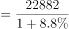
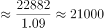

# 基期量计算

考点：[[20-考点/资料分析/增长/基期量计算|增长 / 基期量计算]]
材料：[[15-材料/资料分析/294540 2019年前三季度全国居民人均可支配|294540 2019年前三季度全国居民人均可支配]]

**问法模型**：题干问'2018年前三季度……是多少元'（时间在材料现期之前）→ 用基期量模型：基期量=现期量÷(1+同比增长率)

## 推理链
1. 第1步：题干所求时间为2018年前三季度，早于材料主时间2019年前三季度，判定为基期计算；从材料第1段提取条件：2019年前三季度全国居民人均可支配收入22882元，比上年同期名义增长8.8%
2. 第2步：公式——基期量 = 现期量 ÷ (1 + 增长率) = 22882 ÷ (1+8.8%)
3. 第3步：代入计算：22882 ÷ 1.088，由于21031.25×1.088=21031.25+1850.75=22882，故基期量恰为21031.25元
4. 第4步：与选项对照：A.20112.35、B.21031.25、C.22314.56、D.27456.32，仅B与计算结果一致（精确相等），故选B

**最快解法**：⚡ 截位直除：22882÷1.088，先看首两位——1.088×21000=22848，余数34，商约21031，首三位'210'直接锁定B(21031.25)；同时用上界22882排除C(22314)、D(27456)，用22882÷1.1≈20801作下界排除A(20112)，秒杀定B

## 易错点
- ⚠ 基期现期方向混淆：误把求基期做成现期或增量，如22882×(1+8.8%)≈24896甚至乘倍处理，方向一错即落入D(27456.32)一类干扰项
- ⚠ 增速取值错误：误用材料中并列的其他增速（如中位数增速9.0%、农村收入增速9.2%、消费支出增速8.3%），分母应为'全国居民人均可支配收入'对应的同比名义增速8.8%
- ⚠ 时间口径：材料全部增速为'同比名义增长'，题干问2018年前三季度恰为该增速的基期，无需再考虑价格因素换算实际值

## 母题抽象
> 🧩 当题干出现'基期年份（早于材料主时间）+某指标是多少'且材料给出'现期值、同比增长r'时，用基期量=现期÷(1+r)，先截位直除定首两位、再用现期值作上界排除，最后对照选项验证

**同类特征**：问基期年份（2018年）数值、材料给现期量与同比名义增长率、单位为元、基期计算模型、全国居民人均可支配收入、选项为四位小数的精确值

## 相关题
- [[10-真题/资料分析/增长/2368028 基期量计算|2368028]]（江苏 2019，相关度3）
- [[10-真题/资料分析/增长/20303 基期量计算|20303]]（贵州 2010，相关度2）
- [[10-真题/资料分析/增长/1385893 基期量计算|1385893]]（重庆 2015，相关度2）
- [[10-真题/资料分析/增长/13504658 基期量计算|13504658]]（辽宁 2025，相关度2）
- [[10-真题/资料分析/增长/16593086 基期量计算|16593086]]（新疆 2024，相关度2）

---

### 题干
2018年前三季度，全国居民人均可支配收入是多少元？

### 选项
- A. 20112.35
- B. 21031.25　✅
- C. 22314.56
- D. 27456.32

### 官方解析

根据题干“2018年前三季度······是多少元”，结合材料时间为2019年前三季度，可判定本题为基期计算问题。定位文字材料第一段：2019年前三季度，全国居民人均可支配收入22882元，比上年同期名义增长。根据公式：基期量，可得2018年前三季度，全国居民人均可支配收入元，与B项最接近。

故正确答案为B。

### 给定材料

        2019年前三季度，全国居民人均可支配收入22882元，比上年同期名义增长8.8%。其中，城镇居民人均可支配收入31939元，增长（以下如无特别说明，均为同比名义增长）7.9%；农村居民人均可支配收入11622元，增长9.2%。

        前三季度，全国居民人均可支配收入中位数19882元，增长9.0%，中位数是平均数的86.9%。其中，城镇居民人均可支配收入中位数29304元，增长7.6%，是平均数的91.8%；农村居民人均可支配收入中位数10172元，增长10.0%，是平均数的87.5%。

        按收入来源分，前三季度，全国居民人均工资性收入13020元，增长8.6%；人均经营净收入3757元，增长9.3%；人均财产净收入1949元，增长12.3%；人均转移净收入4157元，增长7.2%。

        2019年前三季度，全国居民人均消费支出15464元，比上年同期名义增长8.3%。其中，城镇居民人均消费支出20379元，增长7.2%；农村居民人均消费支出9353元，增长9.5%。

        前三季度，全国居民人均食品烟酒消费支出4310元，增长6.1%；人均衣着消费支出962元，增长3.8%；人均居住消费支出3607元，增长10.3%；人均生活用品及服务消费支出926元，增长3.2%；人均交通通信消费支出2078元，增长7.6%；人均教育文化娱乐消费支出1766元，增长13.5%；人均医疗保健消费支出1414元，增长10.9%；人均其他用品及服务消费支出401元，增长11.1%。

