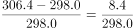
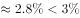
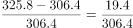
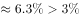
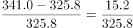
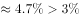

# 两期增长率计算与比较（逐年增速计数）

考点：[[20-考点/资料分析/增长/两期增长率计算与比较（逐年增速计数）|增长 / 两期增长率计算与比较（逐年增速计数）]]
材料：[[15-材料/资料分析/294539 2018年H市国民经济与社会统计公报|294539 2018年H市国民经济与社会统计公报]]

**问法模型**：题干问'某年份区间内同比增速大于3%的年份有几个'→从柱状图逐年取数计算增长率并与3%比较后计数（首年若无基期数据则不可计）

## 推理链
1. 第1步：从柱状图读取2014—2018年末移动电话用户数：304.3、298.0、306.4、325.8、341.0万户；材料无2013年数据，2014年同比增速无法计算，不参与判定
2. 第2步：增长率=（现期−基期）/基期；判定'增速>3%'可等价转化为'增量>基期×3%'，避免逐项做除法
3. 第3步：2015年增量=298.0−304.3=−6.3，负增长，直接排除
4. 第4步：2016年增量=306.4−298.0=8.4，与298.0×3%=8.94比较，8.4<8.94，增速≈2.8%<3%，排除（临界点）
5. 第5步：2017年增量=325.8−306.4=19.4，306.4×3%≈9.19，19.4>9.19，增速≈6.3%>3%，符合；2018年增量=341.0−325.8=15.2，325.8×3%≈9.77，15.2>9.77，增速≈4.7%>3%，符合
6. 第6步：符合条件的年份为2017年、2018年共2个，对照选项选B

**最快解法**：⚡ 增量—阈值比较法（免除法）：逐年求增量，与'基期×3%'比较。2015年负增长排除；2016年8.4<8.94不超阈（易错临界）；2017年19.4>9.19、2018年15.2>9.77超阈，秒判共2个

## 易错点
- ⚠ 2014年同比增速因缺2013年数据无法计算，官方已注明题干歧义；若强行估算或把2014年计入，会多算年份
- ⚠ 2016年增速≈2.8%逼近3%但小于3%，是最易错的临界年份；粗心估算（8.4/300≈3%）易误判为达标
- ⚠ 柱状图纵轴自270起步而非0，柱高视觉差被放大，不能凭柱高比例估增速；且'大于3%'是严格大于，临界略小不计入

## 母题抽象
> 🧩 当题干出现'某年份区间内同比增速大于X%的年份有几个'特征时，逐年取现期与基期，用'增量是否大于基期×X%'替代除法判定，并先确认区间首年有无基期数据，无则不计入

**同类特征**：同比增速大于3%的年份、2014年—2018年、柱状图逐年读数、计数型问法（有几个）、年末移动电话用户数量、临界值判定

## 相关题
- [[10-真题/资料分析/增长/2452887 增长量比较（计数型：同比增量与阈值45亿元逐一比较后数个数）|2452887]]（河南 2019，相关度1）
- [[10-真题/资料分析/平均数/2578505 现期平均数求总体均值后与个体比较计数|2578505]]（陕西 2020，相关度1）
- [[10-真题/资料分析/增长/5102149 同比增量（增长量）计算与临界值计数比较|5102149]]（浙江 2022，相关度1）
- [[10-真题/资料分析/增长/13432354 同比增长率计算与超过50%计数比较|13432354]]（深圳市考 2025，相关度1）
- [[10-真题/资料分析/倍数/5521188 现期倍数判定（增长超一倍=现期≥基期2倍，即增长率-100%）|5521188]]（深圳市考 2023，相关度1）

---

### 题干
2014年—2018年中年末移动电话用户数量同比增速大于3%的年份有几个？

### 选项
- A. 1个
- B. 2个　✅
- C. 3个
- D. 4个

### 官方解析

根据题干“2014年—2018年中······同比增速大于的年份有几个”，可判定本题为一般增长率问题。定位柱状图可得2014年—2018年各年年末移动电话用户数量，根据增长率计算各年增长率即可。2015年为负增长，增速小于；2016年：；2017年：；2018年：。同比增速大于的年份有2017年和2018年，共2个。

故正确答案为B。

注：本题题干表述有一定歧义，要求计算2014年—2018年每年的同比增速，但材料并未给出2013年相关数据，故2014年的同比增速无法计算。

### 给定材料

        2018年H市粮食种植面积235.7千公顷，油料种植面积3.0千公顷，棉花种植面积0.02千公顷。在粮食种植面积中，玉米种植面积199.3千公顷，小麦种植面积4.7千公顷。全年粮食产量150.2万吨。其中，夏粮2.4万吨，秋粮147.9万吨。

        2018年H市完成邮电业务总量108.2亿元。其中，邮政业务总量40.8亿元，同比增长26.5%；电信业务总量67.4亿元，同比增长56.7%。年末移动电话用户达到341万户，其中，3G移动电话用户达到25.7万户，4G移动电话用户达到241.4万户。全市互联网接入用户89.9万户，其中，新增互联网用户23.8万户。

        2018年全年全市保费收入65.4亿元，增长0.7%。其中，寿险业务保费收入39.5亿元，下降5.1%；健康和意外险业务保费收入9.1亿元，增长21.6%，增速同比增加5个百分点；财产险业务保费收入3.4亿元，增长25.2%；车险业务保费收入13.3亿元，增长1.8%。全年支付各类赔款及给付21.2亿元，增长5.3%。其中，寿险业务保费赔付11.0亿元，增长1.4%；健康和意外险业务保费赔付3.0亿元，增长68.7%；财产险业务保费赔付0.9亿元，增长5.7%；车险业务保费赔付6.4亿元，下降5.0%。

