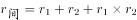
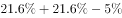
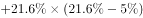
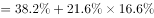
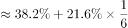
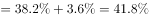
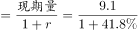
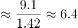

# 隔年基期量计算（间隔增长率）

考点：[[20-考点/资料分析/增长/隔年基期量计算（间隔增长率）|增长 / 隔年基期量计算（间隔增长率）]]
材料：[[15-材料/资料分析/294539 2018年H市国民经济与社会统计公报|294539 2018年H市国民经济与社会统计公报]]

**问法模型**：题干求2016年（比材料现期2018年早两年）的保费收入 → 属隔年基期问题：先用'增速同比增加5个百分点'做百分点减法还原2017年增速，再套间隔增长率公式r=r₁+r₂+r₁×r₂，最后以现期量÷(1+r)求隔年基期量

## 推理链
1. 第1步：题干求2016年健康和意外险保费收入，而材料现期为2018年，中间隔着2017年，判定为间隔基期问题
2. 第2步：从材料第三段提取：2018年该险种保费收入9.1亿元，同比增长21.6%，且'增速同比增加5个百分点'，即2018年增速比2017年高5个百分点
3. 第3步：做百分点减法还原2017年增速：21.6%−5%=16.6%（'个百分点'参与的是加减运算，不是把21.6%乘除）
4. 第4步：代入间隔增长率公式：r=21.6%+16.6%+21.6%×16.6%≈38.2%+3.6%≈41.8%，即2018年相对2016年总增长约41.8%
5. 第5步：隔年基期量=9.1÷(1+41.8%)=9.1÷1.418≈6.4亿元；验证：两步倒推9.1÷1.216≈7.48，7.48÷1.166≈6.42，两法一致
6. 第6步：与选项对照：6.4对应C项；A项7.5恰为只倒推一步的2017年基期值（9.1÷1.216≈7.5），是典型陷阱，排除

**最快解法**：⚡ 公式法+截位直除：先由21.6%−5%=16.6%还原2017年增速，间隔增长率r≈21.6%+16.6%+0.216×0.166≈41.8%，9.1÷1.418≈6.4；或两步截位直除9.1÷1.216≈7.48、7.48÷1.166≈6.4，秒选C

## 易错点
- ⚠ '增速同比增加5个百分点'是百分点口径：2017年增速=21.6%−5%=16.6%，误把21.6%当成2017年增速、或把5%当作2017年增速代入，都会算错
- ⚠ 隔年问题必须两步倒推或用间隔增长率公式：只倒推一步得9.1÷1.216≈7.5亿元，这是2017年的基期值，正好落入A项陷阱
- ⚠ 间隔增长率公式中r₁×r₂≈3.6%这一项不能漏掉，漏掉则得9.1÷1.382≈6.6，偏离正确值；另注意隔年基期量略小于'现期÷(1+r₁+r₂)'的粗算结果，选项间距小时必须精算（材料导读中写2017年增速16.5%系笔误，按21.6%−5%应为16.6%，但两种取值下结果均约6.4，不影响答案）

## 母题抽象
> 🧩 当题干求间隔两年前的基期量（现期2018、目标2016），且材料出现'增速同比增加/回落N个百分点'时，先做百分点加减还原中间年增速，再用r=r₁+r₂+r₁×r₂求间隔增长率，最后现期量÷(1+r)即为所求，同时警惕'只倒推一步'的中间年基期值被设为干扰选项

**同类特征**：求2016年数据（隔年基期）、增速同比增加5个百分点、健康和意外险保费收入9.1亿元、约为多少亿元、选项间距小需精算

## 相关题
- [[10-真题/资料分析/增长/2172279 隔年基期量计算（间隔增长率）|2172279]]（江苏 2018，相关度2）
- [[10-真题/资料分析/增长/2456363 基期量计算|2456363]]（浙江 2020，相关度1）
- [[10-真题/资料分析/平均数/2579778 现期平均数计算（累计值−单月值做差求子时段总量后求月均）|2579778]]（浙江 2020，相关度1）
- [[10-真题/资料分析/平均数/4652180 现期平均数之两步拼接（单位企业利润=利润总额÷企业数，企业数由营业收入÷单位企业营业收入间接求出）|4652180]]（北京 2022，相关度1）
- [[10-真题/资料分析/增长/2388066 按上年价格计算的现期值折算（名义增速→实际增速）|2388066]]（河北 2019，相关度1）

---

### 题干
2016年全年全市健康和意外险业务保费收入约为多少亿元？

### 选项
- A. 7.5
- B. 6.9
- C. 6.4　✅
- D. 6.1

### 官方解析

根据题干“2016年全年······约为多少亿元”，结合材料时间为2018年，与2016年间隔了2017年，可判定本题为间隔基期问题。定位文字材料第三段可得：2018年全年全市······健康和意外险业务保费收入9.1亿元，增长，增速同比增加5个百分点。代入间隔增长率计算公式：，相对于2016年，2018年健康和意外险业务保费收入增长了，则2016年全年全市健康和意外险业务保费收入亿元。

故正确答案为C。

### 给定材料

        2018年H市粮食种植面积235.7千公顷，油料种植面积3.0千公顷，棉花种植面积0.02千公顷。在粮食种植面积中，玉米种植面积199.3千公顷，小麦种植面积4.7千公顷。全年粮食产量150.2万吨。其中，夏粮2.4万吨，秋粮147.9万吨。

        2018年H市完成邮电业务总量108.2亿元。其中，邮政业务总量40.8亿元，同比增长26.5%；电信业务总量67.4亿元，同比增长56.7%。年末移动电话用户达到341万户，其中，3G移动电话用户达到25.7万户，4G移动电话用户达到241.4万户。全市互联网接入用户89.9万户，其中，新增互联网用户23.8万户。

        2018年全年全市保费收入65.4亿元，增长0.7%。其中，寿险业务保费收入39.5亿元，下降5.1%；健康和意外险业务保费收入9.1亿元，增长21.6%，增速同比增加5个百分点；财产险业务保费收入3.4亿元，增长25.2%；车险业务保费收入13.3亿元，增长1.8%。全年支付各类赔款及给付21.2亿元，增长5.3%。其中，寿险业务保费赔付11.0亿元，增长1.4%；健康和意外险业务保费赔付3.0亿元，增长68.7%；财产险业务保费赔付0.9亿元，增长5.7%；车险业务保费赔付6.4亿元，下降5.0%。

