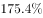
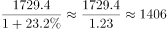
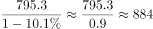
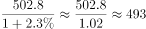
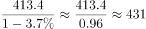
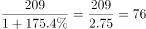
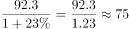

# 基期量计算与大小比较（基期排名）

考点：[[20-考点/资料分析/增长/基期量计算与大小比较（基期排名）|增长 / 基期量计算与大小比较（基期排名）]]
材料：[[15-材料/资料分析/294541 2018年我国木材（原木、锯材，含针|294541 2018年我国木材（原木、锯材，含针]]

**问法模型**：题干以基期年份（2017年）设问并要求‘进口量排第四’→ 采用基期量比较模型：各国现期量/(1+增速)回推2017年值后排序定位第N名。

## 推理链
1. 第1步：定位材料第4段，提取2018年针叶原木分国别数据：新西兰1729.4万m³(+23.2%)、俄罗斯795.3万m³(-10.1%)、美国502.8万m³(+2.3%)、澳大利亚413.4万m³(-3.7%)、乌拉圭209万m³(+175.4%)、日本92.3万m³(+23%)。
2. 第2步：题干求2017年（基期）排名，用基期量公式：基期量=现期量/(1+增速)，负增长国家分母为1-降幅。
3. 第3步：逐国回推：新西兰1729.4/1.232≈1404，俄罗斯795.3/0.899≈885，美国502.8/1.023≈492，澳大利亚413.4/0.963≈429。
4. 第4步：乌拉圭增速高达175.4%，基期量209/2.754≈76，日本92.3/1.23≈75，两国基期量远小于其他国家，不可能进前四。
5. 第5步：2017年排序为新西兰(≈1404)>俄罗斯(≈885)>美国(≈492)>澳大利亚(≈429)>乌拉圭(≈76)>日本(≈75)，第四名为澳大利亚，对照选项选C。

**最快解法**：⚡ 基期量公式+截位直除：先看选项，新西兰、日本不在选项中；乌拉圭+175.4%即现期约为基期的2.75倍，基期仅约76万m³，秒排除D；俄罗斯、澳大利亚负增长，基期量=现期量/(1-降幅)反而变大（俄罗斯≈885、澳大利亚≈429），美国基期≈492，故前四为新西兰、俄罗斯、美国、澳大利亚，第四为澳大利亚。

## 易错点
- ⚠ 乌拉圭+175.4%为超高增速，基期量应骤减为209/2.754≈76；若把基期公式用反（算成现期×(1+增速)≈576）会误判乌拉圭排第四而错选D。
- ⚠ 俄罗斯-10.1%、澳大利亚-3.7%为负增长，基期公式分母是1-降幅（小于1，基期量比现期大）；若错写成除以(1+降幅)，俄罗斯基期被算小，排序判断可能出错。
- ⚠ 层级陷阱：题干限定'针叶原木'，勿与'针叶锯材2488万m³''锯材总量3674万m³''原木总量5974.9万m³'的数据混淆；且'排第四'须对全部六国排序，而非仅在四个选项国内比较。

## 母题抽象
> 🧩 当题干出现'基期年份+某指标排第N名'特征时，用 基期量=现期量/(1+增速)（负增长取1-降幅）逐项回推后排序，先用增速极端值（如超100%高增长、负增长）快速定位易排除项，再精确比较相邻名次。

**同类特征**：基期年份设问（2017年）、进口量排第四、基期量比较、分国别排名、负增长国家回推基期、选项为四个国家名

## 相关题
- [[10-真题/资料分析/增长/2388069 基期量比较（现期量-(1+增速)取最大）|2388069]]（河北 2019，相关度1）
- [[10-真题/资料分析/增长/1796168 基期量比较（1-11月累计−11月当月差值+基期换算）|1796168]]（贵州 2016，相关度1）
- [[10-真题/资料分析/增长/5802113 基期量比较（负增速基期换算后比大小）|5802113]]（浙江 2023，相关度1）
- [[10-真题/资料分析/增长/1797916 基期量计算与排序（环比基期比较）|1797916]]（黑龙江 2016，相关度1）

---

### 题干
2017年，针叶原木进口量排第四的是哪个国家？

### 选项
- A. 俄罗斯
- B. 美国
- C. 澳大利亚　✅
- D. 乌拉圭

### 官方解析

根据题干“2017年······排第四的······”，结合材料时间为2018年，可判定本题为基期比较问题。定位文字材料第四段可得：2018年，针叶原木从新西兰进口1729.4万立方米，增长；俄罗斯795.3万立方米，下降；美国502.8万立方米，增长；澳大利亚413.4万立方米，下降；乌拉圭209万立方米，同比增长；从日本进口针叶原木92.3万立方米，同比增长。根据公式：基期量，可知2017年针叶原木从各国的进口量分别为：新西兰：万立方米；俄罗斯：万立方米；美国：万立方米；澳大利亚：万立方米；乌拉圭：万立方米，日本：万立方米。综上可知，2017年针叶原木从各国的进口量排前四的分别为：新西兰、俄罗斯、美国、澳大利亚，故针叶原木进口量排第四的是澳大利亚。

故正确答案为C。

### 给定材料

        2018年共进口木材11194.4万立方米（原木锯材合计，原木材积）金额210.9亿美元，同比分别增长3.2%和5.6%。数量增幅比上年同期下降了12.9个百分点，金额增幅下降了17.6个百分点。

        2018年进口木材及木制品总金额245.89亿美元（不含纸及纸制品），增长6.3%。出口总金额362.53亿美元，增长2%。2018年进口原木5974.9万立方米，金额101.08亿美元，分别增长7.9%和10.7%；进口锯材3674万立方米，金额101.08亿美元，分别下降1.7%和增长0.4%。

        2018年木家具进口金额9.24亿美元，增长3.6%，木框架坐具进口金额3.32亿美元，增长13.8%。刨花板2016年进口增幅41%，2017年增幅21%，2018年进口69.2万吨，为负增长（-2.7%）。2018年木制品出口金额仅增长2%。2018年木家具出口数量增长5.68%，金额负增长1.6%，木地板出口26.6万吨，3.85亿美元，分别下降24.8%和下降25.9%。胶合板出口1137.8万立方米，55.56亿美元，数量增长5%，金额增长9%，纤维板出口179万吨，38.35亿美元，数量下降14.9%，金额增长6.2%。木制品出口企业普遍效益下降。2018年进口针叶原木4159.7万立方米，金额57.86亿美元，同比分别增长8.8%和12.6%。

        针叶原木从新西兰进口1729.4万立方米，增长23.2%，俄罗斯795.3万立方米，下降10.1%。美国502.8万立方米，增长2.3%，澳大利亚413.4万立方米，下降3.7%。乌拉圭209万立方米，同比增长175.4%，从日本进口针叶原木92.3万立方米，同比增长23%。2018年进口针叶锯材2488万立方米，金额49.91亿美元，分别下降0.7%和增长2.3%。其中来自俄罗斯针叶锯材1567.4万立方米，增长9.7%，占进口针叶锯材63%，从加拿大进口417.4万立方米，大幅下降18.2%，占进口针叶锯材的17%。

