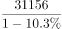
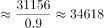
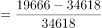
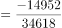
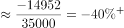

# 一般增长率计算（同比倒推基期量后与现期比较升降幅度）

考点：[[20-考点/资料分析/增长/一般增长率计算（同比倒推基期量后与现期比较升降幅度）|增长 / 一般增长率计算（同比倒推基期量后与现期比较升降幅度）]]
材料：[[15-材料/资料分析/307042 2020年1～12月全国'12369|307042 2020年1～12月全国'12369]]

**问法模型**：题干'2020年1月……比上个月'且选项按30%分档问升降 → 先用同比下降10.3%倒推2019年12月基期量，再与1月现期总量求增长率并按30%档位判断升降

## 推理链
1. 第1步：题干求2020年1月对上月（2019年12月）的增长率；图表均无2019年数据，文字给出2020年12月举报31156件、同比下降10.3%，即基期量=31156÷(1-10.3%)
2. 第2步：基期量公式：基期=现期÷(1-同比增长率)，得2019年12月举报量=31156÷0.897≈34755件
3. 第3步：从柱状图读2020年1月两段：未受理4543件、受理15123件，加和得1月举报总量=4543+15123=19666件
4. 第4步：增长率公式：增长率=(现期-基期)÷基期=(19666-34755)÷34755≈-15089÷34755≈-43.4%
5. 第5步：-43.4%即下降超过30%，对照选项'下降了30%以上'，锁定B项

**最快解法**：⚡ 公式法+截位直除：基期31156÷0.897≈34800件（直除前三位），现期19666件；更快的档位校验——若降幅恰为30%，基期应=19666÷0.7≈28100件，而实际基期34755件更大，故实际降幅必超过30%，直接选B

## 易错点
- ⚠ 基期跨界陷阱：2020年1月的'上个月'是2019年12月，柱图和表格均不含2019年数据，必须用文字'同比下降10.3%'倒推基期；误拿2020年12月31156件或11月数据当基期（同比与环比混淆）即出错
- ⚠ 现期量需自行拼总：1月总量=受理15123+未受理4543=19666件，只读柱图白色受理段漏加黑色未受理段会使数值失真
- ⚠ 比率干扰：文字中'环比下降23.2%'是12月对11月的关系，与本题无关，误用该比率会把比较对象错配到11月或12月

## 母题抽象
> 🧩 当题干问'年初某月比上个月'升降而图表无上年数据时，用'基期=现期÷(1-同比增长率)'从文字同比比率倒推上年末基期量，再与该月现期总量（图表两段加和）求增长率，按选项百分数档位定升降

**同类特征**：1月比上个月（跨年度基期）、同比下降10.3%需倒推基期量、选项按不到30%/30%以上分档问升降、现期总量需柱图两段加和、增长率档位判断、文字比率与图表数据跨源配合

## 相关题
（暂无）

---

### 题干
2020年1月，全国“12369环保举报联网管理平台”接到环保举报件数比上个月：

### 选项
- A. 下降了不到30%
- B. 下降了30%以上　✅
- C. 上升了不到30%
- D. 上升了30%以上

### 官方解析

根据题干“2020年1月······比上个月”，结合选项为百分数，可判定本题为一般增长率计算问题。定位文字材料可得：2020年12月，全国“12369环保举报联网管理平台”共接到环保举报31156件，环比下降23.2%，同比下降10.3%。根据公式：基期量，则2019年12月，全国“12369环保举报联网管理平台”共接到环保举报件数为件；定位柱状图可得：2020年1月，全国“12369环保举报联网管理平台”接到环保举报件数中未受理量为4543件，受理量为15123件。则2020年1月，全国“12369环保举报联网管理平台”接到环保举报件数为4543+15123=19666件。根据公式：增长率，则所求增长率，即下降了30%以上，对应B项。

故正确答案为B。

### 给定材料

        2020年12月，全国“12369环保举报联网管理平台”共接到环保举报31156件，环比下降23.2%，同比下降10.3%，其中，受理量23792件，较11月减少6316件；因举报线索不详或不属于生态环境部门职责范围而未受理7364件，较11月减少3119件。

