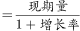
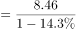
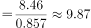

# 环比增长率逆运算求基期量并求和

考点：[[20-考点/资料分析/增长/环比增长率逆运算求基期量并求和|增长 / 环比增长率逆运算求基期量并求和]]
材料：[[15-材料/资料分析/307043 2021年1-5月全国打击治理电信网|307043 2021年1-5月全国打击治理电信网]]

**问法模型**：题干问'4-5月两个月合计立案数'而材料只给5月现期值8.46万起及环比降幅14.3% → 采用基期量=现期量/(1-环比增长率)反推4月，再加5月现期值求和

## 推理链
1. 第1步：从材料第一段提取条件——2021年5月全国共立电信网络诈骗案件8.46万起，与4月相比下降14.3%（环比口径，4月为基期）
2. 第2步：所用公式——环比下降14.3%意味着5月=4月×(1-14.3%)，故基期量4月=现期量/(1-14.3%)=8.46/0.857
3. 第3步：代入计算——8.46/0.857≈9.87万起，即2021年4月立案约9.87万起
4. 第4步：求和——2021年4-5月合计=8.46+9.87=18.33万起
5. 第5步：与选项对照——18.33万起与D项18最接近，故正确答案为D

**最快解法**：⚡ 百化分速算：14.3%≈1/7，则1-14.3%≈6/7，4月基期=8.46×7/6≈9.87万起，合计8.46+9.87≈18.3万起，秒选D

## 易错点
- ⚠ 环比与同比口径混淆：误用破获案件11.4万起（1-5月累计、同比口径）或同比上升60.4%等数据参与计算，而本题只能用'立案8.46万起+环比下降14.3%'
- ⚠ 忽视'下降'方向：将14.3%误当上升处理，算出4月=8.46×(1-14.3%)≈7.25万起，合计约15.7万起而误选C
- ⚠ 直接8.46×2≈16.9万起未反推4月，忽略环比下降意味着4月基期量大于5月现期量，误选C

## 母题抽象
> 🧩 当题干问'现期月份与上一期（基期）合计/相差'且材料只给现期值与环比增降率时，用基期=现期/(1±r)反推基期量，再做加（减）求和，与选项对照验证

**同类特征**：跨月合计（4-5月）、材料仅给5月单月值与环比降幅、基期计算（反推4月）、环比下降14.3%方向词、单位'万起'、选项间隔较大（约2万）

## 相关题
（暂无）

---

### 题干
2021年4-5月，全国共立电信网络诈骗案件约多少万起？

### 选项
- A. 12
- B. 14
- C. 16
- D. 18　✅

### 官方解析

根据题干“2021年4-5月······约多少万起”，结合材料时间为2021年5月，可判定本题为基期计算问题。定位文字材料第一段可得：2021年5月，全国共立电信网络诈骗案件8.46万起，与4月相比下降14.3%。根据公式：基期量，则2021年4月全国共立电信网络诈骗案件万起。故2021年4-5月，全国共立电信网络诈骗案件=8.46＋9.87=18.33万起，与D项最接近。

故正确答案为D。

### 给定材料

        2021年1-5月，全国共破获电信网络诈骗案件11.4万起，打掉犯罪团伙1.4万个，抓获犯罪嫌疑人15.4万名，同比分别上升60.4%、80.6%和146.5%。2021年5月，全国共立电信网络诈骗案件8.46万起，与4月相比下降14.3%。

        2021年1-5月，全国拦截诈骗电话6.1亿次，拦截诈骗短信9.1亿条，封堵诈骗网址82.1万个。1-5月公安部日均下发预警指令5.2万条。

        2021年1-5月，全国共成功劝阻771万名群众免于受骗，紧急止付涉案资金2654亿元，为群众挽回经济损失991亿元。

        2021年1-5月，全国公安机关捣毁境内诈骗窝点6500余个，共破获被骗百万元以上案件881起，同比上升160.5%，先后组织20余次集中收网行动，抓获犯罪嫌疑人2421名，打掉技术开发平台、网络引流推广、虚拟货币洗钱等团伙380余个。

        2020年10月至2021年5月，全国公安机关会同检察、法院、通讯、金融等部门，共打掉“两卡”违法犯罪团伙1.5万个，缴获涉诈电话卡373.3万张，银行卡56.6万张，惩戒“两卡”失信人员17.3万名，整治违规行业网点，机构1.8万家。

