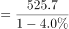
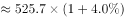
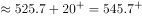

# 基期量计算（负增速）

考点：[[20-考点/资料分析/增长/基期量计算（负增速）|增长 / 基期量计算（负增速）]]
材料：[[15-材料/资料分析/307047 2020年H省秋粮（玉米、稻谷）的平|307047 2020年H省秋粮（玉米、稻谷）的平]]

**问法模型**：题干问'2019年（上年）……约为多少元/亩'而材料现期为2020年 → 基期量=现期量÷(1+同比增速) 模型，增速为负时分母小于1、基期大于现期

## 推理链
1. 第1步：题干时间为2019年（基期），材料现期为2020年，定位表格'稻谷'列'生产成本'行：2020年稻谷平均生产成本525.7元/亩，同比增速-4.0%
2. 第2步：基期量公式：基期=现期÷(1+r)，r=-4.0%，即基期=525.7÷(1-4.0%)
3. 第3步：代入计算：525.7÷0.96≈547.6元/亩（亦可用增量法：基期≈525.7+525.7×4.0%/96%≈525.7+21.9≈547.6）
4. 第4步：与选项对照：547.6≈548，选D；注意现期525.7本身无对应选项，A439≈430.5÷(1-1.9%)（误取玉米列）、B450≈440.6÷(1-2.1%)（误取秋粮整体列），均为串列干扰

**最快解法**：⚡ 截位直除+定性排除：负增速下基期必大于现期525.7，先排除A(439)、B(450)；再算525.7÷0.96≈525.7×25/24≈547.6≈548锁定D（或首两位'54'直除秒判）

## 易错点
- ⚠ 负增速符号处理：增速-4.0%代入分母(1-4.0%)=0.96，基期应大于现期；误把公式当现期×(1-4%)得504.7或误用其他方向会算错
- ⚠ 三列串行取数：表格有秋粮、玉米、稻谷三列同名指标，须取'稻谷'列的525.7/-4.0%；误取秋粮整体440.6/-2.1%得约450（B）、误取玉米430.5/-1.9%得约439（A），选项即按此设坑
- ⚠ 时间口径：题干问2019年，不能直接拿2020年现期值525.7当答案，须用增速列还原基期

## 母题抽象
> 🧩 当题干出现'上年/基期年份+某指标约为多少'且材料给出现期值与同比增速时，用 基期=现期÷(1+r)，先按'r为负则基期大于现期'定性排坑，再截位直除对照选项

**同类特征**：问2019年（上年/基期）数值、约为多少元/亩、平均生产成本、稻谷（需列定位）、同比增速为负、选项差距较大适合估算直除

## 相关题
（暂无）

---

### 题干
2019年，H省秋粮稻谷的平均生产成本约为多少元/亩？

### 选项
- A. 439
- B. 450
- C. 533
- D. 548　✅

### 官方解析

根据题干“2019年······约为多少元/亩”，结合材料时间为2020年，可判定本题为基期计算问题。定位表格材料可得：2020年H省秋粮稻谷平均生产成本为525.7元/亩，同比增速为-4.0%。根据公式：基期量，可知2019年H省秋粮稻谷的平均生产成本元/亩，与D项最接近。

故正确答案为D。

### 给定材料

        2020年，H省秋粮玉米和稻谷的市场平均交易价格分别为2.34元/公斤和2.74元/公斤，分别比上年上涨28.6%和8.7%。按此价格测算，2020年全省农户种植玉米、稻谷扣除成本前的产值分别为957.1元/亩、1520.7元/亩，分别比上年增长33.4%、8.9%。

