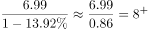

# 基期量计算（负增长反推）与两期求和

考点：[[20-考点/资料分析/增长/基期量计算（负增长反推）与两期求和|增长 / 基期量计算（负增长反推）与两期求和]]
材料：[[15-材料/资料分析/307048 C市天然气用量的月度与年度统计，围绕|307048 C市天然气用量的月度与年度统计，围绕]]

**问法模型**：题干问'2019—2020年跨期总量'而材料只给2020年值及同比增速 → 先用基期公式 2020年值÷(1+r) 反推2019年值，再与2020年值相加，选最接近项

## 推理链
1. 第1步：题干要求2019—2020年CNG用气总量，材料仅直接给出2020年CNG用气6.99亿立方米（同比下降13.92%），2019年数据须反推；定位第二段（2020年全年），第一、三、四段的月度数据均为干扰
2. 第2步：基期量公式：基期=现期÷(1+r)，本题r=-13.92%，故2019年CNG用气=6.99÷(1-13.92%)=6.99÷0.8608
3. 第3步：代入计算：6.99÷0.8608≈8.12亿立方米
4. 第4步：两期求和：2019—2020年总量≈8.12+6.99≈15.11亿立方米
5. 第5步：与选项对照：与A项15最接近，故选A

**最快解法**：⚡ 截位直除：分母1-13.92%=0.8608≈0.86，6.99÷0.86≈7÷0.86≈8.1；再心算加6.99得≈15.1，直接锁定A。负增长陷阱自查：分母必须小于1

## 易错点
- ⚠ 取数错位：误用2020年12月CNG当月值0.64亿方或2021年数据（0.52、1.14亿方），正确应取2020年全年CNG用气6.99亿方（当月值与累计值混排的阅读陷阱）
- ⚠ 负增长符号处理：r=-13.92%，基期分母应为1-13.92%=0.8608（小于1）；若误写成1+13.92%，基期≈6.14，两期和≈13.1，会误选D项13
- ⚠ 只算基期忘求和：反推出≈8.1后忘记加上2020年的6.99亿方，导致无法匹配正确量级；另注意应用'用气结构'中的CNG项，不可与供应结构（中石油/中石化）交叉混用

## 母题抽象
> 🧩 当题干出现'基期年—现期年总量/合计'且材料只给现期值与同比增速时，用基期公式 现期÷(1+r) 反推基期（r为负时分母小于1），再与现期相加，选与结果最接近的选项

**同类特征**：跨年求和（2019—2020年）、CNG用气总量、材料仅直接给出后一年（2020年）数据、同比为负（下降13.92%）、'约为多少亿立方米'（估算选最近项）、需基期反推的间接数据

## 相关题
（暂无）

---

### 题干
2019—2020年，C市CNG用气总量约为多少亿立方米？

### 选项
- A. 15　✅
- B. 17
- C. 11
- D. 13

### 官方解析

根据题干“2019—2020年······约为多少亿立方米”，结合材料中只给出了2020年的数据，可判定本题为基期计算问题。定位文字材料第二段可得：2020年，C市天然气用量为107.47亿立方米，同比增长3.83%。其中······CNG用气6.99亿立方米，同比下降13.92%。根据公式：基期量，则2019年C市CNG用气量为亿立方米，故2019—2020年，C市CNG用气总量为亿立方米，与A项最接近。

故正确答案为A。

### 给定材料

        2020年12月，C市天然气用量为9.67亿立方米，同比增长11.66%。从供应结构看：中石油供应7.22亿立方米，同比增长7.44%；中石化供应2.45亿立方米，同比增长26.29%。从用气结构看：民用气为3.98亿立方米，同比增长16.72%；CNG用气0.64亿立方米，同比下降7.25%；工业用气5.05亿立方米，同比增长10.75%。

        2020年，C市天然气用量为107.47亿立方米，同比增长3.83%。其中，中石油供应73.96亿立方米，同比增长1.72%；中石化供应33.51亿立方米，同比增长8.8%。从用气结构看：民用气为33.75亿立方米，同比增长5.4%；CNG用气6.99亿立方米，同比下降13.92%；工业用气66.73亿立方米，同比增长5.3%。

        2021年2月，C市天然气用量为9.31亿立方米，同比增长21.38%。从供应结构看：中石油供应6.7亿立方米，同比增长25.23%；中石化供应2.61亿立方米，同比增长12.5%。从用气结构看：民用气为3.56亿立方米，同比增长16.34%；CNG用气0.52亿立方米，同比增长205.88%；工业用气5.23亿立方米，同比增长17.79%。

        2021年1—2月，C市天然气用量为19.21亿立方米，同比增长12.8%。其中，中石油供应14.23亿立方米，同比增长18.88%；中石化供应4.98亿立方米，同比下降1.58%。从用气结构看：民用气为7.78亿立方米，同比增长12.75%；CNG用气1.14亿立方米，同比增长44.3%；工业用气10.29亿立方米，同比增长10.17%。

