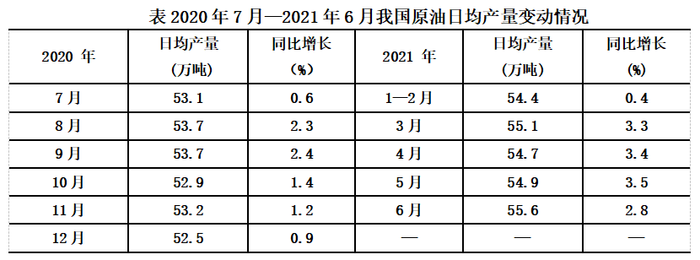

# 基期量计算

考点：[[20-考点/资料分析/增长/基期量计算|增长 / 基期量计算]]
材料：[[15-材料/资料分析/307972 2020年7月—2021年7月我国原|307972 2020年7月—2021年7月我国原]]

**问法模型**：题干求'2020年6月'的日均产量，而表格时间从2020年7月起、不含该期 → 以2021年6月为现期，用基期量=现期量/(1+同比增速)换算

## 推理链
1. 第1步：表格统计期为2020年7月—2021年6月，2020年6月不在表内，无法直接读数，需基期换算
2. 第2步：从表格提取2021年6月数据——原油日均产量55.6万吨，同比增长2.8%（此为现期量与增长率）
3. 第3步：套用基期量公式：2020年6月日均产量=55.6/(1+2.8%)=55.6/1.028
4. 第4步：计算得55.6/1.028≈54.1万吨（因2.8%很小，基期量应略小于55.6且明显不是55.5或更低量级）
5. 第5步：与选项对照，54.1万吨最接近C项，排除A（52.8）、B（53.2）、D（55.5）

**最快解法**：⚡ 化除为乘近似（r<5%适用）：基期量≈现期量×(1−r)=55.6−55.6×2.8%≈55.6−1.6≈54.0，对照选项锁定C（54.1）；或截位直除55.6/1.028≈54.1，一步出答案

## 易错点
- ⚠ 时间陷阱：2020年6月早于表格起始月（2020年7月），误以为表中有该行数据而直接读表或凭空作答
- ⚠ 现期基期混淆：误乘(1+2.8%)得55.6×1.028≈57.2，或误除(1−2.8%)得55.6/0.972≈57.2，均远离选项；D项55.5≈现期值55.6是'当作基期≈现期'的干扰项
- ⚠ 图表口径错配：表是'日均产量'（万吨/日），图是进口月度总量，勿跨图表错取数据；选项中52.8/53.2对应2020年下半年部分月份的日均产量，属同期数据干扰

## 母题抽象
> 🧩 当所求时期早于图表起始时间且材料给出'现期量+同比增速'时，用基期量=现期量/(1+r)；r在5%以内可化除为乘（现期×(1−r)）速算，并警惕'基期≈现期'的近似值干扰项

**同类特征**：求早于图表时间范围的历史时期数据、基期量计算、现期量+同比增长率明确给出（55.6万吨、+2.8%）、日均产量口径（万吨/日）、选项中含现期近似值作干扰、单一数据点即可求解、无需跨图表

## 相关题
- [[10-真题/资料分析/增长/2033794 基期量计算|2033794]]（江苏 2016，相关度3）
- [[10-真题/资料分析/增长/2050974 基期量计算|2050974]]（江西 2017，相关度3）
- [[10-真题/资料分析/增长/2187862 基期量计算|2187862]]（山东 2018，相关度3）
- [[10-真题/资料分析/增长/2394030 基期量计算|2394030]]（青海 2019，相关度3）
- [[10-真题/资料分析/增长/20303 基期量计算|20303]]（贵州 2010，相关度2）

---

### 题干
2020年6月，我国原油日均产量是：

### 选项
- A. 52.8万吨
- B. 53.2万吨
- C. 54.1万吨　✅
- D. 55.5万吨

### 官方解析
根据题干“2020年6月······日均产量是”，结合材料时间为2021年，可判定本题为基期计算问题。定位表格材料可得：2021年6月我国原油日均产量为55.6万吨，同比增长2.8%。根据公式：基期量，可得2020年6月，我国原油日均产量为万吨，最接近C项。
故正确答案为C。

### 给定材料

        2021年1-7月，我国原油产量11561万吨，同比增长2.4%，比2019年同期增长3.9%。其中，7月我国原油产量1686万吨，增长2.5%，比2019年同期增长3.1%。1-7月我国进口原油30193万吨，下降5.6%。其中，7月进口原油4124万吨，下降19.6%。

