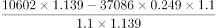
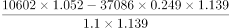
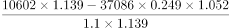
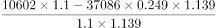

# 基期计算（基期值之差-两期混合差额）

考点：[[20-考点/资料分析/增长/基期计算（基期值之差-两期混合差额）|增长 / 基期计算（基期值之差/两期混合差额）]]
材料：[[15-材料/资料分析/307971 2020年江苏省'三新'经济发展情况|307971 2020年江苏省'三新'经济发展情况]]

**问法模型**：题干要求'可以作为计算2019年非实物商品网上零售额的算式' → 判定基期计算题，模型为'非实物基期=总网零基期−实物网零基期'，两个基期分别用各自增速÷(1+增速)后再相减

## 推理链
1. 第1步：从材料末句提取条件：2020年全省网上零售额10602亿元、增长10.0%；实物商品网上零售额增长13.9%，占社会消费品零售总额37086亿元的24.9%；材料未直接给出'非实物商品网上零售额'
2. 第2步：确定结构关系：非实物商品网上零售额=全省网上零售额−实物商品网上零售额（跨句拼出的隐含关系）
3. 第3步：套用基期公式'基期值=现期值÷(1+增速)'，2019年全省网上零售额=10602÷(1+10.0%)
4. 第4步：实物网零需两步：先由'部分=整体×比重'得2020年实物网零=37086×24.9%，再÷(1+13.9%)得2019年实物网零
5. 第5步：代入相减：2019年非实物网零=10602÷(1+10.0%)−37086×24.9%÷(1+13.9%)
6. 第6步：与选项逐项核对分子（10602、37086×24.9%）与分母（各自对应的1+增速），与A项对应，故选A

**最快解法**：⚡ 框架验证法（不必精算）：先写出'总基期−部分基期'框架 10602÷1.100 − 37086×24.9%÷1.139，只需核对选项中两个除数是否分别对应10.0%与13.9%、实物部分是否先乘37086×24.9%，即可秒锁A

## 易错点
- ⚠ 两个增速口径不同：总网零用10.0%，实物网零用13.9%，若共用一个增速或张冠李戴（如把10.0%除到实物部分）即错
- ⚠ 实物网零是复合算式：必须先做'部分=整体×比重'（37086×24.9%）再做基期换算，直接拿24.9%或漏乘37086都会算错整体口径
- ⚠ '增速比上年快5.2个百分点'是干扰信息（13.9%本身就是2020年增速可直接用），且'个百分点'只能做差不能参与比值运算；另注意求的是2019年基期，误用2020年现期直接相减必错

## 母题抽象
> 🧩 当题干出现'求上年（基期）某量'且该量=材料中两量之差、而两量增速不同时，必须'现期÷(1+各自增速)'分别还原基期后再相减，禁止用同一增速或先减后除

**同类特征**：2019年（基期年份）、非实物商品网上零售额（材料无直接数据）、差额结构：总网零−实物网零、两个不同增速（10.0%与13.9%）、占社零总额比重24.9%（部分=整体×比重）、选算式而非算结果

## 相关题
（暂无）

---

### 题干
下列可以作为计算2019年江苏非实物商品网上零售额的算式是：

### 选项
- A. 

　✅
- B. 

- C. 

- D. 

### 官方解析
根据题干“······2019年江苏非实物商品网上零售额······”，结合材料时间为2020年，可判定本题为基期计算问题。定位文字材料可知，2020年全省网上零售额10602亿元，增长10.0%。其中，实物商品网上零售额增长13.9%，占社会消费品零售总额37086亿元的比重为24.9%。根据公式：，可得2019年全省网上零售额；根据公式：部分=整体×比重，可得2020年实物商品网上零售额=37086×24.9%，则2019年实物商品网上零售额。非实物商品网上零售额=全省网上零售额-实物商品网上零售额，因此2019年江苏非实物商品网上零售额，与A项对应。
故正确答案为A。

### 给定材料

        2020年江苏省实现以新产业、新业态、新模式为主要内容的“三新”经济增加值25177亿元，比上年增长5.6%，比全省地区生产总值的增速快1.5个百分点，占全省地区生产总值的比重为24.5%。全省战略性新兴产业产值增长11.0%，快于规模以上工业5.5个百分点。其中新能源汽车、数字创意、新能源和高端装备制造业的产值增速分别为21.0%、19.8%、15.6%和15.5%。高技术制造业增加值增长10.3%，占规模以上工业的比重为23.5%，提高1.7个百分点。高技术服务业营业收入增长14.1%，占规模以上服务业的比重为37.9%，提高2.4个百分点。全省碳纤维增强复合材料、新能源汽车、城市轨道车辆、集成电路、太阳能电池等新产品的产量分别增长48.9%、42.0%、24.5%、22.3%和16.5%。全省现代设施农业占地面积100.5万公顷，其中属于战略性新兴产业的中药材种植业种植面积1.8万公顷，实现产值32亿元，产值增长138.1%。全省网上零售额10602亿元，增长10.0%。其中，实物商品网上零售额增长13.9%，增速比上年快5.2个百分点，占社会消费品零售总额37086亿元的比重为24.9%，提高2.7个百分点。

