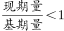

# 年均增速正负判断（现期量与基期量比较）

考点：[[20-考点/资料分析/增长/年均增速正负判断（现期量与基期量比较）|增长 / 年均增速正负判断（现期量与基期量比较）]]
材料：[[15-材料/资料分析/307974 2016—2020年（十三五期）全球|307974 2016—2020年（十三五期）全球]]

**问法模型**：题干出现'2017—2020年发射数量年均增速为负'→年均增长率模型：基期取2016年、间隔4年，年均增速为负当且仅当现期量(2020)＜基期量(2016)，无需实际开方计算

## 推理链
1. 第1步：题干问'发射数量'的年均增速，锁定表格'数量(枚)'列，而非'次数(次)'列；涉及主体为中国、美国、俄罗斯、欧洲
2. 第2步：2017—2020年年均增速以2016年为基期、间隔4年，由年均增速公式(现期/基期)^(1/4)−1可知，增速为负等价于现期量＜基期量
3. 第3步：从数量列提取各主体2016年与2020年数据：中国40枚→77枚、美国72枚→1099枚、俄罗斯27枚→23枚、欧洲20枚→36枚
4. 第4步：逐主体判断：中国77＞40（正）、美国1099＞72（正）、欧洲36＞20（正），均不满足；只有俄罗斯2020年23枚＜2016年27枚，为负增长
5. 第5步：与选项对照，仅C项俄罗斯符合，故正确答案为C

**最快解法**：⚡ 首尾比较法（年均增速性质）：'年均增速为负⇔现期量＜基期量'，直接在'数量(枚)'列只看2016与2020两行四个数字（40/77、72/1099、27/23、20/36），扫一眼即锁定俄罗斯27→23唯一下降，全程零计算

## 易错点
- ⚠ 列口径误读：误用'次数(次)'列比较（俄罗斯19→17、欧洲9→5均下降），会得出俄罗斯与欧洲两个'负增长'主体而无法排除；题干问的是航天器发射数量（枚），必须用数量列
- ⚠ 基期年份错置：误把2017年当基期比较2017与2020；规范口径是2017—2020年年均增速以2016年为基期、间隔4年，且判断正负只需看2020与2016两个端点值
- ⚠ 极端值干扰：2020年美国数量1099枚因一箭多星异常放大，若试图逐年算增速再平均会受基数效应干扰；本题用首尾比较法可完全绕开该陷阱

## 母题抽象
> 🧩 当题干出现'某时间段年均增速为正/负（或最大/最小）'且以主体为选项时，不必逐项开n次方计算，直接用'现期量与基期量大小比较'即可判定正负；先核对题干锁定正确数据列（数量≠次数），再取间隔起始前一年（如2017—2020取2016）为基期

**同类特征**：2017—2020年、年均增速、为负、发射数量（枚列）、基期2016、间隔4年、首尾值大小比较

## 相关题
- [[10-真题/资料分析/综合/2676669 综合判断选非题（增长率-比重的数据可得性判断）|2676669]]（选调 2018，相关度1）
- [[10-真题/资料分析/增长/4652203 年均增长率比较（年份差相同，比较末期值-基期值）|4652203]]（北京 2022，相关度1）
- [[10-真题/资料分析/综合/2377082 综合判断题（趋势定性+年均增速+比重+五年加总对比的跨项验证）|2377082]]（选调 2019，相关度1）
- [[10-真题/资料分析/增长/5445745 年均增长率比较排序（同基期同n型）|5445745]]（国考 2023，相关度1）
- [[10-真题/资料分析/增长/15121365 年均增长率（年均增速）计算与现期外推|15121365]]（江苏 2024，相关度1）

---

### 题干
下列国家或地区中，2017—2020年发射数量年均增速为负的是：

### 选项
- A. 中国
- B. 美国
- C. 俄罗斯　✅
- D. 欧洲

### 官方解析

根据题干“······2017—2020年发射数量年均增速······”，可判定本题为年均增长率问题。定位表格材料，可知2016年、2020年中国、美国、俄罗斯、欧洲的航天器发射数量。根据年均增长率公式：，可得年均增速为负即，故现期量＜基期量。观察发现只有俄罗斯满足该要求。

因此2017—2020年发射数量年均增速为负的是俄罗斯。

故正确答案为C。

### 给定材料

