# 同比增长率计算与大小比较

考点：[[20-考点/资料分析/增长/同比增长率计算与大小比较|增长 / 同比增长率计算与大小比较]]
材料：[[15-材料/资料分析/307973 2015—2020年我国住房公积金的|307973 2015—2020年我国住房公积金的]]

**问法模型**：题干要求比较四个指标2020年增速的大小关系 → 对每个指标统一用同比增长率=(现期-基期)/基期计算后排序对照选项

## 推理链
1. 第1步：从统计表提取金额类数据：2020年实缴额2.62万亿元、实缴余额7.30万亿元；2019年实缴额2.37万亿元、实缴余额6.54万亿元
2. 第2步：从统计图按数值标注提取主体类数据：2020年实缴职工人数1.53亿人、实缴单位数365万个；2019年职工1.49亿人、单位322万个（勿按柱高估读）
3. 第3步：所用公式：同比增长率=（2020年值-2019年值）/2019年值，四个指标基期均为2019年
4. 第4步：代入计算：实缴额增速=0.25/2.37≈10.5%；实缴余额增速=0.76/6.54≈11.6%
5. 第5步：代入计算：职工人数增速=0.04/1.49≈2.7%；单位数增速=43/322≈13.4%
6. 第6步：排序对照：单位数13.4%＞实缴余额11.6%＞实缴额10.5%＞职工人数2.7%，与选项A的关系式一致，故选A

**最快解法**：⚡ 截位直除+先粗筛后精排：先定性排除——职工人数分子0.04、基期1.49，增速明显最小（约2.7%）；单位数43/322明显超10%且分子比分母接近1/8，为最大；再用截位直除精排中间两项：余额0.76/6.54≈11.6%，实缴额0.25/2.37≈10.5%，比较时可看分子（0.76≈3×0.25）倍数大于分母（6.54≈2.8×2.37）倍数，故余额增速＞实缴额增速，四项排序即得A

## 易错点
- ⚠ 实缴额是当年缴存发生额（流量）、实缴余额是期末累计结存（存量），两者口径不同但本题同为同比增速可直接比较，切勿把余额误作流量或把实缴额误作累计值
- ⚠ 同比增长的基期是2019年，若误用2015年为基期（算累计增速）会得出完全不同的排序
- ⚠ 双轴图中柱（亿人，左轴）与点线（万个，右轴）量纲量级不同，职工人数柱子视觉上升明显但实际增速仅约2.7%（最小），凭图形直观判断必错，必须以图中标注数值计算

## 母题抽象
> 🧩 当题干出现'多个指标同一年的增速、则关系正确的是'特征时，统一按（现期-上一年值）/上一年值逐项截位直除算出百分数，先粗筛明显最大/最小项，再精排中间项后对照选项

**同类特征**：2020年……增速分别为……、四个指标增速、下列关系正确的是、同比（环比）增长率排序、表图结合取数、流量与存量同题比较

## 相关题
- [[10-真题/资料分析/增长/2367902 同比增长率大小比较（同季度对同季度）|2367902]]（江苏 2019，相关度1）

---

### 题干

设2020年我国住房公积金实缴额、实缴余额、实缴职工人数、实缴单位数的增速分别为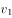、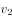、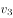、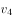，则下列关系正确的是：

### 选项
- A. 
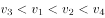
　✅
- B. 
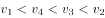

- C. 
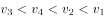

- D. 
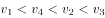

### 官方解析

根据题干“······2020年······增速······则下列关系正确的是”，可判定本题为一般增长率问题。定位统计表和统计图，可得2020年我国住房公积金实缴额、实缴余额、实缴职工人数、实缴单位数分别为2.62万亿元、7.30万亿元、1.53亿人、365万个；2019年我国住房公积金实缴额、实缴余额、实缴职工人数、实缴单位数分别为2.37万亿元、6.54万亿元、1.49亿人、322万个。根据公式：增长率，可得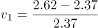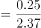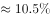、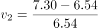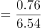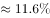、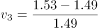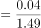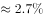、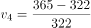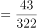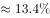，即。

故正确答案为A。

### 给定材料

