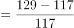
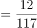
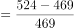
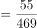
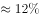
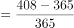
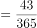
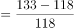
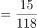

# 增长率比较（2017→2019两年累计增幅最小项）

考点：[[20-考点/资料分析/增长/增长率比较（2017→2019两年累计增幅最小项）|增长 / 增长率比较（2017→2019两年累计增幅最小项）]]
材料：[[15-材料/资料分析/307982 2017年与2019年全球医疗器械销|307982 2017年与2019年全球医疗器械销]]

**问法模型**：题干'与2017年相比，2019年……增幅最小'→ 对各细分市场逐项套用增长率=(2019年−2017年)/2017年，比较后取最小

## 推理链
1. 第1步：从表格提取四个选项的两年数据（题干要求排除其他类631/706）：肾病117→129、心血管469→524、骨科365→408、医疗软件118→133，单位均为亿美元
2. 第2步：增长率公式=（2019年−2017年）/2017年，此为2017→2019两年累计增幅，非年均
3. 第3步：代入计算——肾病 12/117≈10.3%；心血管 55/469≈11.7%；骨科 43/365≈11.8%；医疗软件 15/118≈12.7%
4. 第4步：四个比率中10.3%最小，对应肾病，且全表剔除其他类后逐项核验（如神经外科10/86≈11.6%、创伤护理15/130≈11.5%等均大于肾病），与选项对照选A

**最快解法**：⚡ 增长率比较用'增量÷基期'截位估算：肾病12/117≈10.3%一眼锁定低位；其余三项增量55/469、43/365、15/118粗估均在11%~13%区间，无需精算即可排除，答案A

## 易错点
- ⚠ 把表格底部'销售总额'行（4050/4529）误当成第17个细分市场参与增幅比较
- ⚠ 忽略'除其他类外'限定，把其他类（631→706）纳入比较
- ⚠ 数值重复项看串行：肾病与糖尿病2017年同为117，须核对2019年分别为129与132；另误用增量绝对值代替增长率（如心血管增量55最大≠增幅最大）

## 母题抽象
> 🧩 当题干出现'与A年相比，B年……增幅最小/最大的是'时，用(后值−前值)/前值逐项求率比较，勿直接比增量；增量小且基期不小的项往往即答案，截位估算即可锁定

**同类特征**：与2017年相比、2019年、增幅最小、除其他类外、细分市场、全球医疗器械销售额

## 相关题
- [[10-真题/资料分析/平均数/3019277 现期平均数（分子取自文字、分母取自表格的跨源拼数据）|3019277]]（广东 2021，相关度1）
- [[10-真题/资料分析/增长/3522685 增长率计算（增长倍数=增长量-基期量）|3522685]]（广西 2021，相关度1）
- [[10-真题/资料分析/比重/4651816 现期比重与固定阈值比较（占比超5%计数）|4651816]]（深圳市考 2022，相关度1）
- [[10-真题/资料分析/增长/5521214 同比增长率计算与比较|5521214]]（深圳市考 2023，相关度1）
- [[10-真题/资料分析/增长/2376633 增速变动幅度（百分点）读图比较|2376633]]（吉林 2019，相关度1）

---

### 题干
与2017年相比，除其他类外，2019年全球医疗器械销售额增幅最小的细分市场是：

### 选项
- A. 肾病　✅
- B. 心血管
- C. 骨科
- D. 医疗软件

### 官方解析

根据题干“与2017年相比······2019年······增幅最小······”，可判定本题为一般增长率问题。定位表格材料可得，2017年与2019年全球医疗器械各细分市场销售额。根据公式：增长率，则肾病医疗器械销售额的增长率，心血管医疗器械销售额的增长率，骨科医疗器械销售额的增长率，医疗软件销售额的增长率，故选项中，增幅最小的是肾病医疗器械销售额。

故正确答案为A。

### 给定材料

