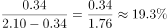

# 存量（在校生）增长率——流量平衡法求增量与基期

考点：[[20-考点/资料分析/增长/存量（在校生）增长率——流量平衡法求增量与基期|增长 / 存量（在校生）增长率——流量平衡法求增量与基期]]
材料：[[15-材料/资料分析/307984 H市2019年统计公报节选：教育（各|307984 H市2019年统计公报节选：教育（各]]

**问法模型**：题干问'在校生数（存量）同比增长'但材料未直接给该口径增速和基期 → 用在校生流量平衡'增量=当年招生−当年毕业'先求增量，再按'增长率=增量/基期'计算

## 推理链
1. 第1步：定位材料第一段末句：2019年普通高等学校研究生教育招生0.81万人、在校生2.10万人、毕业生0.47万人；材料对研究生在校生只给现期值，未给增速或2018年数据
2. 第2步：规则：在校生是时点存量，满足流量平衡'上年末在校−当年毕业+当年招生=今年末在校'，故同比增长量=当年招生−当年毕业=0.81−0.47=0.34万人
3. 第3步：还原基期：2018年末研究生在校生=现期−增量=2.10−0.34=1.76万人
4. 第4步：代入增长率公式：增长率=增量/基期=0.34/1.76≈19.3%
5. 第5步：对照选项：19.3%即B；A(7.6%)、C(26.1%)不吻合；因流量数据充分可算，不选D'无法判断'

**最快解法**：⚡ 公式法+截位直除：增量=招生−毕业=0.81−0.47=0.34万人；基期=2.10−0.34=1.76万人；0.34/1.76=17/88，88×0.193≈17.0，故≈19.3%，直接锁定B，全程口算

## 易错点
- ⚠ 存量增速不能直接抄材料：材料只给'普通高等学校（含本专科）在校学生数增长9.0%'这一大口径增速，并非研究生口径；因材料未直接给出研究生增速而误选D'无法判断'是最大陷阱
- ⚠ 增量方向搞反：误用'毕业−招生'得−0.34万人（算成负增长），或把本专科数据（招3.00、毕业2.13万人）与研究生混算
- ⚠ 基期与现期混淆：误算增量/现期=0.34/2.10≈16.2%；正确须先还原基期1.76万人，再用0.34/1.76

## 母题抽象
> 🧩 当题干问'在校生/库存类存量同比增长'而材料只给现期存量和当年流入流出量（招生/毕业、新增/退出）时，用'增量=流入−流出、基期=现期−增量、增速=增量/基期'三步流量平衡模型，再截位直除锁定选项，切勿因材料未直接给增速而选'无法判断'

**同类特征**：在校生（存量）同比增长、材料未直接给出该口径增速、同时给出招生与毕业两项流量、选项含'无法判断'、万人单位可直接相减、需先求增量再还原基期

## 相关题
- [[10-真题/资料分析/增长/2730982 基期增速判断——信息不足-无法判断类|2730982]]（深圳市考 2020，相关度1）
- [[10-真题/资料分析/比重/2606260 基期比重计算（重复用水率=重复用水量÷(用水量+重复用水量)的基期倒推）|2606260]]（广东 2020，相关度1）

---

### 题干
2019年末，H市普通高等学校研究生在校生数同比增长（    ）。

### 选项
- A. 7.6%
- B. 19.3%　✅
- C. 26.1%
- D. 无法判断

### 官方解析

根据题干“2019年末，·······同比增长”，结合选项为百分数，可判定本题为一般增长率问题。定位文字材料第一段可得：2019年全年普通高等学校研究生教育招生0.81万人，在校生2.10万人，毕业生0.47万人。根据公式：今年在校人数=去年在校人数-毕业人数+招生人数，可得：今年在校人数-去年在校人数=招生人数-毕业人数=今年在校人数同比增长量=2019年招生人数-2019年毕业人数=0.81万-0.47万=0.34万人。根据公式：增长率，可得：2019年末，H市普通高等学校研究生在校生数同比增长率为：。

故正确答案为B。

### 给定材料

        H市统计公报显示，2019年末全市各级各类学校总数达2642所，比上年增加91所；毕业生51.49万人，招生63.97万人，在校学生232.24万人，分别增长2.9%、0.5%和5.1%。年末全市有幼儿园1836所，增加65所；在园幼儿54.50万人，增长4.0%；有小学340所，减少4所；在校学生106.90万人，增长4.0%。普通中学417所，增加27所；在校学生47.74万人，增长6.6%。普通高等学校13所，与上年持平，在校学生数增长9.0%。全年全市普通高等学校本专科招生3.00万人，在校生9.22万人，毕业生2.13万人；普通高等学校研究生教育招生0.81万人，在校生2.10万人，毕业生0.47万人。

        2019年末，全市各类专业技术人员183.50万人，比上年增长10.1%，其中具有中级及以上技术职称的专业技术人员54.69万人，增长7.4%。年末全市各级创新载体2258个，其中，国家级重点实验室、工程实验室和技术中心等创新载体116个，部级创新载体604个，市级创新载体1537个。全年专利申请量与授权量分别为26.15万件和16.66万件，分别增长14.4%和18.8%。其中，发明专利申请量与授权量分别为8.29万件和2.61万件，分别增长18.4%和22.3%；PCT国际专利申请量1.75万件，减少3.4%。

